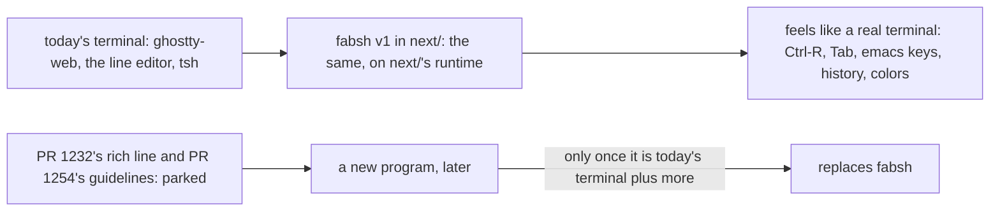

# 0586: In next/, fabsh v1 is today's terminal rebuilt on next/'s runtime, a Ghostty terminal in a tile with today's line editor, tsh's grammar and syntax highlighting, set under [terminal] with Ghostty's key names, the rich line waits for a later program, summon v1 is today's summon, and join v1 is IRC's join



```toml
# ~/.fabrika/fabrika.toml: Ghostty's own key names, as fabrika settings (a sketch of the keys).
[terminal]
font-family = "JetBrains Mono"
font-size = 13
theme = "light:fabrika-light,dark:fabrika"
cursor-style = "bar"
keybind = ["ctrl+shift+c=copy_to_clipboard"]
```

**What this decides:** what the four-primitives push builds first in `next/`: a shell that is
today's terminal, a `summon` that is today's, a `join` that is IRC's, and the order of the four.

## Context

[0432](0432-next-has-fabsh-rethought-from-tsh.md) said `fabsh` is rethought from `tsh`, never
copied, under the lesson rule of [0217](0217-next-grows-beside-today.md) ("a lesson, rethought,
never copied") and [rethink, do not port](../docs/direction/rethink-do-not-port.md). The first build
under that rule, [pull request 1232](https://github.com/kamp-us/tea-fabrika/pull/1232), read as a
form, not a shell. Its guideline study,
[pull request 1254](https://github.com/kamp-us/tea-fabrika/pull/1254), weighed a classical
terminal against new designs. Meanwhile today's app already has a terminal people use every day.

The owner ruled on 2026-11-15: for the four primitives
([0159](0159-fabsh-pipes-summon-join-first.md)), `fabsh` v1 is what today's app has, with no
tradeoff. A lead's note the same day added syntax highlighting to v1.

How this relates to the decisions near it:

- **[0432](0432-next-has-fabsh-rethought-from-tsh.md), amended in part.** Its "rethought from tsh,
  never copied" does not apply to v1.
- **[0217](0217-next-grows-beside-today.md), amended in part.** The owner sets its lesson rule aside
  for this one case: `fabsh` v1 carries today's terminal over as it behaves, feature for feature.
  `next/` imports nothing from today's version: each part is rebuilt in `next/`, on its runtime,
  and the switch pull request deletes the old part once its laws are ported.
- **[0275](0275-the-shell-is-a-regular-program.md) governs it.** `fabsh` is a regular program, a
  submitted line is a Msg, keys typed mid-line are never saved, and the window echoes at once. Where
  the line editor runs on `next/`'s runtime is the plan's, inside 0275.
- **[0159](0159-fabsh-pipes-summon-join-first.md) governs it,** and this answers one thing it left open:
  what a `fabsh` line may contain. In v1 it is what a `tsh` line may contain.
- **[0069](0069-choices-are-settings.md) applies:** the terminal's look is settings, not code.

## Decision

**`fabsh` v1 is today's terminal, rebuilt on `next/`'s runtime, and the bar is "feels like a real
terminal".**

- **What it is.** Each of these is rebuilt in `next/`, never imported:
  - a ghostty-web terminal in a tile, as today's `apps/fabrika/src/window/terminal.ts` draws one;
  - the line editor today's host runs (`apps/fabrika/src/editor/`): its keys, its history file and
    its Ctrl-R search;
  - `tsh`'s grammar, built-ins, completion and pipes (`packages/fabrika/src/shell/`).
- **The bar is a real terminal.** Ctrl-R history search, Tab completion, readline's emacs editing
  keys, and history kept across starts. Anything today's editor lacks of that bar is in scope.
- **Syntax highlighting is in v1,** as fish does it natively
  ([fish's interactive docs](https://fishshell.com/docs/current/interactive.html#syntax-highlighting))
  and as zsh-syntax-highlighting does it for zsh
  ([its main highlighter](https://github.com/zsh-users/zsh-syntax-highlighting/blob/master/docs/highlighters/main.md)).
  - The line editor colors each word by its role as it is typed: program, flag, argument, pipe,
    `@name`, `#room`, string.
  - An unknown program, or a pipe whose two sides do not fit, gets the error role.
  - The roles come from `tsh`'s own reading of a line (`words.ts` and `check.ts`), rebuilt in
    `next/`.
  - The colors are ANSI codes drawn into the Ghostty terminal, and they come from the terminal's
    theme, so `[terminal]` theming covers them.
- **It is set the way Ghostty is set.** Ghostty's own config key names (`font-family`, `font-size`,
  `theme`, `keybind`, `cursor-style` and the rest) become fabrika settings under `[terminal]`, each
  declared once and read through the settings system (0069). The names and values follow
  [Ghostty's config reference](https://ghostty.org/docs/config/reference).
- **Pipes, `summon` and `join` lines run inside it,** as `tsh`'s do today.
- **Two pull requests are parked, not merged:** the rich line of
  [pull request 1232](https://github.com/kamp-us/tea-fabrika/pull/1232) (role-colored spans
  drawn as a view, drafts, `process.draft`) and the fabsh guidelines of
  [pull request 1254](https://github.com/kamp-us/tea-fabrika/pull/1254).
- **Their ideas start later, as a new program of its own.** It replaces `fabsh` only once it is
  today's terminal plus more.

## Summon v1 is today's summon

The owner extended the same rule to `summon` on 2026-11-15. **`summon`'s first version in `next/`
is exactly what today's `tsh` does, rebuilt on `next/`'s runtime, with no new ideas on top.** The
bar is "works like today's `tsh`".

What today's code does, read on main for this file (`packages/fabrika/src/shell/summon.ts`,
`said.ts`, `complete.ts`, `packages/fabrika/src/agents/summon/manager.ts` and `turn.ts`):

- **The summon line:** `summon <agent> [model] [effort] as <name>`, with `dismiss <name>` and
  `agents`. A setting word not offered by the harness is refused, with the lists, before any paid
  turn. A taken name is refused, never replaced, as Erlang's `register` fails.
- **`@name` messages:** a line that starts with `@` is a said line. What follows the name goes to
  the agent as typed, so no shell word is read in it. A bare `@` goes to the one agent summoned. A
  wrong name is refused with a "did you mean".
- **Turns as jobs:** each `@name` line is one job of the `turn` program. In the foreground it holds
  the prompt; with `&` it runs in the background and `jobs` lists it. Its status is drawn in place,
  its reply is said once, whole, and an edit the agent asks for waits for the person's `y`.
- **Ctrl-C** cancels the turn, and the agent stays. `attach %n` waits on a job again.
- **The same agent:** a name is one agent until it is dismissed, kept between turns and across a
  host restart.
- **Its completion,** which the owner calls "magical": Tab after `summon` offers the harnesses,
  then the models and efforts that harness's own session offered, then `as`; Tab after `@` offers
  the names summoned now.

Three things on the owner's list are not in today's code as named, and the summon plan settles
each against this rule: today's `tsh` has no `fg` word (`attach %n` is its nearest), Ctrl-Z does
nothing (`packages/fabrika/src/shell/main.ts:361`), and a reply is said in the tile where its turn
runs, not sent to an inbox.

**Owed, not decided here:** the summon plan, written right after the pipe plan, says which parts of
today's agent plumbing (the `acp` harness link, the summon manager, the `turn` program, the ask
flow) carry over as they work and which are rebuilt on `next/`'s runtime, with the reason for each.

## Join v1 is as close to IRC as it can be

The owner ruled the same day: **`join`'s first version is as close to IRC as it can be,** on the
room records [0583](0583-a-room-keeps-one-stream-of-events-and-its-words-apart.md) decided (one
process and one stream per room, the words in a deletable content row).

```text
A sketch: the lines join v1 takes, and how a reply prints.
fabsh$ join #bug-17
fabsh$ #bug-17 @scout here is the failing run
#bug-17 <scout> The run fails at step 3 ...
fabsh$ leave #bug-17                  part #bug-17 does the same
```

- **`join #bug-17`** joins a room, as IRC's JOIN does
  ([RFC 2812, 3.2.1](https://www.rfc-editor.org/rfc/rfc2812#section-3.2.1);
  [RFC 1459, 4.2.1](https://www.rfc-editor.org/rfc/rfc1459#section-4.2.1)).
- **`leave #bug-17`** leaves it. IRC's word is PART (RFC 2812, 3.2.2), so `part` is kept as a
  second word for it where that is cheap.
- **`#bug-17 <text>`** speaks in the room, as PRIVMSG to a channel does (RFC 2812, 3.3.1), and an
  `@name` inside it mentions that member.
- **Replies print in the scrollback with the room name in front,** as irssi prints a message from a
  channel that is not the window's own as `<nick:#channel>`, and as weechat shows the buffer name on
  each line of merged buffers. Both are from those clients' docs as remembered, not fetched for this
  file.
- **A names list and a topic are in,** because both are in IRC's basic channel operations: RFC
  2812's section 3.2 lists JOIN, PART, MODE, TOPIC, NAMES, LIST, INVITE and KICK, and RFC 1459's
  section 4.2 lists the same eight. RFC 2812 also sends a channel's topic and its names to a person
  as they join. So `names #bug-17` and `topic #bug-17 [text]` are in v1. MODE, LIST, INVITE and KICK
  are not on the owner's list and are not added here.

## The order of the primitives push

1. **`fabsh` v1:** today's terminal, plus Ctrl-R, Tab, syntax highlighting and Ghostty-style
   settings.
2. **Pipe slice 1,** at the next free slot.
3. **`summon`,** working like today's `tsh`.
4. **`join`,** working like IRC.

The summon plan is written after the pipe plan, and the join plan after summon's.
[Tier 1's build order](../docs/plan/tier-1.md#the-build-order) carries this order.

**Binding constraints**

- No v1 plan drops a feature today's terminal has, or trades one for a new design.
- A `[terminal]` key uses Ghostty's name for the same thing. A key Ghostty has no name for gets a
  name in Ghostty's style, and the plan says so.
- No v1 work merges pull request 1232 or 1254, or builds on their branches.
- `summon` v1 adds nothing today's `tsh` does not do.
- `join` v1 takes no command IRC's basic set lacks.
- This is the `fabsh` slice of the four primitives, not sev0 work.

## Consequences

- The plan for `fabsh` v1 lists today's terminal feature by feature as its parity bar, and names
  each gap against the real-terminal bar.
- Today's code becomes the spec for v1: its tests and laws are read as the list of what must hold,
  and each is rewritten as a `next/` law.
- The cost: the rethought shell of pull request 1232 and the study in pull request 1254 wait. What
  they learned is kept on their branches for the later program.
- [Tier 1, piece 3](../docs/plan/tier-1.md) gets a dated line saying so.
- Not decided here: where the line editor runs on `next/`'s runtime (the plan's, under 0275), which
  `[terminal]` keys ghostty-web can honor, and the later program's name.
