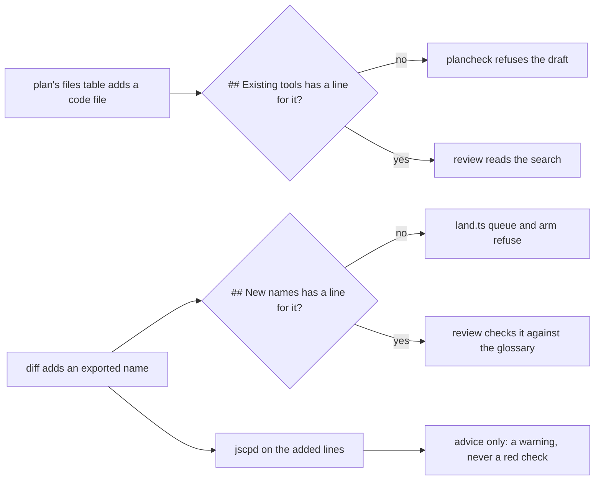

# 0587: A plan's new helper names the existing tools it searched, a pull request's new name cites the industry's word, and code refuses a plan or a pull request that leaves either line out



```markdown
## Existing tools

- `.github/ci/copies.ts`: searched npm for a copy-paste detector and `rg jscpd`; found jscpd,
  used as it ships, and this file only keeps the clones on the lines a pull request adds.

## New names

- `Clone`: a clone, the copy-paste detectors' word for two copies of one fragment (jscpd,
  https://github.com/kucherenko/jscpd, and PMD's CPD, https://pmd.github.io/pmd/pmd_userdocs_cpd.html).
```

**What this decides:** a plan says what it searched before it adds a helper, a pull request says
what the industry calls each new name it adds, review judges both lines, code refuses a plan or a
pull request that lacks a line, and a copy-paste detector advises on each pull request.

## Context

The owner ruled yes on 2026-11-15 to two judgment checks.

- [0040](0040-existing-tools-before-hand-written.md) already says a plan that adds a check or a
  tool names the existing tools it looked at. It left open whether code checks that a plan carries
  the list. This decision answers that, and widens the rule from checks and tools to every new
  helper. 0040 is amended in part; the rest of it holds.
- [Use the industry's names](../docs/direction/use-the-industrys-names.md) and the names rule in
  `AGENTS.md` say a thing keeps the industry's name, checked on every pull request. Nothing wrote
  down where a pull request shows that check, so a reviewer had to guess the source of each name.
- [0408](0408-skills-keep-only-judgment.md) says a rule that code can check becomes a check.
  Whether a line exists is code's job. Whether the search was good or the source is right is
  judgment, and stays in the review skill.
- [0523](0523-advice-rules-block-where-clean.md) and `AGENTS.md`'s checks section set the bar
  for a check that can block: its false alarms measured first, about 0% to block and up to 10% to
  only advise. A copy-paste detector has not been measured here, so it starts as advice.
- [0585](0585-kalfa-is-six-domain-packages.md) names `@kalfa/ci/ship` as the future home of the
  pull request checks. Until that package exists, the checks stay where today's live.

## Decision

**A plan names what it searched before each new helper, a pull request names the industry's word
for each new name, and code refuses either one when a line is missing.**

**Check 1, existing tools first:**

- A plan that adds a helper, a function or a tool has an `## Existing tools` section with one line
  per new helper: the helper, what was searched, and the existing one found or why none fits.
- `plancheck.sh` refuses a draft whose files table adds a code file with no line for it there. A
  new function inside an existing file still gets its line; review checks that one.
- Review sends back a plan or a diff that adds a helper with no line, or whose line shows no real
  search.
- [jscpd](https://github.com/kucherenko/jscpd), the existing copy-paste detector (0040), runs on
  each pull request as advice only. It names a clone that touches the lines the pull request adds,
  and never turns a check red. It blocks only after its false alarms are measured at 0523's bar.

**Check 2, industry names:**

- A pull request that adds a new name (a type, a service, a function, a file, a setting, a record
  field) has a `## New names` section with one line per name: what the industry calls it, with the
  source.
- `land.ts queue` and `land.ts arm` refuse a pull request whose diff adds an exported name that its
  `## New names` section does not name. A name with no export (a file, a setting, a record field)
  still gets its line; review checks that one.
- Review checks each line against [`.glossary/TERMS.md`](../.glossary/TERMS.md) and the names rule
  in `AGENTS.md`: one word per idea, the industry's word where one exists, and a plain gloss for an
  obscure one.

**Binding constraints:**

- A line's existence is checked by code. Only its quality is judged in prose.
- jscpd stays advice until its false alarms are measured at or under the blocking bar.
- When `@kalfa/ci/ship` lands, these checks move there whole; they are not written twice.

## Consequences

- A plan and a pull request each gain one short section when they add a helper or a name. A plan
  or pull request that adds neither has nothing new to write.
- `plancheck.sh` checks the line in draft mode only, so a plan approved before this keeps passing.
- A pull request opened before this decision and landed after it needs a `## New names` section
  added to its description when its diff adds an exported name.
- CI runs jscpd once per pull request, about 2 seconds on the whole tree on a laptop.
- Not decided here: when jscpd blocks, and what counts as a name the code check cannot see (a
  setting key, a record field). Those wait on measurement.

## Amendments

- 2026-11-15: `plancheck.sh` checks the line in draft mode, with no new plan version, so plans
  approved earlier keep passing. jscpd was measured on main before it advises: 5 of 60 fresh clones
  were false alarms, 8% ([experiment 297](../experiments/297-jscpd-false-alarms.md)).
