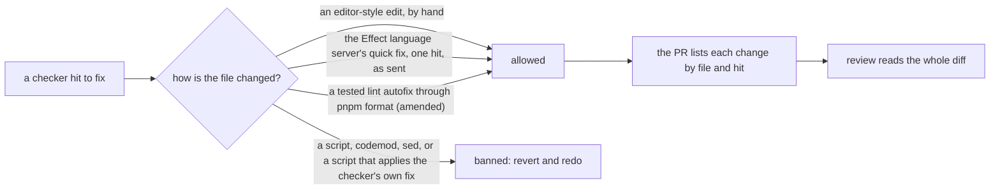

# 0588: No script or program edits files for a sweep, except the Effect language server's own quick fix, applied one hit at a time exactly as the server sends it



```text
allowed  editor edit            the Edit tool, one site at a time
allowed  language-server fix    textDocument/codeAction from the Effect language server,
                                one hit at a time, applied exactly as the server sends it
banned   any other program      sed, a Node or Python script, a codemod, a script that
                                reads the checker's positions and writes its suggested fix
```

## Decision

AGENTS.md already says to change code with an editor-style edit, not with a find-and-replace
script run over the tree. The owner ruled on 2026-11-15 how far that goes, after a sweep slice
edited 141 files with a one-off script that applied the checker's own fix at the checker's
positions:

1. **No script edits files,** not even one that applies the checker's own suggested fix at the
   checker's own positions. Edits a script made are reverted and redone.
2. **The Effect language server's own quick fix counts as an editor edit.** A client may ask the
   server for the code action at one hit and apply it exactly as the server sends it, one hit at a
   time, as an editor's quick fix does. That is the makers' own fix, through the protocol editors
   use (the Language Server Protocol's `textDocument/codeAction`).
3. **Any other program that edits files stays banned.**
4. **Each pull request lists those changes by file and hit,** and review reads the whole diff.

Laptop agents and the cloud twin follow the same rule. The twin's language-server client is on
branch `fabrikalfa/twin-tools`.

## Consequences

- Effect-check sweep slices fix their hits by hand or through the language server's quick fix,
  never through a script.
- A reviewer that finds a scripted edit sends the slice back to have it redone.
- Reading tools stay free: running the checker to list hits (`effect-tsgo diagnostics`) edits
  nothing and is fine.

## Amendments

### 2026-11-15: a tested lint autofix through `pnpm format` is the third allowed route

The owner ruled the same day that a lint rule's safe autofix, applied by `pnpm format`, is an
allowed tool, like oxlint's built-in fixes. That holds as long as the rule has its laws and plants
and review reads the diff. Effect slices E1 (PR 1426) and E2 (PR 1430) keep their work.

There are now three allowed routes to edit a file:

1. an editor-style edit;
2. the Effect language server's own quick fix, one hit at a time, exactly as the server sends it;
3. a tested lint autofix, through `pnpm format`.

Anything else that edits files stays banned.
