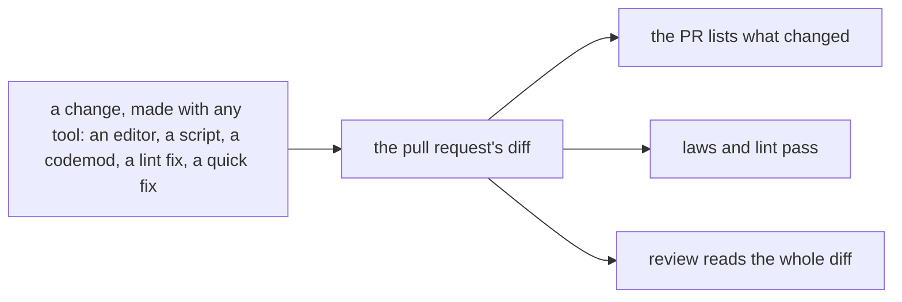

# 0589: Agents edit files with any tool, scripts and codemods included; review reads the diff, and laws and lint must pass

## Decision

The owner ruled on 2026-11-15 that the rule on how files are edited goes, as unnecessarily
strict. An agent may edit files with any tool: an editor, a script, a codemod, a lint autofix, or
the Effect language server's quick fix.

What still holds is everything else:

- review reads the whole diff;
- laws and lint must pass;
- the pull request lists what changed.

This supersedes [0588](0588-no-program-edits-files-but-the-language-servers-quick-fix.md) whole,
with its amendment. It also removes AGENTS.md's line "Change code with an editor-style edit, not
with a find-and-replace script run over the tree", in the same pull request.

## Consequences

- Nothing already redone by hand needs undoing. Effect slice E3's hand redo (PR 1435) stays as it
  is.
- A sweep slice may apply its fixes with a script or a codemod, such as ast-grep or jscodeshift. The
  PR names the tool and lists the changes, and the review reads the diff as it reads any other.
- "Move files with `git mv`, so history follows" stays. It is about history, not about how an edit
  is made.

## Amendments

### 2026-11-15: a mechanical fold pull request gets no review agent

The owner ruled the same day that a mechanical fold pull request gets no review agent. That means
the cloud twin's `fabrikalfa/effect-mechanical` (Effect-check slices E4 to E25, and any later slice
a tool fixes whole) and the laptop's `fabrikalfa/effect-laptop-fold` (E0 to E3). For these, the
checks passing is the review: the pull request check, then the full run in the merge queue. Each
goes through the merge queue like any pull request, with no admin merge.

Judgment slices (E26 to E39) keep their review agent. They come as separate pull requests that add
no lock lines, and their locks land in one small pull request at the end.

### 2026-11-15: one pull request per sweep, never one per slice

The owner ruled the same day, with 67 pull requests open, that a sweep lands as one pull request,
never one per slice. A slice opens no pull request of its own. Its work goes onto the sweep's fold
branch, and each judgment slice is reviewed in its own box before it is folded.

| Sweep | One pull request |
|---|---|
| Effect checks, mechanical (E4 to E25) | `fabrikalfa/effect-mechanical` |
| Effect checks, judgment (E26 onward) | `fabrikalfa/effect-judgment` |
| Effect checks, laptop E0 to E3 | `fabrikalfa/effect-laptop-fold` |
| Reflect ban, slices 2 to 8 | `fabrikalfa/reflect-fold` |
| Reflect ban, slices 9 to 15 | `fabrikalfa/reflect-rest` |
| The mock sweep's plans | one plan pull request, `fabrikalfa/mock-plans`, with one lead approval |
| Anti-slop rules | one mechanical and one judgment pull request |

A slice pull request opened before this ruling is closed with a link to its replacement once the
replacement exists.
