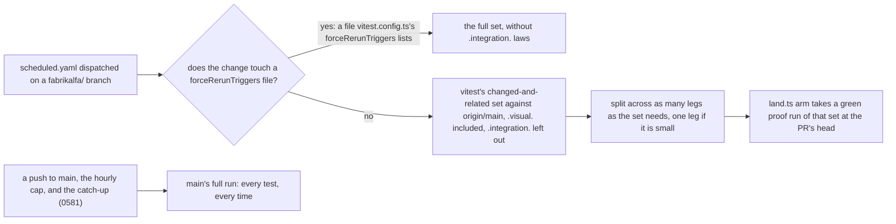

# 0590: A branch's proof run runs only the tests its change reaches, and main's own full run stays complete as the safety net



```sh
# Sketch: what a branch's proof run asks vitest for.
vitest list --changed origin/main --related   # the files this change reaches
vitest run  <those files> --shard=<i>/<n>     # n legs, sized to the set
```

## Decision

The owner ruled on 2026-11-15, after asking for it several times, that a branch's proof run, meaning
`scheduled.yaml` dispatched on a `fabrikalfa/` branch, runs only the tests its change reaches:

1. **The set is vitest's own.** It is the changed-and-related set against `origin/main`, the same
   import graph that `--changed` uses, with `.visual.` laws included and `.integration.` laws left
   out ([0602](0602-integration-laws-leave-merge-line.md)). Vitest's
   [`--changed`](https://vitest.dev/guide/cli.html#changed) and
   [`forceRerunTriggers`](https://vitest.dev/config/forcereruntriggers) are the makers' tools for
   exactly this.
2. **Legs follow the set.** The set is split across as many legs as it needs, and a small set is
   one leg.
3. **A change to a file in vitest's `forceRerunTriggers` runs the full set.** The files are the
   ones `forceRerunTriggers` in `vitest.config.ts` lists. The full set of a branch's proof run
   leaves `.integration.` laws out too.
4. **A test that reads a file as text without importing it declares the read on its law,** with the
   `reads:` option beside the plant and label options of
   [0580](0580-law-options-carry-plant-and-label.md)
   ([0591](0591-exam-shape-checks-become-lint-rules-and-text-reads-are-declared.md)). The
   changed-set picker treats it like an import, so the import graph cannot miss it. A read is never
   added to `forceRerunTriggers`. Until a law's `reads:` lands, the changed-set run adds the
   reader tests whenever `next/` changes.
5. **`land.ts arm` accepts a green proof run of the changed set** at the pull request's head. It
   asks for no `.integration.` law, through either of its routes.
6. **Main's own full run stays complete:** every test, on push with the hourly cap, plus the
   catch-up (0581). It is the safety net for anything the changed set misses.

Batches of pull requests in one proof run stay possible, but are rarely needed after this.

This amends [0534](0534-the-merge-line-runs-changed-tests-a-schedule-runs-all.md),
[0536](0536-real-resource-tests-run-only-on-the-schedule.md) and
[0581](0581-main-full-run-starts-on-push-and-hourly.md): a branch's run is no longer the full set.

## Consequences

- A small change waits for its own tests, not every leg. The one-at-a-time line moves faster.
- A miss in the import graph shows on main's next full run, and the fix adds the
  missed read as a `reads:` entry on the law that reads it
  ([0591](0591-exam-shape-checks-become-lint-rules-and-text-reads-are-declared.md)), never as a
  `forceRerunTriggers` entry.
- The build is lead tooling, fast-tracked: the scheduled workflow's dispatch path, the leg split,
  and `land.ts arm`'s check.
