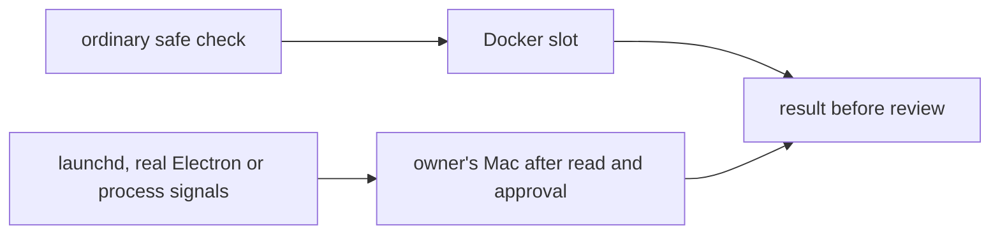
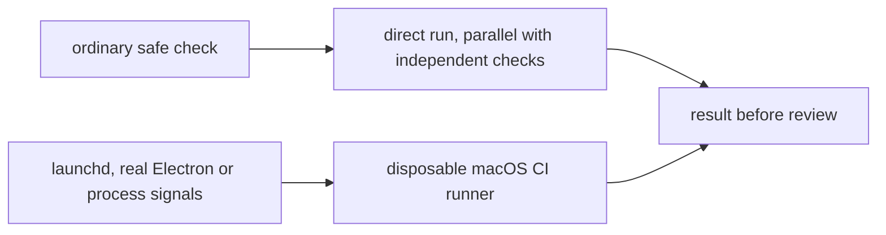

# 0594: Ordinary safe checks run directly in parallel with launchd, real Electron and process-signal laws on disposable macOS CI

**Before:**



**After:**



```sh
# Ordinary safe checks can run alongside independent checks, under the existing caps.
nice -n 19 pnpm lint
nice -n 19 pnpm exec vitest run --maxWorkers=1 <verified-safe-test-path>

# Existing macOS proof: this workflow runs its declared P19 L13 law only.
gh workflow run host.yaml --ref <branch>
```

**What this decides:** where checks run, so ordinary safe work can proceed in parallel while tests
that use launchd, real Electron or real process signals stay off the owner's laptop.

## Context

- [0045](0045-test-steps-run-in-containers.md) requires a container for a step that needs ports,
  sockets or its own processes. Applying that rule to every safe tool invocation puts independent
  checks behind the single Docker slot in [0012](0012-twelve-agents-at-once.md).
- [0178](0178-host-only-laws-run-first.md) requires real-machine proof before the first review,
  and allows the owner's Mac after the lead's read and the owner's approval.
- [The host workflow](../.github/workflows/host.yaml) already runs its declared launchd and real
  Electron law on a disposable macOS runner. Its scope is that law, not every integration test.
- This amends 0045 for ordinary safe checks and 0178 for tests that use launchd, real Electron or
  real process signals. The before-review requirement stays.

## Decision

**Ordinary safe checks run directly in parallel; launchd, real Electron and process-signal laws
run on disposable macOS CI, never on the owner's laptop.**

- Run independent safe checks directly, without requiring a Docker slot. This includes format,
  lint, ordinary tests and scoped temporary-Git checks that do not signal real processes.
- Read the tests a command will reach and their cleanup before a direct run. A plain test-file
  name is not clearance. If `--changed` selects a law that uses launchd, real Electron or real
  process signals, run explicit verified-safe paths locally and obtain remote proof for those
  selected files separately.
- Keep launchd, real Electron and real process-signal tests on an eligible disposable macOS CI
  runner. Obtain their proof before the first review, as 0178 requires.
- Use a workflow only for the laws it actually runs. A green `host.yaml` run proves its declared
  P19 L13 law; it is not proof for another file or law.
- Existing Linux CI remains valid for ordinary integration proof. This decision does not move all
  real-resource or integration tests to macOS.
- Keep the global resource caps in [0012](0012-twelve-agents-at-once.md) and
  [0410](0410-the-machine-caps-live-in-code.md), including one typecheck at a time. Parallel safe
  checks do not raise a cap or permit a broad local test run.

**Binding constraints**

- No blanket laptop sandbox allowance follows from a direct safe check. A check that still needs
  network isolation keeps 0045's isolation requirements.
- Existing integration guards still apply. No guard is bypassed or approval variable forged to
  turn missing remote proof into a local pass.
- Product boxes and their isolation are unchanged. This ruling concerns check execution.

## Consequences

- Ordinary safe checks no longer wait for Docker or its single slot.
- A missing disposable macOS run remains missing proof. The owner's laptop is not a fallback.
- AGENTS.md and the lead skill point to this split instead of sending these laws to the laptop.
- No workflow or product behavior changes in this record. A workflow that does not run a required
  law still needs its own change before that law has proof.
- Agent counts, incident policy and how agents are started are outside this decision.

## Records

- `.glossary/TERMS.md`: the existing **host-only law** row points to 0178 for execution rules.
  No new term is added.
