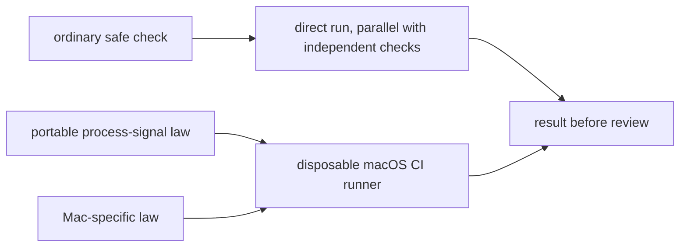
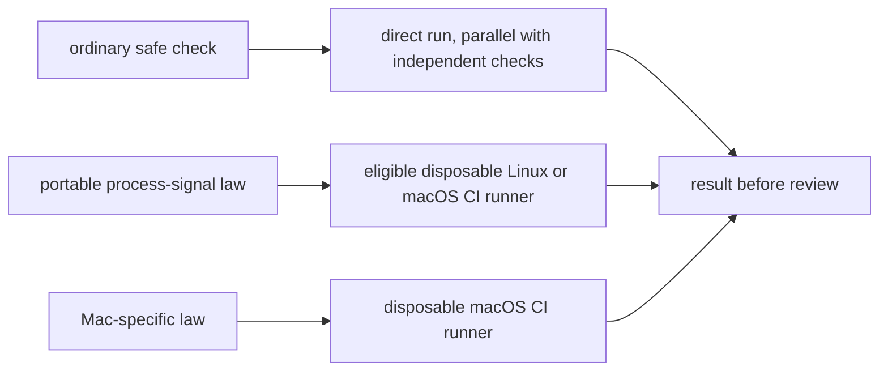

# 0594: Ordinary safe checks run directly in parallel while launchd, real Electron and process-signal laws use disposable CI

**Earlier wording (wrong, corrected on 2026-11-16: it was broader than the ruling):**



**Corrected routing:**



```sh
# Ordinary safe checks can run alongside independent checks, under the existing caps.
nice -n 19 pnpm lint
nice -n 19 pnpm exec vitest run --maxWorkers=1 <verified-safe-test-path>

# Existing macOS proof: this workflow runs only its declared laws.
gh workflow run host.yaml --ref <branch>
```

**What this decides:** ordinary safe checks run directly in parallel, while laws using launchd,
real Electron or real process signals use eligible disposable CI away from the owner's laptop.

## Context

- [0045](0045-test-steps-run-in-containers.md) requires a container for a step that needs ports,
  sockets or its own processes. Applying that rule to every safe tool invocation puts independent
  checks behind the single Docker slot in [0012](0012-twelve-agents-at-once.md).
- [0178](0178-host-only-laws-run-first.md) requires real-machine proof before the first review.
  This record keeps that timing and moves the laws named here off the owner's laptop.
- [0584](0584-a-tests-kind-follows-what-it-uses.md) classifies a test by what it reaches.
  [0590](0590-a-branch-proof-run-runs-only-what-its-change-reaches.md) sets the branch proof
  selection. Neither a filename nor a green unrelated workflow supplies proof.
- [The host workflow](../.github/workflows/host.yaml) supplies a disposable macOS route for its
  declared laws. That existing route does not make portable process-signal laws Mac-only.
- This amends 0045 for ordinary safe checks and 0178 for execution away from the owner's laptop.
  It applies to checks for both today's version and `next/`.

## Decision

**Ordinary safe checks run directly in parallel; laws using launchd, real Electron or real
process signals run on eligible disposable CI away from the owner's laptop.**

- Run independent safe checks directly, without requiring a Docker slot. This includes format,
  lint, ordinary tests and scoped temporary-Git checks that do not signal real processes.
- Read the tests a command will reach and their cleanup before a direct run. A plain test-file
  name is not clearance. If `--changed` selects a law that uses launchd, real Electron or real
  process signals, run explicit verified-safe paths locally and obtain remote proof for those
  selected files separately.
- A portable process-signal law may use eligible disposable Linux CI. Use disposable macOS CI
  when the law needs macOS. Launchd and real Electron laws keep their current disposable macOS
  route. None of these laws runs on the owner's laptop.
- Obtain the required real-machine proof before the first review, as 0178 requires.
- Use a workflow only for the laws and proof operations it actually runs. A green result for
  three selected files does not prove other files or an unrun deliberate fault check.
- Existing Linux CI remains valid for ordinary integration proof. The selected runner must
  support the law's actual dependencies, isolation and cleanup.
- Keep the global resource caps in [0012](0012-twelve-agents-at-once.md) and
  [0410](0410-the-machine-caps-live-in-code.md), including one typecheck at a time. Parallel safe
  checks do not raise a cap or permit a broad local test run.

**Binding constraints**

- No blanket laptop sandbox allowance follows from a direct safe check. A check that still needs
  network isolation keeps 0045's isolation requirements.
- Existing integration guards still apply. No guard is bypassed or approval variable forged to
  turn missing remote proof into a local pass.
- A static inventory of selected files grants no local execution clearance.
- Product boxes and their isolation are unchanged. This ruling concerns check execution.

## Consequences

- Ordinary safe checks no longer wait for Docker or its single slot.
- Missing eligible disposable CI proof remains missing proof. The owner's laptop is not a
  fallback.
- AGENTS.md and the lead skill point to this routing.
- No workflow or product behavior changes in this record. A workflow that does not run a required
  law still needs its own change before that law has proof.
- Agent counts, incident policy and how agents are started are outside this decision.

## Records

- No glossary term is added or renamed.
