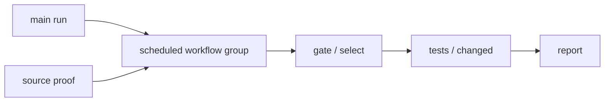
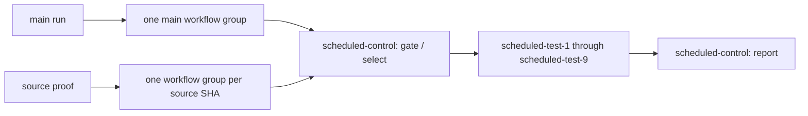

# 0595: Scheduled runs share ten job groups before proof queues separate

**Before:**



**After the staged rollout:**



```yaml
# Shared job groups; the workflow queue stays unchanged in the first slice.
jobs:
  gate:
    concurrency:
      group: scheduled-control
      queue: max
      cancel-in-progress: false
  changed:
    concurrency:
      group: scheduled-test-${{ matrix.shard }}
      queue: max
      cancel-in-progress: false
```

**What this decides:** today's scheduled CI enforces its ten-runner budget through shared job
groups before main and source-proof workflow queues separate.

## Context

One workflow group currently holds main and every branch proof until the preceding run ends.
[Run 44018856944](https://github.com/kamp-us/tea-fabrika/actions/runs/44018856944) waited
511 seconds before its gate job was created.
[Run 44019111065](https://github.com/kamp-us/tea-fabrika/actions/runs/44019111065) waited
387 seconds. Each gate then waited two seconds for a runner. These observations prove a queue
delay in those two runs, not a future speedup or the cause of every CI delay.

GitHub's [job concurrency](https://docs.github.com/en/actions/how-tos/write-workflows/choose-when-workflows-run/control-workflow-concurrency)
can serialize jobs across runs by a shared group. This is the existing platform mechanism;
no separate queue service is added. The change applies to today's CI serving both versions.

This amends [0534](0534-the-merge-line-runs-changed-tests-a-schedule-runs-all.md)'s single
scheduled queue, [0581](0581-main-full-run-starts-on-push-and-hourly.md)'s all-ref serialization,
and [0590](0590-a-branch-proof-run-runs-only-what-its-change-reaches.md)'s branch-ref dispatch
route. Their test selection, depth, main cadence and reporting rules remain.

## Decision

**Participating scheduled runs share nine test-job groups and one control-job group; separate
workflow admission follows only after trusted source proof and migration are proven.**

- Each full or changed test leg uses exactly one of `scheduled-test-1` through
  `scheduled-test-9`. Both matrices share these names across source commits and workflow runs.
  `gate`, `select` and `report` share `scheduled-control`. A group admits one job at a time.
- Retain `queue: max` and `cancel-in-progress: false`. Keep every test, full-depth case count,
  job name, failure verdict and timeout. Main still runs the complete suite; branch proof keeps
  [0590](0590-a-branch-proof-run-runs-only-what-its-change-reaches.md)'s selection.
- The supported proof request uses the current workflow on main and an exact target source SHA.
  Verify each actual source checkout. Keep source SHA, workflow SHA, run, attempt, selection and
  actual runtime versions in its evidence. Missing or mismatched facts are missing proof.
- Treat source proof separately even when its workflow comes from main. It never advances main's
  hour limiter or writes main's incident issue. Main runs remain serialized with their existing
  push, hourly catch-up and manual-start rules.
- After migration, tooling starts and accepts new proofs only through this current-workflow
  protocol. Historical records retain their original meaning; they are never relabeled as the
  new protocol. A direct dispatch of historical workflow code is outside this protocol's budget
  guarantee and is not suggested or accepted as current proof.

**Binding constraints**

- At most ten jobs run across participating versions of `scheduled.yaml`: nine test jobs and
  one control job. This does not cap `check`, `host` or other GitHub workflows.
- Shared job-group names have no source, ref, run or attempt suffix. Such a suffix would remove the
  shared budget. No job holds one group while acquiring another.
- Do not cancel runs to clear the queue or replace an older entry. Existing fail-fast behavior
  stays. No narrower tests, new infrastructure, paid runner or new token grant.
- Local compiler rules and agent caps do not change.

## Rollout

1. Add and prove the shared job groups while keeping the existing global workflow group.
2. Add and prove current-main source-SHA dispatch, actual checkout and evidence verification,
   still under the global workflow group.
3. Let already queued or running versions without shared job groups finish without cancellation.
   Record their workflow versions and the drain before enabling independent admission.
4. Separate main and source-proof workflow queues, retaining all ten shared job groups. Prove
   actual overlap, job bounds, source identity and unchanged reporting before claiming recovery.

This decision records the staged change. It does not say these code slices have landed or that
the global workflow queue has already been removed.

## Consequences

- A free job group can serve another source proof while a different group's earlier test runs.
  A busy fixed group can still delay a job while another group is free; this is not a dynamic
  worker pool. Measure the resulting wait and execution time after rollout.
- The scheduled workload keeps its existing ten-runner budget and the intent to leave capacity
  for pull requests. This does not reserve runners against every other workflow.
- Evidence must identify tested source independently from the workflow's own commit. A green
  workflow at the wrong source is not proof for a pull request.
- No glossary term is added or renamed.
