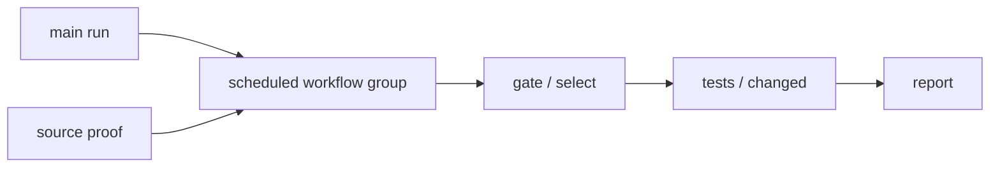
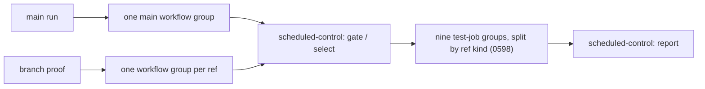

# 0595: Scheduled runs hold at most ten jobs through ten shared job groups, and each ref queues its workflow runs apart

**Before:**



**After:**



```yaml
# A sketch of the shared job groups. Names carry no ref, run or attempt suffix.
jobs:
  gate:        # select and report too
    concurrency:
      group: scheduled-control
      queue: max
      cancel-in-progress: false
  changed:     # tests too; 0598 splits the nine groups by ref kind
    concurrency:
      group: scheduled-<main or proof>-<n>
      queue: max
      cancel-in-progress: false
```

**What this decides:** today's scheduled CI enforces its ten-runner budget through shared job
groups, while main and each branch's proof queue their workflow runs apart.

## Context

Before this, one workflow group held main and every branch proof until the preceding run ended.
[Run 44018856944](https://github.com/kamp-us/tea-fabrika/actions/runs/44018856944) waited
511 seconds before its gate job was created.
[Run 44019111065](https://github.com/kamp-us/tea-fabrika/actions/runs/44019111065) waited
387 seconds. Each gate then waited two seconds for a runner. These observations prove a queue
delay in those two runs, not a future speedup or the cause of every CI delay.

GitHub's [job concurrency](https://docs.github.com/en/actions/how-tos/write-workflows/choose-when-workflows-run/control-workflow-concurrency)
can serialize jobs across runs by a shared group. This is the existing platform mechanism;
no separate queue service is added. The change applies to today's CI serving both versions.

This amends [0534](0534-the-merge-line-runs-changed-tests-a-schedule-runs-all.md)'s single
scheduled queue and [0581](0581-main-full-run-starts-on-push-and-hourly.md)'s all-ref serialization.
[0598](0598-merge-line-leaves-scheduled-groups.md) later split the nine test groups by ref kind.

## Decision

**Participating scheduled runs share nine test-job groups and one control-job group, and each ref
has its own native workflow group.**

- Each full or changed test leg uses exactly one of the nine test-job groups. Main's full run takes
  `scheduled-main-1` to `MAIN_SLOTS` and a branch's proof run takes `scheduled-proof-1` to
  `PROOF_SLOTS` ([0598](0598-merge-line-leaves-scheduled-groups.md)). Both counts are `env` values
  in `.github/workflows/scheduled.yaml` and add up to nine. Both matrices use these names across
  source commits and workflow runs. `gate`, `select` and `report` share `scheduled-control`. A
  group admits one job at a time. The merge line, `check.yaml`, takes none of them.
- Retain `queue: max` and `cancel-in-progress: false`. Keep every test, full-depth case count,
  job name, failure verdict and timeout. Main still runs the complete suite; branch proof keeps
  [0590](0590-a-branch-proof-run-runs-only-what-its-change-reaches.md)'s selection.
- Keep branch-ref dispatch and the existing branch/head proof contract, which native per-ref
  workflow groups can carry as they are. [`Arm.ts`](../.agents/skills/lead/scripts/pr/Arm.ts)
  matches `run.head` to the pull request's head, [`proof.ts`](../.github/ci/proof.ts) records
  checkout `HEAD`, [`gate.mjs`](../.github/ci/gate.mjs) reads main histories only, and
  [`scheduled.mjs`](../.github/ci/scheduled.mjs) writes no incident for a branch. Before each
  supported new proof start, tooling checks the exact branch HEAD for all shared job locks. Missing
  locks refuse the start. This adds no trusted-main input, dual checkout or artifact schema, and it
  weakens no proof or resource check.
- Branch proof never advances main's gap limiter or writes main's incident issue. Main runs
  remain serialized in their own workflow group with the existing gap (`env.GAP_MINUTES`), push,
  catch-up and manual-start rules. Other refs use their own native workflow groups.
- Historical proof records retain their original meaning and existing acceptance rules. Do not
  relabel them or accept stale proof unconditionally. Direct dispatch of historical workflow code
  remains outside the supported budget guarantee and is not suggested as a supported new start.

**Binding constraints**

- At most ten jobs run across participating versions of `scheduled.yaml`: nine test jobs (main's
  `env.MAIN_SLOTS` and a proof's `env.PROOF_SLOTS`, per 0598) and one control job. This does not cap `check`, `host` or
  other GitHub workflows.
- Shared job-group names have no source, ref, run or attempt suffix. Such a suffix would remove the
  shared budget. No job holds one group while acquiring another.
- Do not cancel runs to clear the queue or replace an older entry. Existing fail-fast behavior
  stays. No narrower tests, new infrastructure, paid runner or new token grant.
- Local compiler rules and agent caps do not change.

## Rollout

1. Add and prove the shared job groups while keeping the existing global workflow group.
2. Add and prove the exact-branch-HEAD lock preflight for supported proof starts, still under the
   global workflow group. Migrate active proof refs to the shared job groups.
3. Drain every already queued or running version without shared job groups, without cancellation.
   Record their workflow versions and the drain before enabling independent admission.
4. Use native per-ref workflow groups, retaining all ten shared job groups. Prove
   actual overlap, job bounds, source identity and unchanged reporting before claiming recovery.

Step 4 is the end state the Decision above states.

## Consequences

- A free job group can serve another source proof while a different group's earlier test runs.
  A busy fixed group can still delay a job while another group is free; this is not a dynamic
  worker pool. Measure the resulting wait and execution time after rollout.
- The scheduled workload keeps its existing ten-runner budget and the intent to leave capacity
  for pull requests. This does not reserve runners against every other workflow.
- Existing run-head checks and checkout-HEAD records still identify the tested source. A green
  workflow at the wrong source is not proof for a pull request.
- No glossary term is added or renamed.
