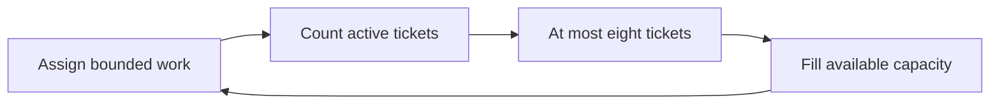
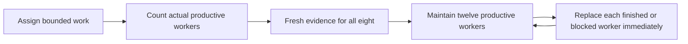

# 0597: Staff eight productive workers before twelve

**Before:**



**After:**



```markdown
Before: Drive at most eight active tracker tickets.
After: Count actual productive workers under decision 0597.
```

**What this decides:** staffing counts workers doing useful bounded work, with fresh evidence before
raising the target from eight to twelve.

## Context

[0596](0596-eight-active-tracker-tickets.md) counted active tickets. The earlier agent cap in
[0012](0012-twelve-agents-at-once.md), also repeated in
[0063](0063-todays-app-lanes-share-the-slots.md), counted agents. Neither count proves how many
workers are doing useful work now. A coordinator, a finished task and a passive wait can leave
the reported total high while work stops.

The owner replaced those counts with actual productive workers. This is the current operating
rule for today's tooling and work on `next/`. It replaces 0596 whole and the staffing counts in
0012 and 0063. Their resource, ownership and work-priority rules keep their existing amendments.
This records how authorized work is staffed and verified; it adds no application setting (0069).

## Decision

**Staff eight actual productive workers first, then twelve after a fresh verification of all eight.**

- A worker counts while carrying out a useful bounded task. Reading, planning, tests, building,
  review, docs repairs and active proof work count when the worker is actually doing them.
- Coordinators, completed tasks, blocked workers and passive CI waits do not count. Starting a
  thread or sending a brief is not proof that work started.
- Before raising the target, verify all eight workers afresh. Name each worker and task, check
  current activity, and record evidence that the task is being worked. An old roster or an
  unchecked self-report does not satisfy that check.
- Keep reports tied to verified named workers and tasks, with actual start and release times.
  Report vacancies honestly. A worker blocked or finished is released from the productive count.
- Refill each vacancy immediately when useful independent work is available. Keep work moving as workers
  finish; do not wait for a whole group to finish before assigning the next tasks. A blocked worker
  counts again only after useful work actually resumes or a new bounded task starts.
- Keep one owner per file, fresh agents for the required steps, independent review and required
  proof. A staffing target does not replace any of these checks.
- Keep the shared-resource limits: one typecheck, one Electron test app and one Docker box, plus
  the existing nice levels and test-worker limits (0012, 0410). Real-signal, launchd and real
  Electron proof follows [0594](0594-safe-checks-direct-mac-ci.md).
- Work already authorized by the owner continues while the owner is away. A new owner decision
  still waits for the owner; reporting or refilling workers adds no approval gate.

**Binding constraints**

- Useful work and current evidence decide the count. No dummy task or passive waiter fills a vacancy.
- Keep saved work and running jobs intact. This decision authorizes no cancellation, Sev0
  declaration, infrastructure change or weakening of review and proof requirements.

## Consequences

The coordinator verifies activity and refills useful work rather than reporting ticket or thread
counts. Those reads take attention, but the report now shows who is doing work and which places
are vacant. The target changes only after the eight-worker check; resource limits still govern
which checks may run together.

No product code, CI workflow, schedule, paid service or infrastructure changes here. No new
vocabulary is introduced.
