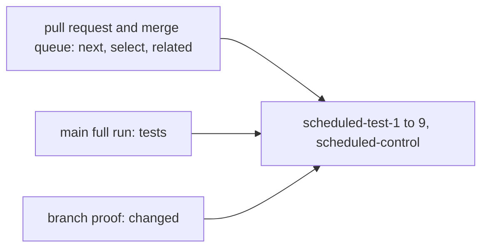
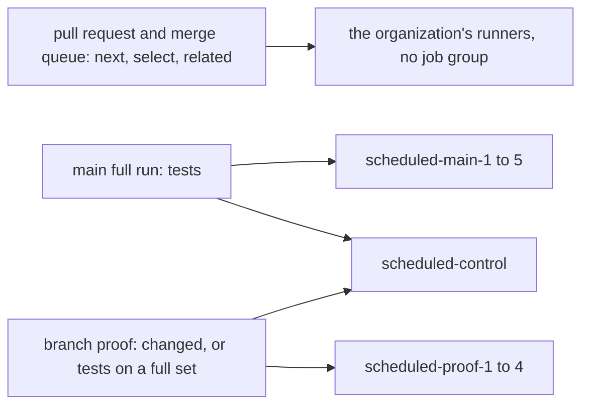

# 0598: The merge line leaves the scheduled job groups, and main's full run and branch proofs get their own groups inside the ten-job budget

**Before:**



**After:**



```yaml
# A sketch of the slot shape, today's CI. Names have no ref, run or attempt suffix.
# check.yaml: next, select, related keep only the run's own `check-<pr>` group.
# scheduled.yaml:
env:
  MAIN_SLOTS: 5   # a setting (0069); MAIN_SLOTS + PROOF_SLOTS = 9
  PROOF_SLOTS: 4
jobs:
  tests:   # main: shard -> scheduled-main-1..5; a branch full set: shard -> scheduled-proof-1..4
    concurrency:
      group: ${{ github.ref == 'refs/heads/main' && 'scheduled-main-' || 'scheduled-proof-' }}<n>
      queue: max
      cancel-in-progress: false
  changed: # proof.ts `slots` rotates the legs over scheduled-proof-1..4 by run number
    concurrency:
      group: scheduled-proof-<n>
      queue: max
      cancel-in-progress: false
  gate, select, report: # unchanged
    concurrency: { group: scheduled-control, queue: max, cancel-in-progress: false }
```

**What this decides:** in today's CI, merge-line test jobs stop waiting for `scheduled.yaml`'s
job groups, and main's full run and branch proofs stop waiting for each other, while the
scheduled workload keeps its ten-job budget, its full depth and every check.

## Context

[0595](0595-scheduled-runs-share-slots.md) put every `scheduled.yaml` test leg in one of nine
fixed groups, `scheduled-test-1` to `9`, plus `scheduled-control`. A job group is a lock, not a
pool: a leg pinned to group 3 waits while group 3 is busy, even when eight groups are free.
[PR 1581](https://github.com/kamp-us/tea-fabrika/pull/1581) then put check.yaml's `next` and
`related` legs and its `select` job in the same groups, so pull requests wait on main's full run.
[PR 1577](https://github.com/kamp-us/tea-fabrika/pull/1577) rotates proof legs over the nine
groups, which spreads the wait but cannot remove it while main holds all nine.

What the runs show (job `created_at` to `started_at`, read from the GitHub API on 2026-11-18):

| Run | What waited | Queue | Ran |
|---|---|---|---|
| [main full run 44155250216](https://github.com/kamp-us/tea-fabrika/actions/runs/44155250216) | nine `tests` legs, behind proof run [44155042561](https://github.com/kamp-us/tea-fabrika/actions/runs/44155042561) | 5.6 to 11.3 min | 6.8 to 11.7 min, 85 runner minutes in all |
| [branch proof 44155342361](https://github.com/kamp-us/tea-fabrika/actions/runs/44155342361) | three `changed` legs, behind that main run | 16.8 to 18.2 min | 4.3 to 5.3 min, 14 runner minutes in all |
| [ready pull request run 44201566907](https://github.com/kamp-us/tea-fabrika/actions/runs/44201566907) | five of seven `related` legs, behind the run's own `next` legs and other runs | 1.2 to 7.4 min | 6.7 to 10.4 min |

The proof run took 24.6 minutes for 14 runner minutes of tests. The pull request run took 20.2
minutes; without the queue its longest leg would have ended it in about 12.5. Jobs outside the
groups in the same day started in 0 to 0.1 minutes (lane 1's report for issue
[1333](https://github.com/kamp-us/tea-fabrika/issues/1333), 355 runs, 2026-11-17 00:05Z to
2026-11-18 00:05Z): the organization's runners were not the bottleneck, the locks were. Over that
day the pull request check had a median of 3.0 and a p90 of 6.2 minutes against a goal of 3 and
5, and last push to merged a median of 19.2 and a p90 of 67.8 against 8 and 15.

This amends [0595](0595-scheduled-runs-share-slots.md): its ten-job budget, its no-suffix rule,
its control group and its rollout stay; its nine shared test groups split in two by ref kind, and
the merge line leaves them. [0581](0581-main-full-run-starts-on-push-and-hourly.md)'s cadence and
[0590](0590-a-branch-proof-run-runs-only-what-its-change-reaches.md)'s selection do not change.

### How GitHub Actions and the industry do this

- **GitHub Actions has no job priority.** Its tools are concurrency groups, which admit one job
  per group name
  ([control workflow concurrency](https://docs.github.com/en/actions/how-tos/write-workflows/choose-when-workflows-run/control-workflow-concurrency)),
  `strategy.max-parallel`, which caps one matrix in one run
  ([workflow syntax](https://docs.github.com/en/actions/reference/workflows-and-actions/workflow-syntax#jobsjob_idstrategymax-parallel)),
  and the plan's concurrent job limit, which queues every job past it
  ([Actions limits](https://docs.github.com/en/actions/reference/limits)). This repo's comment in
  `scheduled.yaml` puts that limit at 20 runners for the organization. Separate runner groups or
  labels are the other known way, and they need self-hosted or paid larger runners, which 0595
  rules out.
- **The industry gives pre-merge work its own capacity so post-merge work cannot block it.**
  Buildkite does it with separate agent queues and job priority
  ([managing priorities](https://buildkite.com/docs/pipelines/configure/workflows/managing-priorities)),
  GitLab serializes only the jobs that share a resource
  ([resource groups](https://docs.gitlab.com/ci/resource_groups/)). Shared locks are for a
  resource that truly admits one user, such as a deploy target; our test legs share no such
  resource, only a runner budget.

### The options

| Option | What it loses | How it fails |
|---|---|---|
| A. The merge line gets its own nine groups | Nothing new is reserved, but pull requests still pin legs to fixed locks | Two ready pull requests wait on each other's legs, today's problem among pull requests |
| B. The merge line leaves job groups (chosen, part 1) | Its legs are no longer counted inside the ten | A burst of merge-line jobs past the organization's limit waits in GitHub's own queue, which is a pool, so no runner sits idle while a job waits |
| C. Main's full run gives way through `max-parallel` alone, groups kept shared | Main's full run gets slower | `max-parallel` caps how many groups main holds, not which; a proof leg pinned to a busy group still waits |
| D. Disjoint groups per ref kind inside the nine (chosen, part 2) | Main's full run takes longer, five legs at a time instead of nine; a proof gets at most four legs at once | Two proofs at once share four groups; a full-set proof runs nine legs on four groups |
| E. No job groups at all | The ten-job scheduled budget | Main and proofs together can take 18 runners and starve pull requests at the organization's limit |
| F. Proofs get nine more groups of their own | The budget, 19 of 20 runners | The same as E, at a quiet hour too |

## Decision

**The merge line's test jobs take no job concurrency group, and `scheduled.yaml`'s nine test
groups split by ref kind into five for main's full run and four for branch proofs, with the one
control group shared.**

- **Merge line, `check.yaml`:** the `next`, `select` and `related` jobs drop their job-level
  `concurrency`. Each run keeps its existing `check-<pr>` run group. This covers pull request,
  merge queue and push-to-main runs of `check.yaml`. Their legs then wait only for the
  organization's runners, as every other check job does today.
- **Main's full run, `scheduled.yaml` `tests` on `refs/heads/main`:** groups `scheduled-main-1`
  to `scheduled-main-5`, `max-parallel: 5`. The nine legs are pinned longest first, measured
  from run 44155250216: group 1 tooling-1 then e2e-1, group 2 legs 3 then 4, group 3 legs 2
  then 1, group 4 leg 5 then e2e-2, group 5 tooling-2. The pins refresh with
  `vitest.shards.full.json`.
- **Branch proofs, `scheduled.yaml` `changed`, and `tests` on any other ref (a full set):** groups
  `scheduled-proof-1` to `scheduled-proof-4`, `max-parallel: 4`. `select`'s `MOST` becomes 4, so
  a changed set splits into at most four legs. `.github/ci/proof.ts` `slots` rotates over four
  groups by the workflow run number, in place of nine.
- **Control:** `gate`, `select` and `report` keep `scheduled-control`, shared by both ref kinds.
  Each holds it for seconds to about two minutes.
- **The split is a setting** ([0069](0069-choices-are-settings.md)): `MAIN_SLOTS` and
  `PROOF_SLOTS`, declared once in `scheduled.yaml`, 5 and 4 to start. Changing them is an edit of
  that file, not a decision, while they add up to nine.
- **Lint, the workflow-lint slot rules** (`.github/ci/workflow-lint/scheduled.ts`, `related.ts`
  and their tests): `check.yaml` carries no `scheduled-` group; every `scheduled.yaml` test job
  uses exactly the main or proof names; `MAIN_SLOTS + PROOF_SLOTS` is nine and each matrix's
  `max-parallel` matches its count; no group name carries a ref, run or attempt suffix.

**Binding constraints**

- At most ten jobs run across `scheduled.yaml`: five main test jobs, four proof test jobs and one
  control job. This still does not cap `check`, `host` or other workflows.
- No gate loosens: main's full run runs every leg at full depth; a proof runs 0590's selected set
  at full depth; required checks, timeouts, fail-fast and the report stay as they are.
- No cancellation to clear a queue, no new infrastructure, paid runner or token grant (0595).
- `check.yaml`, `.github/ci/related.ts` and the workflow-lint files are held by the kalfa
  delivery lane for issue 1333, so the build's edits to them are sequenced with that lane: one
  writer of `check.yaml` at a time.

## Consequences

**Runner minutes stay the same.** The same jobs run at the same depth: about 85 runner minutes
per main full run (the nine legs of run 44155250216) and each proof's selected set. A proof that
would have used more than four legs now uses four longer ones and saves about half a minute of
setup per leg dropped (checkout to the first test step took 0.5 minutes in run 44155342361).

**Concurrent runners rise for the merge line, not for the schedule.** `scheduled.yaml` stays at
ten. The merge line's legs, up to five `next` and seven `related` per ready run, now sit beside
those ten instead of inside them. Past the organization's limit GitHub queues them, first come
first served.

**Queue minutes saved, from the runs above, as estimates:**

| Who | Today | After |
|---|---|---|
| A ready pull request's legs | 1.2 to 7.4 min at a quiet hour; up to a full-run leg, 6.8 to 11.7 min, when main holds the groups | about 0 to 0.1 min, as jobs outside the groups today; run 44201566907 would end in about 12.5 min, not 20.2 |
| A branch proof's legs | 16.8 to 18.2 min behind main | 0 when no other proof runs; that proof ends in about 7 min, not 24.6 |
| Main's full run | 5.6 to 11.3 min queue, then about 12 min of legs, 23.2 min in all | no wait on proofs, about 20 min of legs in five groups |

The pull request p90 of 6.2 minutes should fall toward the run time of its longest leg, since
the queue part goes; how far depends on how many runs met a busy group, which lane 1's per-job
data can say once rerun after the build.

- 0595's status line is `amended-in-part by [0598](0598-merge-line-leaves-scheduled-groups.md)`.
- The glossary's `full run` row names the `scheduled` group and 0595's cutover; it gets the
  main and proof groups in the build's pull request. No new term is coined here.
- How sure: about 75% that this split is right. The doubt is the organization's limit: since
  PR 1581 landed at 00:04Z on 2026-11-18 there is no day of data with merge-line legs outside the
  groups, and the limit is shared with the organization's other repositories. What settles it:
  after the build, the queue time of merge-line jobs at the busiest hour, and whether
  `scheduled.yaml` jobs start waiting at the organization's limit.

## What this cannot tell us

- The five and four split comes from one main full run and one proof run. A different mix of
  proof sizes may want another split; it is a setting for that reason.
- A full-set proof, one that touches a rerun trigger, runs nine legs on four groups, about 28
  minutes from the leg times above. How often that happens was not measured.
- Two proofs at once still wait on each other. The data above has one proof at a time per wait.
- The saving on pull request p90 and on last push to merged is an estimate from three runs, not a
  measurement of the day.
