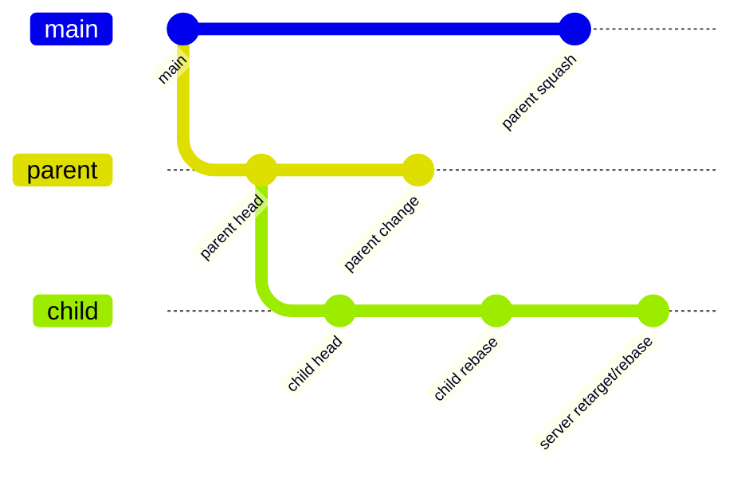
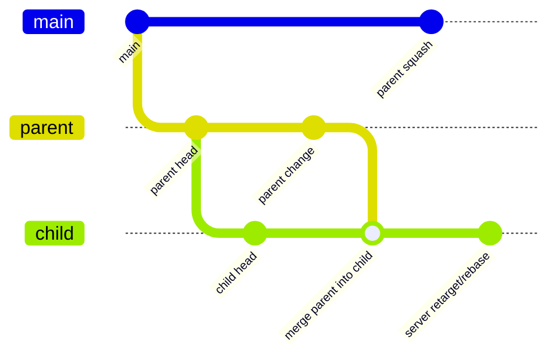

# 0599: Native stacks link whole chains and keep children current by merging

**What this decides:** Native stacks have no fixed layer limit, link bottom-to-top as a whole, and keep open children current with merge commits.

## Context

[0004](0004-squash-merges-and-native-stacks.md) says to catch up a stacked child by rebasing it.
GitHub's public docs describe linking the full chain bottom-to-top, updating a PR branch with a
merge commit, and GitHub retargeting and rebasing a child after its parent merges
([linking stacks](https://docs.github.com/en/pull-requests/reference/use-other-tools-with-stacked-pull-requests),
[updating a branch](https://cli.github.com/manual/gh_pr_update-branch),
[merging stacks](https://docs.github.com/en/pull-requests/how-tos/merge-and-close-pull-requests/merging-stacked-pull-requests)).

The owner has verified a direct three-layer exercise. That supports direct mode only. It is not a
protected three-layer result.

The earlier stack 1522 was observed with `failed_checks` and `stack_invalidated`. The
[T1115 field run](../field/runs/2026-11-16-t1115-stack-size-guard-hand.json) records the
four-layer, queue-build-two state and says no real stack was merged in that hand run. These
observations do not show that layer depth caused the failure.

## Decision

**Link native stacks as a whole and keep open children current by merging their parent's head.**

**Before:**



**After:**



The merge commit keeps an open child current. GitHub's server move after the parent squash is a
separate event.

```sh
# before
gh stack init <bottom> ... <top>
gh stack rebase

# after
gh stack link <bottom> <next> ... <top>
gh pr update-branch <child> # after source, queue and writer agree on the parent head
```

**Binding constraints**

- Link every layer in one command, bottom-to-top. Do not link only part of the chain.
- After source, queue and writer coordination on a parent's new head, update each open child with
  `gh pr update-branch <child>`. It creates a merge commit. Repeat up the chain. Do not add a fixed
  10-minute wait, rebase or force-push for this upkeep.
- After a parent squash, GitHub's server-side retarget and rebase are separate from that merge
  update. The owner of a step re-signs only when that step's signed tree links changed.
- Every layer still lands as a squash. Keep each layer's guards and the normal protected merge
  gates, including protected merge-group CI ([0162](0162-no-friction-before-a-merge.md)). The
  wrapper must send the top head SHA as `merge-async`'s `sha`
  ([asynchronous merge API](https://docs.github.com/en/rest/pulls/pulls?apiVersion=2026-03-10)).
- A merge queue may land a bottom-up prefix in one group and the remaining layers in later groups.
  Do not set a stack-depth limit from queue grouping or build concurrency.

## Consequences

Open children gain merge commits when their parents move. GitHub may still retarget and rebase a
child after its parent lands, so changed signed tree links need their step owner's signature again.
The separate source adaptation applies this rule in code. This ADR adds no product code or queue
setting.
