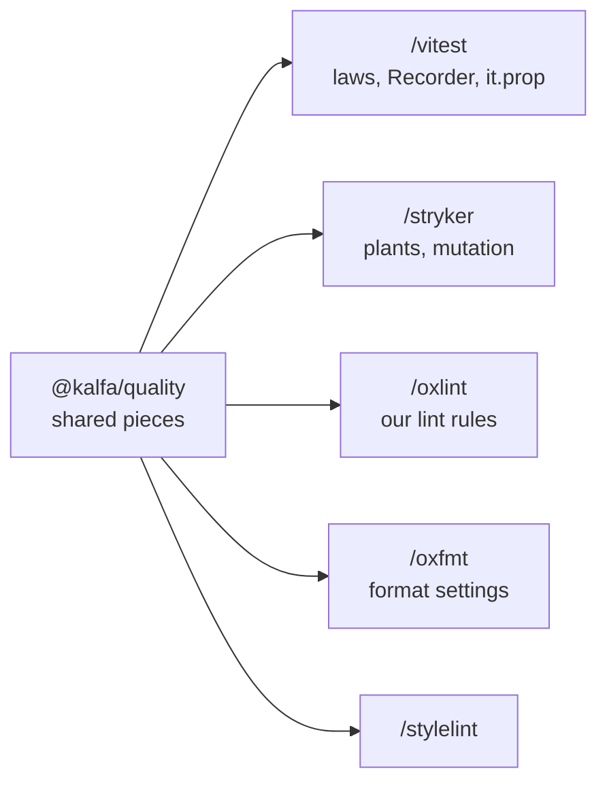

# 0600: Testing, linting and formatting live in one package, @kalfa/quality, with one subpath per tool, and its first build moves the plant runner onto Stryker



```ts
// A law file imports only what it uses; Stryker never loads unless a plant runs.
import { it } from "@kalfa/quality/vitest";
// A plant names its mutant by code shape, never by bytes or a commit.
import { plant } from "@kalfa/quality/stryker";
```

**What this decides:** where our test, lint and format tooling lives, how it is split, and what the
package builds first.

## Context

[0585](0585-kalfa-is-six-domain-packages.md) groups our tooling into domain packages, but two of
them were named after one tool each: `@kalfa/vitest` ([0557](0557-kalfa-vitest-is-the-test-toolbox.md))
and `@kalfa/oxlint`. Testing, linting and formatting all answer one question, whether the code is
good, so they are one domain.

The same day, a check that plants a bug to prove a law goes red failed on every pull request that
selected it. Its hand-written runner (`.github/ci/plant.ts` and its cases, from ticket 1133) pinned
each target by sha256 and by commit ancestry. A squash merge left the pinned commit off main, and
two blank lines in a fixture changed 27 pinned hashes. Nobody had weighed Stryker for it, as
[0040](0040-existing-tools-before-hand-written.md) asks. The pipeline's own Stryker driver
(`packages/pipeline/src/stages/mutation/stryker.ts`) already lists the mutants in a span, runs one
exact mutant against chosen test files and reads which test killed it. Of the runner's 16 cases, 5
plant into product code; 11 edit the test file's own fake.

## Decision

**One package, `@kalfa/quality`, holds testing, linting and formatting, with one subpath per tool.**

- The subpaths are `/vitest`, `/stryker`, `/oxlint`, `/oxfmt` and `/stylelint`. A new tool in this
  domain is a new subpath, never a new package. The package root holds only pieces two or more
  subpaths share, such as Schemas and settings.
- Each tool is an optional peer dependency, so a project installs only the tools it imports. This is
  how drizzle-orm ships one driver per subpath.
- It replaces `@kalfa/vitest` and `@kalfa/oxlint` with `@kalfa/quality/vitest` and
  `@kalfa/quality/oxlint`.
- **Its first build is the plant runner on Stryker**, in `/stryker`, built from the pipeline's
  driver:
  - A plant names its mutant by code shape. If the target is not found exactly once, the plant fails
    loudly. No byte pins and no commit pins.
  - The 5 product-code cases move to it. The 11 cases that edit a test's own fake are dropped: a
    plant goes in product code ([0093](0093-laws-walk-plants-run-once.md)).
  - Once they run there, the hand-written runner is deleted: `plant.ts`, `plant-cases.ts`,
    `plant-machine.ts`, `plant-related.ts`, `plant-errors.ts` and `.github/workflows/plant.yaml`.
  - The law those 11 cases pointed at ("successive sends land", in the checklist law file) gets its
    proof from the hourly mutation run, which adds `next/packages/libfabrika`
    ([0066](0066-mutation-runs-on-a-schedule.md)).

**Binding constraints**

- No subpath imports another tool's subpath. They meet only through the root.
- The driver comes over with no repo path baked in (0585): what is ours becomes a setting.

## Consequences

- 0557, 0579 and 0585 are amended in part: the package name and 0585's count of six.
  0585's build order changes only in that `/stryker` starts now, beside `@kalfa/config`.
- A breaking change in one tool bumps the whole package's major version. That matters only once it
  is published, and it stays private until the owner says publish (0556). If release coupling
  hurts, a subpath can split out with almost no import changes.
- Until the hourly run covers libfabrika, the "successive sends land" law has no planted proof. That
  gap is ticketed, not hidden.
- Not decided here: whether stylelint stays, and the shape of each subpath's exports beyond what
  0557 and 0579 already say.

## Records

- Glossary: the `kalfa` row names `@kalfa/quality` in place of `@kalfa/vitest` and `@kalfa/oxlint`.
