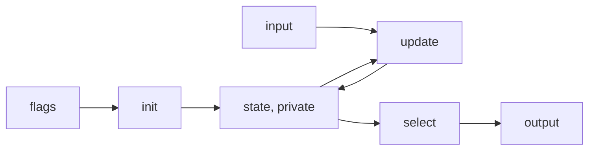

# 0601: In next/ and kalfa/, a program is three functions, init, update and select, that Program.make in @kalfa/program turns into flags => Stream of inputs => Stream of outputs, with tea underneath and never in its API



```ts
// @kalfa/program. A sketch: the names and shapes are decided, the exact generics are the plan's.
import type { Effect, Stream } from "effect";

type Init<Flags, State> = (flags: Flags) => State;
type Update<State, In, Err, Req> = (state: State, input: In) => Effect.Effect<State, Err, Req>;
type Select<State, Out, Err, Req> = (state: State) => Effect.Effect<Out, Err, Req>;

// What make answers. Started with its flags, a program is Stream => Stream.
type Program<Flags, In, Out, Err, Req> = (
  flags: Flags,
) => (inputs: Stream.Stream<In>) => Stream.Stream<Out, Err, Req>;

declare const Program: {
  readonly make: <Flags, State, In, Out, Err, Req>(spec: {
    readonly init: Init<Flags, State>;
    readonly update: Update<State, In, Err, Req>;
    readonly select: Select<State, Out, Err, Req>;
  }) => Program<Flags, In, Out, Err, Exclude<Req, Machine>>; // Machine: the escape hatch below
};
```

**What this decides:** what a program is at its core, before any fabrika part: its three functions,
how programs compose, what tea does under it, what runs it, and which package holds it.

## Context

The owner settled the program core in a design talk on 2026-11-17. He also ruled that the terms of
that talk are final: an older record that clashes with them is replaced where it clashes.

Why it came up:

- A program in `next/` today is spread over a hand-written tea machine and a long `Program.make`
  ([0256](0256-a-program-is-one-program-make.md) to
  [0260](0260-an-output-is-a-model-value.md)). Its author meets tea's Msgs, Cmds and cells.
- A program cannot run outside fabrika's app. Its runner needs seven services that only the app's
  worker wires ([0070](0070-flow-runner-stays-a-machine.md)).

What makes it safe to run an Effect `update` inside one tea Cmd. Each fact was read in the code:

- tea's logged store boots from the committed state and never runs a reducer or `init` again:
  `committedState` in demlik's `packages/tea/src/internal/persistence/durable-log/format.ts`.
- On boot it steps again only the messages not yet applied, and hands out again only the owed
  deliveries that survive: `packages/tea/src/internal/engine/loop.ts` in demlik.
- A handler is confirmed only after it finishes cleanly (`confirmEffect`, same file).
- So a crash in the middle of a step hands it out again under the same delivery id. Our ledger's
  append dedups on `(stream, id)` and answers `resent`
  (`next/packages/libfabrika/src/ledger/internal/ledgerStore.ts`), so a write the step made before
  the crash is not made twice.
- Long work uses tea's `owed()` and `dispatch(msg, { answerTo })`, from demlik's pull requests
  [982](https://github.com/kamp-us/demlik/pull/982) and
  [983](https://github.com/kamp-us/demlik/pull/983), both merged on 2026-11-17.

The known ways it follows: Elm's `init`, `update` and flags
([Elm guide, "Flags"](https://guide.elm-lang.org/interop/flags.html)); Cycle.js, whose `main` is a
function from sources to sinks; Redux's selectors, which derive a value from state; Effect's own
`Stream`, `Layer` and `ManagedRuntime`; and raw SQL under an ORM, for the escape hatch.

How it relates to older records. Each is amended in part, and only its `status:` line changes:

| Record | What still holds | What this replaces |
|---|---|---|
| [0046](0046-one-tea-machine-per-file.md) | Every other state machine is a tea machine, one per file | A program's state machine is written with `Program.make`, whose `make` makes its tea machine; its `update` may call services |
| [0070](0070-flow-runner-stays-a-machine.md) | The flow runner stays a tea machine, and the lead scripts have no `Program.make`, until a program runs outside the app | Its open item: what lets a program run outside the app is `@kalfa/program` and its runner, not a piece moved into libfabrika |
| [0253](0253-init-cmds-run-once-per-process.md) | A program has no `main` | `init` answers only a state, so a core program has no init Cmds |
| [0254](0254-tea-is-the-one-engine.md) | tea holds the state that moves; the bans on Effect `Workflow`, replay engines and actor runtimes; Effect under tea's Cmds | The deciding moves from a pure tea `update` into the program's Effect `update`, run inside one tea Cmd. Boot installs the committed state; it never folds facts through `update` |
| [0256](0256-a-program-is-one-program-make.md) | One `Program.make` in Effect's `X.make` style, never `defineProgram` or a plain object; nothing written twice | The exported `Machine.make` value, types read off it, and `view: (m) => ...`. Now three functions, types from schemas, and `select` |
| [0257](0257-a-programs-api-has-one-way.md) | The rule: one meaning per word, one way per job, links by reference or tsc, unused parts left out, `Program.make` only | The older shape's parts it names (`refuse`, the saved version, a Msg built from inputs) are not in the core |
| [0258](0258-inputs-are-plain-data.md) | An input is plain data; `personOnly: true` and the `FromPerson` brand, until fabrika's parts are placed | `Input.make`, `Input.group` and a Msg built from them. A program's inputs are one `Schema.TaggedUnion` that `update` takes |
| [0259](0259-each-event-brings-its-write.md) | `Fact` is `Event`; an event names its stream once | An event's write as a tea Cmd listed in a machine's `cmds`, and `Program.make` reading events off `cmds`. A program has no `cmds` |
| [0260](0260-an-output-is-a-model-value.md) | An output is picked from the state, is never a Cmd and is kept nowhere | An output is a case of `Out`, made by `select` as an Effect. When one is sent, and what `null` means, are open again |
| [0556](0556-kalfa-holds-our-tooling-packages.md) | The `@kalfa` scope, the `kalfa/` folder, all private | `@kalfa` also holds the program core, which is not tooling or infra |
| [0578](0578-tea-cell-answers-a-step.md) | Every hand-written tea cell answers a `Step`, through our tea patch | A program's `update` is not a cell. It answers an Effect of its next state |
| [0585](0585-kalfa-is-six-domain-packages.md) | The tooling packages by domain, the `kalfa` command, and the cap on tooling packages | `@kalfa/program` joins `kalfa/` beside them, as the program core |

Three direction notes change their `state:` line the same way:
[a program's shape](../docs/direction/program-shape.md),
[tea is the engine](../docs/direction/tea-is-the-engine.md) and
[init runs once per process](../docs/direction/init-runs-once-per-process.md).
[tea-program](../docs/direction/tea-program.md) is not changed: it covers today's version only, and
this record does not touch today's version.

## Decision

**A program is three functions, `init`, `update` and `select`. `Program.make({ init, update, select })`
turns them into a `Program`: a function from flags to a function from a stream of inputs to a stream
of outputs (owner, 2026-11-17).**

### The three functions

- `init: (flags: Flags) => State` makes the first state from the flags. The word is `Flags`, Elm's
  word for what `init` is started with.
- `update: (state, input: In) => Effect<State, Err, Req>` takes one input and answers the next
  state. It is the one place a program decides.
- `select: (state) => Effect<Out, Err, Req>` picks the output from the state. It is an Effect, so it
  has the same shape as `update`.
- **The state is private.** Nothing outside the program reads it or writes it. Others see only its
  outputs.

### Schemas first

- Inputs and outputs are tagged unions, made with Effect's `Schema.TaggedUnion`, with the same shape
  on both sides.
- The schemas come first, so every type is inferred from them. Nobody writes a type by hand.

### Programs compose as streams

- Started with its flags, a program is `Stream => Stream`. Programs compose with Effect's own
  `Stream` tools: `pipe`, `merge`, `broadcast`, `filter`.
- A chain of programs is itself a program.
- A test is a stream of inputs in and the collected outputs out.

```ts
// A sketch: a counter.
const In = Schema.TaggedUnion({ add: { n: Schema.Int }, reset: {} });
const Out = Schema.TaggedUnion({ count: { n: Schema.Int } });

export const counter = Program.make({
  init: (flags: { readonly start: number }) => ({ n: flags.start }),
  update: (state, input: typeof In.Type) =>
    Effect.succeed(
      In.match(input, {
        add: ({ n }) => ({ n: state.n + n }),
        reset: () => ({ n: 0 }),
      }),
    ),
  select: (state) => Effect.succeed(Out.cases.count.make({ n: state.n })),
});

// The test: a stream of inputs in, the outputs collected.
const inputs = Stream.make(In.cases.add.make({ n: 2 }), In.cases.reset.make({}));
const outputs = inputs.pipe(counter({ start: 1 }), Stream.runCollect);
```

### tea underneath, never in the API

- **Interacting with a program never uses a tea concept:** no Msg, no Cmd, no machine, no cell, no
  `Step`.
- tea is how it runs. `make` makes a small tea machine. It runs the Effect `update` inside one tea
  Cmd, the step, and the step's logged answer installs the new state.
- Long work uses tea's `owed()`: the step's handler answers owed, and the answer comes later through
  `dispatch(msg, { answerTo })`.
- People may still import tea for their own needs.
- **The escape hatch.** A program may reach its own machine through a `Context.Service`, `Machine`,
  which `make` provides for each running program, as raw SQL sits under an ORM. It shows in
  `update`'s `Req`, never in the `Program`'s.

### The runner

- **It has two jobs:** it provides the Layers for `Req`, and it plumbs the streams, from an inputs
  source to an outputs sink.
- It takes the started form, `Stream => Stream`.
- There is one Layer bundle per place: a Durable Object, Node, a browser tab, a test.
- It is to a program what react-dom's `createRoot(el).render(app)` is to a component tree, with
  Effect's `ManagedRuntime` providing the Layers.

### Where it lives

- The core lives in `kalfa/program`, as `@kalfa/program`, `"private": true` for now.
- `@kampus/libfabrika` keeps its name. An `@libfabrika/*` scope waits until packages move to their
  own repos.

**Binding constraints:**

- A program's API holds no tea word. Only `Machine` reaches tea, and only through `update`'s `Req`.
- A program's state is seen only through its outputs.
- Every type of a program is inferred from its schemas, never written by hand.
- `make` never runs a step tea has confirmed again. Boot installs the committed state.
- The runner provides Layers and plumbs streams. Deciding stays in `update`.

## Consequences

These are the lead's reading of what follows from the ruling. They are not the owner's words.

- **`@kalfa/program` gets its own plan,** with type tests that settle the exact generics and how
  `make` takes the schemas, so the hand-written annotations in the counter sketch go too.
- **The installed tea, 0.27.0, has neither `owed()` nor `answerTo`.** They are on demlik's main. The
  build takes the release that ships them, or patches tea locally until then
  ([patch upstream locally](../docs/direction/patch-upstream-locally.md)).
- **Each program in `next/` moves onto the core** in its own slices, in the lead's order. Today's
  version is not touched ([0217](0217-next-grows-beside-today.md)).
- **0070's seven services split along the runner's two jobs.** `ProcessStore`, `CheckedWriter`,
  `Recording` and `Alarm` become Layers. `Mailbox`, `WatcherManager` and `ProcessManager` become
  plumbing.
- **An event's write is an Effect inside `update`,** through a service in its `Req`. A step handed
  out again after a crash writes again, and the ledger answers `resent`.
- **The cost:** every program in `next/` is rewritten, and nothing is proven on a real program yet.
- **Not decided here:**
  - Several outputs per program, and sending an output only when it changes.
  - The name of the piece that pairs a Cmd with its handler, for named work with schemas that
    `update` waits on. It is not "Activity" and not "Work".
  - How fabrika's parts (person-only, the desk, keys) sit on top of the core, as annotations.
  - Splitting the glossary into one per project: the program core, fabrika, and kalfa with its
    tooling.

## Records

- `.glossary/TERMS.md`: a new Program core section with `Program (program core)`, `Flags`,
  `init (program core)`, `update (program core)`, `select (program core)` and
  `runner (program core)`; the `kalfa` row gains `@kalfa/program`; the Runtime rows `program` and
  `output` point here; the context map gains `program`, `init`, `select` and `step`.
