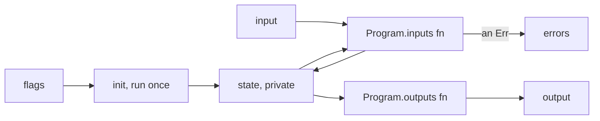

# 0601: In next/ and kalfa/, a program is Program.make(name)(fn) in Effect.fn's shape with optional inputs, outputs and errors pipes, started as Stream to Stream on a tea it never names, and kalfa defines it, the ledger and the transport as protocol packages that libfabrika implements



```ts
// Stateful: the first function is init; the pipes add the rest.
const checklist = Program.make("checklist")((flags: Flags) =>
  Effect.succeed({ title: flags.title, items: [] }),
).pipe(
  Program.inputs(ChecklistIn, (state, input) =>
    ChecklistIn.match(input, {
      add: ({ name }) => add(state, name),
      check: ({ name }) => check(state, name),
    }),
  ),
  Program.outputs(Progress, (state) =>
    Effect.succeed({ left: open(state).length }),
  ),
  Program.errors(NotFound),
);

// Stateless: nothing piped; the first function runs per input.
const badge = Program.make("badge")(
  (flags: BadgeFlags, p: Progress) =>
    Effect.succeed(label(p.left, flags.short)),
);

// Stream<ChecklistIn> => Stream<Progress>
const started = checklist({ title: "groceries" });
```

**What this decides:** what a program is and how it is written, how it fails, what tea does under
it, what runs it, and which packages define the program, the ledger and the wire.

## Context

The owner settled the program core in a design talk on 2026-11-17 and 2026-11-18, and ruled the
final program API on 2026-11-18. He also ruled that the terms of that talk are final: an older
record that clashes with them is replaced where it clashes.

Why it came up:

- A program in `next/` today is spread over a hand-written tea machine and a long `Program.make`
  ([0256](0256-a-program-is-one-program-make.md) to
  [0260](0260-an-output-is-a-model-value.md)). Its author meets tea's Msgs, Cmds and cells.
- A program cannot run outside fabrika's app. Its runner needs seven services that only the app's
  worker wires ([0070](0070-flow-runner-stays-a-machine.md)).

What makes it safe to run a program's Effects inside one tea Cmd. Each fact was read in the code:

- tea's logged store boots from the committed state and never runs a reducer or `init` again:
  `committedState` in demlik's `packages/tea/src/internal/persistence/durable-log/format.ts`.
- On boot it steps again only the messages not yet applied, and hands out again only the owed
  deliveries that survive: `packages/tea/src/internal/engine/loop.ts` in demlik.
- A handler is confirmed only after it finishes cleanly (`confirmEffect`, same file).
- So a crash in the middle of a step hands it out again under the same delivery id. Our ledger's
  append dedups on `(stream, id)` and answers `resent`
  (`next/packages/libfabrika/src/ledger/internal/ledgerStore.ts`), so a write the step made before
  the crash is not made twice.
- tea's Journal (`read`, an atomic `append`, `appendFenced`) is in demlik's
  `packages/tea/src/internal/journal/index.ts`, so it maps onto one ledger turn.
- Long work uses tea's `owed()` and `dispatch(msg, { answerTo })`, from demlik's pull requests
  [982](https://github.com/kamp-us/demlik/pull/982) and
  [983](https://github.com/kamp-us/demlik/pull/983). Both merged after tea 0.29.0 was published,
  so 0.29.0 does not ship them. The build moves tea to 0.29.0 for the logged store, and long work
  through `owed()` and `answerTo` waits for the next demlik release or a local `pnpm patch`.

The known ways it follows:

- Effect's `Effect.fn` for the shape, and Effect's `Rpc`, `Tool` and `Workflow`, which take a name
  first. Effect's `Rpc` also keeps success, error and defect apart, and keeps its `Protocol`
  services apart from its Layers for HTTP, sockets, workers and stdio.
- Elm's flags ([Elm guide, "Flags"](https://guide.elm-lang.org/interop/flags.html)) and a Redux
  reducer, one function from state and input to the next state.
- Cycle.js, whose `main` is a function from sources to sinks.
- Unix's stdin, stdout and stderr for inputs, outputs and errors.
- OTP's supervisors, and its `init` that answers `{stop, Reason}`.
- React's error boundary, for a fallback in a program's place.
- Jay Kreps, "The Log" (2013), for the ledger as the storage primitive. Ink & Switch's local-first
  software (2019) and Linear's sync engine, for a copy in each place.
- Effect's own split: `effect` defines `FileSystem`, and `@effect/platform-node` implements it.
  Effect's one big standard library package is the part we do not copy.

How it relates to older records. Each is amended in part, and only its `status:` line changes:

| Record | What still holds | What this replaces |
|---|---|---|
| [0016](0016-tier-1-supervision-is-otps-top-level-supervisor.md) | OTP's supervisor as the model, and a person restarts a name past its limit | A restart inside intensity at once, with no backoff. The policy is a `Schedule` in a Layer, so it may back off |
| [0046](0046-one-tea-machine-per-file.md) | Every other state machine is a tea machine, one per file | A program is written with `Program.make`, whose `make` makes its tea machine; its functions may call services |
| [0070](0070-flow-runner-stays-a-machine.md) | The flow runner stays a tea machine, and the lead scripts have no `Program.make`, until a program runs outside the app | Its open item: kalfa defines the program, the ledger and the wire, and libfabrika implements them |
| [0253](0253-init-cmds-run-once-per-process.md) | A program has no `main` | `init` is an Effect run once, with no init Cmds. If it fails, the process does not start |
| [0254](0254-tea-is-the-one-engine.md) | tea holds the state that moves; the bans on Effect `Workflow`, replay engines and actor runtimes; Effect under tea's Cmds | The deciding moves from a pure tea `update` into the program's Effects, run inside one tea Cmd. Boot installs the committed state; it never folds facts through `update` |
| [0256](0256-a-program-is-one-program-make.md) | One `Program.make` in Effect's `X.make` style, never `defineProgram` or a plain object; nothing written twice | The exported `Machine.make` value, types read off it, and `view: (m) => ...`. Now `Program.make(name)(fn)` and its pipes, types from schemas |
| [0257](0257-a-programs-api-has-one-way.md) | The rule: one meaning per word, one way per job, links by reference or tsc, unused parts left out, `Program.make` only | The older shape's parts it names (`refuse`, the saved version, a Msg built from inputs) are not in the core |
| [0258](0258-inputs-are-plain-data.md) | An input is plain data; `personOnly: true` and the `FromPerson` brand, as fabrika's own rules | `Input.make`, `Input.group` and a Msg built from them. A program's inputs are one schema that `Program.inputs` takes |
| [0259](0259-each-event-brings-its-write.md) | `Fact` is `Event`; an event names its stream once | An event's write as a tea Cmd listed in a machine's `cmds`, and `Program.make` reading events off `cmds`. A program has no `cmds` |
| [0260](0260-an-output-is-a-model-value.md) | An output is picked from the state, is never a Cmd and is kept nowhere | An output is made by `Program.outputs`' Effect, the first one right after `init`; without `outputs` it is the state. Whether one is sent only on change, and what `null` means, are open |
| [0556](0556-kalfa-holds-our-tooling-packages.md) | The `@kalfa` scope, the `kalfa/` folder, all private | `@kalfa` also holds small libraries of one domain each, which are not tooling or infra |
| [0578](0578-tea-cell-answers-a-step.md) | Every hand-written tea cell answers a `Step`, through our tea patch | A program's functions are not cells. They answer Effects |
| [0585](0585-kalfa-is-six-domain-packages.md) | The tooling packages by domain, the `kalfa` command, and the cap on tooling packages | `@kalfa/program`, `@kalfa/ledger` and `@kalfa/transport` join `kalfa/` beside them |

Four direction notes change their `state:` line the same way:
[a program's shape](../docs/direction/program-shape.md),
[tea is the engine](../docs/direction/tea-is-the-engine.md),
[init runs once per process](../docs/direction/init-runs-once-per-process.md) and
[the five layers](../docs/direction/a-local-first-sync-engine.md), whose "central first" gives way
to a copy in each place. [tea-program](../docs/direction/tea-program.md) is not changed: it covers
today's version only, and this record does not touch today's version.

## Decision

**A program is `Program.make("name")(fn)`, in `Effect.fn`'s shape, and three optional pipes add the
rest: `Program.inputs`, `Program.outputs` and `Program.errors` (owner, 2026-11-18).**

### The program

- **The name comes first,** as in Effect's `Rpc`, `Tool` and `Workflow`. The `Supervisor` and the
  records use it.
- **Every pipe is optional.** `Program.inputs(Schema, (state, input) => Effect<State>)` adds
  memory. `Program.outputs(Schema, (state) => Effect<Out>)` adds a view. `Program.errors(Schema)`
  adds the error schema.
- **The pipe decides what the first function is.** With `inputs` piped, it is `init`,
  `(flags) => Effect<State>`, run once; a generator is fine. With nothing piped, it is
  `(flags, input) => Effect<Out>`, run for each input.
- **Without `outputs`, the output is the state.** With it, the first output comes right after
  `init`: `outputs` on the starting state.
- **`inputs` takes one function.** The author matches inside it with the union's own `match`. No
  bag of handlers and no object of functions is the API. It reads like a Redux reducer.
- **The functions are plain `Effect.gen`.** One fails with `return yield* new NotFound({ name })`,
  where `NotFound` is a `Schema.TaggedError`. A pure `Result` is only for a piece pulled out on
  purpose.

```ts
// A sketch: check, from the example, as plain Effect.gen.
class NotFound extends Schema.TaggedError<NotFound>()(
  "NotFound",
  { name: Schema.String },
) {}

const check = (state: State, name: string) =>
  Effect.gen(function* () {
    const known = state.items.some((item) => item.name === name);
    if (!known) {
      return yield* new NotFound({ name });
    }
    const items = state.items.map((item) =>
      item.name === name ? { name, done: true } : item,
    );
    return { ...state, items };
  });
```

- **Schemas first.** Every type is inferred from the schemas, and nobody writes one by hand. The
  word for init's argument is `Flags`.
- **The state is private and has a schema,** because tea saves it. Before v0.0.0 a change to a
  saved shape wipes the data ([0572](0572-pre-release-shape-change-wipes-data.md)).

### Programs compose as streams

- Started with its flags, a program is `Stream<In> => Stream<Out>`. Programs compose with Effect's
  own `Stream` tools, and a chain of programs is a program.
- A test is `Stream.make(...)`, the program, then `Stream.runCollect`.
- A window is a loop around a program, closed with a `Queue`, as in Cycle.js. A click is an input.
- The wire protocol is the data: tagged JSON that the schemas describe. A program in another
  language, such as Rust, can speak it.

### Errors

- **A program has the Unix set: inputs, outputs and errors.** `errors` is a sink typed by the
  `Program.errors` schema. The runner plumbs it as it plumbs `outputs`.
- **An Err goes to `errors`, and the program keeps going.** The step is confirmed, and the state
  stays as it was.
- **`Effect.orDie` is how an author says "I can't go on".** A defect leaves the step unconfirmed,
  so tea hands it out again on the next boot.
- **`Program.supervise(child)` lives in `@kalfa/program`.** It is a loop on `Stream.catchCause` and
  `Cause.hasDies`, with one input queue the child's runs share. On a defect it asks the
  `Supervisor` service `died(name, cause)`, which answers `restart { after }` or `stop`. Nested
  supervisors give OTP's escalation.
- **The policy and the records are the implementation's job.** The policy is a `Schedule` given by
  a Layer, so it may back off. libfabrika's `Supervisor` records to the ledger, writing the rows
  0016 and [0593](0593-a-program-does-not-pay-for-its-supervisors-bookkeeping.md) name. A test
  version keeps its answers in memory.
- **A fallback in a program's place,** like React's error boundary, is `Stream.catchCause` around
  it.

### tea underneath, never in the API

- `make` makes a small tea machine. `init` runs as its first step, and each input's function runs
  inside one tea Cmd, the step. A busy flag and a queue keep it to one input at a time.
- A step ends one of three ways. On success it answers the new state. A typed Err is caught,
  answered as a normal message, confirmed and sent to `errors`, with the state unchanged. A defect
  leaves the step unconfirmed.
- Boot installs the committed state and runs neither a reducer nor `init` again. So a confirmed
  step runs once, and so does `init`.
- If `init` fails, the process does not start, as OTP's `init` answers `{stop, Reason}`.
- **Interacting with a program never uses a tea concept.** `Machine`, a `Context.Service` that
  `make` provides for each run, is the escape hatch, as raw SQL sits under an ORM. It shows in the
  functions' `Req` only, never in the program's. Anyone may still import tea.
- **tea needs no change for any of this.** It is a data structure we drive.

### The process

- A program and its running copies are one domain, as a class and its instances are. Erlang's
  `spawn`, `link`, `monitor` and `register` are runtime functions too.
- A process has an id, a mailbox, outputs and errors anyone can hear, a life with an exit reason,
  monitors and children.
- `next/`'s process layer (`next/packages/libfabrika/src/processes`) already splits each service
  from its ledger and test versions. Its protocol moves to kalfa. Its ledger files stay as
  fabrika's implementation.
- Pipes ride mailboxes ([0109](0109-a-pipe-is-saved-program-mail.md)). In one place, a pipe is
  `Stream` composition. Across processes, it is Sends into the other process's inbox, and a Send is
  a ledger append with an id.

### The runner

- **It has two jobs:** it provides the Layers for `Req`, and it plumbs inputs, outputs and errors.
- It takes the started form. It is to a program what react-dom's `createRoot(el).render(app)` is to
  a component tree, with a `ManagedRuntime` providing the Layers.
- There is one Layer bundle per place: a Durable Object, Node, a browser tab, a test.

### Storage, in `@kalfa/ledger`

- **The ledger is the storage primitive:** `append`, `read`, `wait`, `transact` and `streams`, with
  appends deduped by id. `@kalfa/ledger` defines it, with `LedgerTransaction`, the schemas and a
  memory version.
- **Who may write what is a `WritePolicy` service** in `@kalfa/ledger`. fabrika implements its
  person-only rules.
- **Every journal sits on the ledger.** A process has one journal stream, with one writer, and one
  inbox stream, with many writers. tea's Journal maps onto a ledger turn, and the adapter is a
  libfabrika Layer.
- **Local first.** Each place keeps a copy and writes to it at once. Logs with ids merge by union.
  A journal's local order is its order, and shared streams wait for their home's order. One process
  runs in one place at a time, and `appendFenced` shows a second writer.
- On the laptop the copy is a ledger Durable Object in local workerd, through Alchemy
  ([0042](0042-platform-pieces-go-through-alchemy.md)). `node:sqlite` stays for tests and the span
  queue.

### The wire, in `@kalfa/transport`

- **A transport is a protocol plus Layers,** as Effect's `Rpc` is.
- **A socket is one end of a connection,** Effect's `Socket`, and the transport makes it.
- **WebSocket and WebRTC Layers both come in the first slice.**
- Signaling goes over the WebSocket to the ledger's Durable Object, which also relays when two apps
  cannot reach each other.
- Every fabrika app is Chromium, so two people's apps can talk directly. Two ledger copies can sync
  directly too, while the Durable Object gives the final order.
- A process can be reachable on several transports at once.

### Durable Objects as the model

- **Design as if every place had Durable Objects.** Later, a browser piece offers exactly this
  list:
  1. One instance per name, found by name: a process's id and address.
  2. One thing at a time inside: the busy flag and the queue.
  3. Its own storage, with atomic writes: the journal, as ledger turns.
  4. Alarms: deadlines.
  5. It wakes on a message and sleeps otherwise
     ([0105](0105-a-durable-object-never-stays-awake-on-its-own.md)): boot from the journal on each
     wake.
  6. Reachable from anywhere by a stub: a Send to a process's inbox.
- A Durable Object is a program, compute with its own storage. The Worker is the entrypoint, our
  door.

### Packages and boundaries

- **kalfa holds small libraries, one domain each.** Each is a protocol, as Effect services, plus a
  test version: `@kalfa/program`, `@kalfa/ledger` and `@kalfa/transport`. All are
  `"private": true` for now.
- **`@kalfa/program`** holds programs and their running instances, `Program.supervise`, and the
  `Supervisor`, `Journal`, `Errors` and `Machine` services.
- **No kalfa package imports another.**
- **libfabrika implements them and joins them:** the ledger on Durable Objects, the Journal on the
  ledger, the `Supervisor` with its records, and the WebSocket and WebRTC Layers. The goal is
  `fabrika.run(checklist)`, with everything provided.
- `@kampus/libfabrika` keeps its name. An `@libfabrika/*` scope waits until packages move to their
  own repos.
- The name `@kalfa/transport` is the lead's pick, not the owner's ruling.

**Binding constraints:**

- A program is written only as `Program.make(name)(fn)` with its pipes. Never a bag of handlers or
  an object of functions.
- A program's API holds no tea word. Only `Machine` reaches tea, and only through its functions'
  `Req`.
- An Err never stops a program; it goes to `errors`. Only a defect stops one.
- `make` never runs a confirmed step or `init` again. Boot installs the committed state.
- No kalfa package imports another. libfabrika joins them.
- The runner provides Layers and plumbs streams. Deciding stays in the program.

## Consequences

These are the lead's reading of what follows from the ruling. They are not the owner's words.

- **The build order:** tea from 0.27.0, the installed version, to 0.29.0; `@kalfa/program`'s v0;
  `@kalfa/ledger`; `@kalfa/transport` with WebSocket and WebRTC; then libfabrika joins them, with
  the journal on the ledger, the ledger-backed `Supervisor`, and the process protocol moved up.
- **Each package gets its own plan,** with type tests that settle the exact generics and how `make`
  is given the state's schema.
- **An event's write is an Effect inside a program's function,** through a service in its `Req`. A
  step handed out again after a crash writes again, and the ledger answers `resent`.
- **Each program in `next/` moves onto the core** in its own slices, in the lead's order. Today's
  version is not touched ([0217](0217-next-grows-beside-today.md)).
- **The cost:** every program in `next/` is rewritten, `next/`'s process layer splits in two, and
  nothing is proven on a real program yet.
- **Not decided here, a direction the owner liked whose types are the lead's:** the cut line,
  `clicks.pipe(checklist(flags), encode(Progress), socket, decode(Progress), badge({}))`. encode
  and decode would be stateless programs, with serialization kept apart from the protocol, as
  Effect's `Rpc` keeps `Protocol` apart from `RpcSerialization`.
- **Not decided here, the lead's take:** an address names who, a process, not where. A registry
  turns who into where, as a fold over the `started` and `exited` facts the runner appends. WebRTC
  signaling could be Sends through the ledger.
- **Not decided here, still open:**
  - The name of the piece that pairs a Cmd with its handler, for long work through `owed()` and
    `answerTo`. It is not "Activity" and not "Work".
  - Private answers: the answer to long work comes back as an input, and outsiders must not be able
    to send that input.
  - Several outputs: the tracker shows `rows` and `selected` at once, as a struct of outputs or a
    union. Sending only on change would be Effect's `Stream.changes`.
  - How a process is told to stop, as OTP's child spec says `brutal_kill` or a timeout. A started
    program already ends when its input stream ends.
  - Where `LedgerSql` lives. It runs on any SQL handle, so it could ship in `@kalfa/ledger`;
    this is decided when the folder is split.
  - Takeover: the same process open on two devices, under the one-writer rule.
  - Each project gets its own glossary later: the program core, fabrika, and kalfa with its
    tooling. When is not decided.

## Records

- `.glossary/TERMS.md`, the Program core section: the `Program (program core)`,
  `init (program core)` and `runner (program core)` rows change; `Program.make`,
  `inputs (program core)`, `outputs (program core)`, `errors (program core)`, `supervise`,
  `Supervisor` and `socket` are new; the `update` and `select` rows go. The `kalfa` row names the
  three libraries, the Runtime rows `program` and `output` point here, and the context map has
  `program`, `init`, `inputs and outputs`, `step` and `supervisor`.
