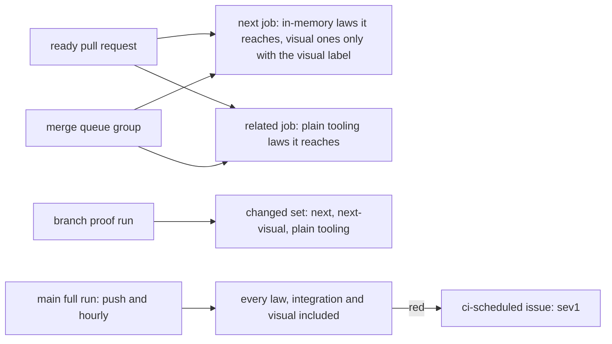

# 0602: Integration laws run only in main's full run, never on a pull request, in the merge queue or in a branch's proof run, and visual laws run on a pull request only when it carries the visual label

**Before:**


**After:**



```ts
// The two merge-line changes, from their pull requests, cut short.
// .github/ci/related.ts (PR 1613): a pull request or a queue group picks tooling only
const projectsOf = (event: string | undefined): readonly Project[] =>
  event === "pull_request" || event === "merge_group" ? ["tooling"] : PROJECTS;

// .github/ci/legs.ts (PR 1615): visual legs only on a push, or on a labeled pull request
const visual = (run: Run) => LINE.has(run.event) || run.visual; // before
const visual = (run: Run) => run.event === "push" || (run.event === "pull_request" && run.visual); // after

// A sketch, for the follow-up: .github/ci/proof.ts, a branch's proof run
export const PROJECTS = ["next", "next-integration", "next-visual", "tooling"] as const; // before
export const PROJECTS = ["next", "next-visual", "tooling"] as const; // after
```

What moves: every `.integration.` law leaves the runs before the merge, and visual laws leave them
unless a pull request asks for them. Main's full run keeps them all.

**What this decides:** where integration and visual laws run in today's CI: integration laws only
after the merge, on main, and visual laws before the merge only when a pull request asks.

## Context

During a sev0 on 2026-11-18, slow integration laws kept turning the merge line red on code the pull
requests never touched:

- The L11 storage law in `next/apps/fabrika/src/start-child.laws.integration.test.ts` runs close to
  its 60-second limit (`testTimeout: 60_000` in `vitest.config.ts`). It failed 9 pull request and
  merge-line runs that night, against 5 passes.
- The watcher's L17 and L18 laws in
  `next/packages/libfabrika/src/node/dev/watch.laws.integration.test.ts` failed the merge queue runs
  of [PR 1494](https://github.com/kamp-us/tea-fabrika/pull/1494) and
  [PR 1593](https://github.com/kamp-us/tea-fabrika/pull/1593), and a run of
  [PR 1525](https://github.com/kamp-us/tea-fabrika/pull/1525).

The job that ran them is `related` in `.github/workflows/check.yaml`. Its `select` job picks the
files through `.github/ci/related.ts`, which lists the `next-integration` and `tooling` laws a change
reaches on every ready pull request and merge queue group. The `tooling` project holds three
`.integration.` files of its own: `.agents/skills/lead/scripts/records-readonly.integration.test.ts`,
`.github/ci/workflow-lint/scheduled.integration.test.ts` and `scripts/typecheck.integration.test.ts`.
[PR 1581](https://github.com/kamp-us/tea-fabrika/pull/1581) (ticket 1155) added the `related` job,
and it also started the visual legs on every pull request and queue group. Before that,
[0590](0590-a-branch-proof-run-runs-only-what-its-change-reaches.md) had put real-instance laws into
a branch's proof run, which `land.ts arm` takes as a pull request's proof.

The owner ruled that integration laws move back to the scheduled runs. The same principle covers
visual laws, which reach a browser or Electron: they leave too, unless a pull request asks.

No decision file records the `related` job's integration legs or the visual legs on every pull
request. The binding line of [0536](0536-real-resource-tests-run-only-on-the-schedule.md),
[0581](0581-main-full-run-starts-on-push-and-hourly.md) and
[0584](0584-a-tests-kind-follows-what-it-uses.md) still says no pull request or merge queue run
starts a law that reaches a real thing. 0536 makes visual laws opt-in on a pull request, and 0584
keeps a tooling law that starts a process on the full run. This decision brings the merge line back
to those lines, so those three are not marked. It changes part of three others:

- [0534](0534-the-merge-line-runs-changed-tests-a-schedule-runs-all.md) set the merge line to run
  the tests a change reaches. Integration laws, and visual laws on an unlabeled pull request, now
  leave that set.
- [0590](0590-a-branch-proof-run-runs-only-what-its-change-reaches.md) put real-instance laws in a
  branch's proof run. They leave it.
- [0598](0598-merge-line-leaves-scheduled-groups.md) sized the merge line's legs per ready run,
  seven of them `related`. Only the plain tooling legs of `related` stay, and an unlabeled pull
  request starts no visual leg.

[0535](0535-pull-requests-stay-fast-the-schedule-carries-the-rest.md) asks for fast checks on the
merge line. This decision fits it and does not change it.

### The known way

Google splits tests into presubmit and post-submit
([Software Engineering at Google, chapter 23](https://abseil.io/resources/swe-book/html/ch23.html)).
Before a change is submitted, it runs "only fast, reliable ones", mostly the small tests of the
project being changed. After the submit, its continuous system (TAP) runs every affected test,
"including larger and slower tests". Post-submit accepts longer times and some flakiness, as long
as something deals with a red result. Here, a small test is a plain law, and medium and up are
`.integration.` or `.visual.` (0584, after the book's chapter 11). Main's full run is the
post-submit run, and its `ci-scheduled` issue is what deals with a red result.

## Decision

**No pull request run, merge queue run or branch proof run starts an `.integration.` law, in
`next/` or in our tooling, even one its change reaches. Visual laws run on a pull request only when
it carries the `visual` label, and never in the merge queue. Main's full run runs every integration
and visual law, and a red one opens its `ci-scheduled` issue, a sev1, as today.**

- **Ready pull request and merge queue, `related` job:** it stops selecting `next-integration`
  files and tooling `.integration.` files. It keeps the plain tooling laws a change reaches.
- **Plain tooling laws:** their routing does not change here.
- **Ready pull request and merge queue, `next` job:** it keeps the in-memory laws a change reaches.
  Its visual legs start on a pull request only when it carries the `visual` label
  ([0536](0536-real-resource-tests-run-only-on-the-schedule.md)), and never in a queue group.
- **A push to main's own `check.yaml` run is not changed here.**
- **A branch's proof run** (`scheduled.yaml` started on a branch, 0590) leaves `.integration.` files
  out, on a changed set and on a full set. `land.ts arm` asks for no integration law, through either
  of its routes.
- **Main's full run does not change:** `scheduled.yaml` on a push to main and on the hourly
  catch-up (0581), the run older records call the 3-hour schedule. It runs every integration and
  visual law at full depth.
- **A red law on main's full run** opens or updates the one `ci-scheduled` issue
  ([0534](0534-the-merge-line-runs-changed-tests-a-schedule-runs-all.md)), which is a sev1. The fix
  goes forward on main ([0544](0544-every-reviewed-pull-request-is-armed.md)).
- **A slow or flaky law is still fixed the day it is seen**
  ([0036](0036-a-flaky-test-is-fixed.md)). Leaving the merge line does not excuse it.

**Binding constraints:**

- No pull request, merge queue or branch proof run starts an `.integration.` law.
- No merge queue run, and no pull request run without the `visual` label, starts a visual law.
- Main's full run never drops either kind.

## Consequences

- **What is lost:** a break that only an integration or visual law shows reaches main. It shows on
  main's next full run, within about an hour of the push, not before the merge. This is the trade
  0536 made. A pull request that wants its visual laws first adds the label.
- A change to the checklist plant files (`.github/ci/plant*.ts`) no longer runs the checklist law
  before the merge, as `wantsChecklistLaw` in `.github/ci/related.ts` did. Main's full run runs it.
- The `related` job shrinks to its plain tooling legs, at most two (`MOST_TOOLING: 2` in
  `check.yaml`), and an unlabeled pull request starts no visual leg. A pull request no longer waits
  on either.
- The L11 and L17/L18 laws still owe their fixes under 0036. A red one now opens the sev1 issue
  instead of holding a merge.
- **The builds,** in today's CI, one writer of `check.yaml` at a time (0598):
  - [PR 1613](https://github.com/kamp-us/tea-fabrika/pull/1613) takes `next-integration` out of the
    `related` job on pull requests and queue groups, in `.github/ci/related.ts`.
  - [PR 1615](https://github.com/kamp-us/tea-fabrika/pull/1615) takes the visual legs out of the
    `next` job on an unlabeled pull request and on every queue group, in `.github/ci/legs.ts` and
    the `next` matrix's fallback in `check.yaml`.
  - A follow-up on branch `fabrikalfa/integration-off-proof-arm` takes tooling `.integration.`
    files off pull requests and the merge line, and `.integration.` files out of a proof run's sets
    (`.github/ci/proof.ts`) and of what `land.ts arm` (`.agents/skills/lead/scripts/pr/Arm.ts`)
    checks. The glossary's `changed set` row, which lists `next-integration`, changes with it.
- 0534, 0590 and 0598 are marked `amended-in-part by` this file.
- **Not decided here:** the host workflow's real-machine laws, which
  [0178](0178-host-only-laws-run-first.md) and [0594](0594-safe-checks-direct-mac-ci.md) run
  before the first review, and whether a branch's proof run keeps its visual laws. This decision
  covers the pull request check, the merge queue and the proof run's integration laws.
