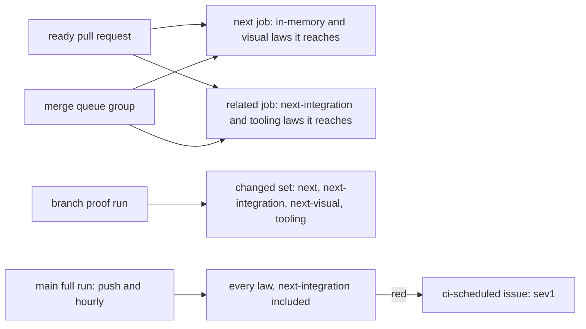
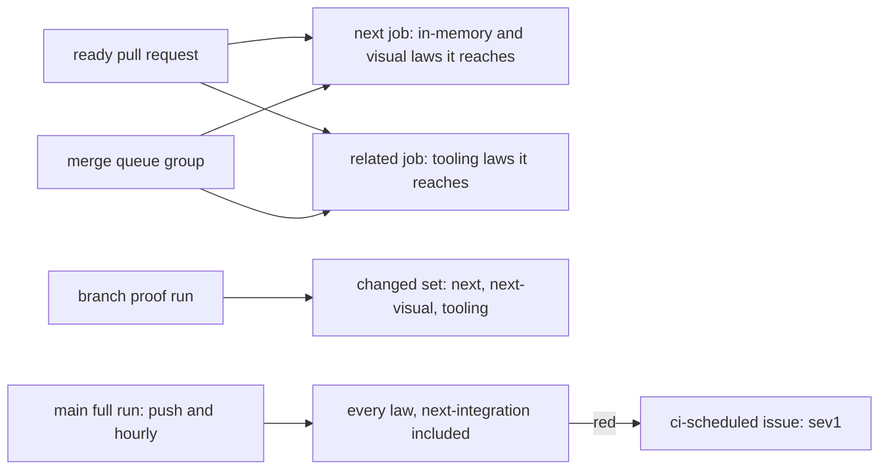

# 0602: Integration laws run only in main's full run, never on a pull request, in the merge queue or in a branch's proof run, even when the change reaches them

**Before:**



**After:**



```ts
// A sketch of the selection, before and after. The build pull request writes the real code.
// .github/ci/related.ts, the related job
const PROJECTS = ["next-integration", "tooling"] as const; // before
const PROJECTS = ["tooling"] as const; // after

// .github/ci/proof.ts, a branch's proof run
export const PROJECTS = ["next", "next-integration", "next-visual", "tooling"] as const; // before
export const PROJECTS = ["next", "next-visual", "tooling"] as const; // after
```

What moves: `next-integration` leaves every run before the merge and stays only on main.

**What this decides:** where the `next-integration` laws run in today's CI: after the merge, on
main, and nowhere before it.

## Context

During a sev0 on 2026-11-18, slow integration laws kept turning the merge line red on code the pull
requests never touched:

- The L11 storage law in `next/apps/fabrika/src/start-child.laws.integration.test.ts` runs close to
  its 60-second limit (`testTimeout: 60_000` in `vitest.config.ts`). It failed 9 pull request and
  merge-line runs that night, against 5 passes.
- The watcher's L17 and L18 laws in
  `next/packages/libfabrika/src/node/dev/watch.laws.integration.test.ts` failed the merge queue runs
  of [PR 1494](https://github.com/kamp-us/tea-fabrika/pull/1494) and
  [PR 1593](https://github.com/kamp-us/tea-fabrika/pull/1593), and a run of
  [PR 1525](https://github.com/kamp-us/tea-fabrika/pull/1525).

The job that ran them is `related` in `.github/workflows/check.yaml`. Its `select` job picks the
files through `.github/ci/related.ts`, which lists the `next-integration` and `tooling` laws a change
reaches on every ready pull request and merge queue group.
[PR 1581](https://github.com/kamp-us/tea-fabrika/pull/1581) (ticket 1155) added it. Before that,
[0590](0590-a-branch-proof-run-runs-only-what-its-change-reaches.md) had put the same laws into a
branch's proof run, which `land.ts arm` takes as a pull request's proof.

No decision file records the `related` job's integration legs. The binding line of
[0536](0536-real-resource-tests-run-only-on-the-schedule.md),
[0581](0581-main-full-run-starts-on-push-and-hourly.md) and
[0584](0584-a-tests-kind-follows-what-it-uses.md) still says no pull request or merge queue run
starts a law that reaches a real thing. For `next-integration` laws, this decision brings the merge
line back to that line, so those three are not marked. It changes part of three others:

- [0534](0534-the-merge-line-runs-changed-tests-a-schedule-runs-all.md) set the merge line to run
  the tests a change reaches. Integration laws now leave that set.
- [0590](0590-a-branch-proof-run-runs-only-what-its-change-reaches.md) put real-instance laws in a
  branch's proof run. They leave it.
- [0598](0598-merge-line-leaves-scheduled-groups.md) sized the merge line with up to seven `related`
  legs per ready run. Only the tooling legs stay.

[0535](0535-pull-requests-stay-fast-the-schedule-carries-the-rest.md) asks for fast checks on the
merge line. This decision fits it and does not change it.

### The known way

Google splits tests into presubmit and post-submit
([Software Engineering at Google, chapter 23](https://abseil.io/resources/swe-book/html/ch23.html)).
Before a change is submitted, it runs "only fast, reliable ones", mostly the small tests of the
project being changed. After the submit, its continuous system (TAP) runs every affected test,
"including larger and slower tests". Post-submit accepts longer times and some flakiness, as long
as something deals with a red result. Here, a small test is a plain law, and medium and up are
`.integration.` (0584, after the book's chapter 11). Main's full run is the post-submit run, and its
`ci-scheduled` issue is what deals with a red result.

## Decision

**No pull request run, merge queue run or branch proof run starts a `next-integration` law, even
one its change reaches. Main's full run runs every integration law, and a red one opens its
`ci-scheduled` issue, a sev1, as today.**

- **Ready pull request and merge queue:** the `related` job stops selecting `next-integration`
  files. It keeps the tooling laws a change reaches.
- **Tooling laws:** their routing does not change here.
- **The `next` job does not change:** the in-memory laws and the visual legs a change reaches.
- **A branch's proof run** (`scheduled.yaml` started on a branch, 0590) leaves `next-integration`
  out, on a changed set and on a full set. `land.ts arm` asks for no integration law, through either
  of its routes.
- **Main's full run does not change:** `scheduled.yaml` on a push to main and on the hourly
  catch-up (0581), the run older records call the 3-hour schedule. It runs every `next-integration`
  law at full depth.
- **A red integration law on main's full run** opens or updates the one `ci-scheduled` issue
  ([0534](0534-the-merge-line-runs-changed-tests-a-schedule-runs-all.md)), which is a sev1. The fix
  goes forward on main ([0544](0544-every-reviewed-pull-request-is-armed.md)).
- **A slow or flaky integration law is still fixed the day it is seen**
  ([0036](0036-a-flaky-test-is-fixed.md)). Leaving the merge line does not excuse it.

**Binding constraints:**

- No pull request, merge queue or branch proof run starts a `next-integration` law.
- Main's full run never drops one.

## Consequences

- **What is lost:** a break that only an integration law shows reaches main. It shows on main's next
  full run, within about an hour of the push, not before the merge. This is the trade 0536 made.
- A change to the checklist plant files (`.github/ci/plant*.ts`) no longer runs the checklist law
  before the merge, as `wantsChecklistLaw` in `.github/ci/related.ts` does today. Main's full run
  runs it.
- The `related` job shrinks to its tooling legs, at most two (`MOST_TOOLING: 2` in `check.yaml`). A
  pull request no longer waits on an integration leg.
- The L11 and L17/L18 laws still owe their fixes under 0036. A red one now opens the sev1 issue
  instead of holding a merge.
- **The build** is its own pull request, on branch `fabrikalfa/integration-off-merge-line`, in
  today's CI. It takes `next-integration` out of `.github/ci/related.ts` and the `related` job, out
  of a proof run's sets in `.github/ci/proof.ts`, and out of what `land.ts arm`
  (`.agents/skills/lead/scripts/pr/Arm.ts`) checks. It updates the workflow-lint rules that hold the
  `related` job, and the glossary's `changed set` row, which lists `next-integration`. 0598's rule
  of one writer of `check.yaml` at a time still holds.
- 0534, 0590 and 0598 are marked `amended-in-part by` this file.
- **Not decided here:** the host workflow's real-machine laws, which
  [0178](0178-host-only-laws-run-first.md) and [0594](0594-safe-checks-direct-mac-ci.md) run
  before the first review. This decision covers the pull request check, the merge queue and the
  proof run.
