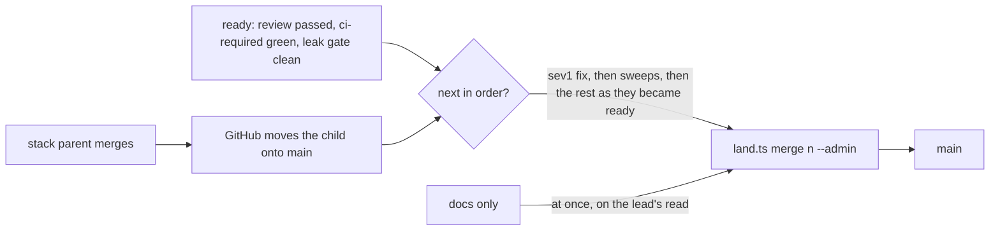

# 0603: The lead admin-merges every ready pull request itself, one at a time, sweeps first, a stack's layers land on their own with no native stack link, and before a push an agent runs only format and the leak grep



```sh
node .agents/skills/lead/scripts/land.ts merge 1525 --admin   # one at a time, in order
gh stack unstack 1554                                         # an old native stack, once
```

**What this decides:** the lead lands each ready pull request itself with an admin merge, one at a
time and in a set order, past the merge queue. A stack no longer lands whole, docs land at once,
and nobody runs by hand a check that CI runs anyway.

## Context

In the sev0 of 2026-11-18, thirteen fixes took about six hours to land through the merge queue.
Under [0179](0179-an-admin-merge-is-the-owners.md) an admin merge was the owner's, so the merging
session's own permission check refused one, and nothing landed for almost two hours. A three-layer
stack could not land whole, because [0599](0599-native-stack-upkeep.md) and `land.ts stack` asked for
one merge of every layer while main's queue built only two entries at once. GitHub also refuses
`gh pr merge` on any pull request in a native stack ("must be merged using the asynchronous merge
REST API"). The owner ruled on 2026-11-18 to drop the stack requirement, to admin-merge everything
one by one in order, to land decision pull requests without waiting, to put the format and
code-quality sweeps first, and to stop every hand check that CI runs anyway. Agents ran lint,
typecheck and `--changed` runs before each push that night, and CI ran them all again.

## Decision

**The lead admin-merges every ready pull request itself, one at a time, in order. The merge queue
and merge when ready are not the route.**

- **Ready** means: open, not a draft, into main, not titled `Plan:`, its steps passed, the leak gate
  clean on its change, its commits and its words, its new names listed under `## New names`
  ([0587](0587-new-helpers-and-names-cite-sources.md)), and `ci-required` a success at its head.
  `land.ts merge <pr> --admin` checks each of these and merges the pinned head.
- **The order:**
  1. a sev1 fix ([0542](0542-two-sev-levels-one-skill.md));
  2. the format and code-quality sweeps: format, lint, Effect, mock and exam sweeps. They touch many
     files, and every pull request that lands before one makes more conflicts for it, so a ready
     sweep jumps the line;
  3. every other pull request, in the order it became ready, a stacked child right after its parent.
- **Docs land at once.** A docs-only pull request ([0183](0183-the-lead-admin-merges-docs-only.md))
  lands on the lead's read, with no wait for CI and no place in the order.
- **One at a time:** the lead reads each merge's answer before the next. A green pull request is not
  caught up with main first ([0162](0162-no-friction-before-a-merge.md)). One that conflicts after an
  earlier merge gets main merged in through `botpush.mjs`, and takes its place again once its new
  head is green.
- **Stacks:** no native stack links. A child pull request targets its parent's branch. When the
  parent lands, GitHub moves the child onto main (the repo deletes merged branches), and the child
  lands on its own. An open child stays current by merging its parent's head, as 0599 says. An old
  native stack is unstacked once with `gh stack unstack <number>`.
- A break only the full run sees is caught by main's full run and fixed as a sev1
  ([0544](0544-every-reviewed-pull-request-is-armed.md), [0581](0581-main-full-run-starts-on-push-and-hourly.md)).

**Before a push, an agent runs `pnpm format` and the leak grep, and nothing else that CI runs.**

- `pnpm format` is a fixer, and the leak grep is a security line, since a push is public.
- No local lint, typecheck, `--changed` or full test run as a check, and no repeat run of a law
  that is already green. CI runs them on the pushed head, and a red one is fixed forward.
- Work-loop runs stay: the test writer seeing its law go red, a plant going red, the builder's
  narrow test while it works. So does anything CI does not run for that change: a tooling
  `.integration.`, visual or host-only law the change reaches, a pull request of only plan files
  and rows (which starts no CI run), an experiment script, a tutorial, a program's shots.
- This widens [0133](0133-no-push-waits-on-a-local-typecheck.md) from the typecheck to every check
  CI runs.

**Binding constraints**

- Every merge goes through `land.ts merge`, never a bare `gh pr merge`. The leak gate and the
  `ci-required` check hold each one.
- Only the lead session merges, so main has one writer.
- Still never: a force push, or a change to the bypass list by an agent.

## Consequences

- 0179 is superseded: the lead starts an admin merge without asking. 0530 is superseded: the lead
  does not turn on merge when ready. 0544 changes in part: a reviewed pull request is admin-merged in
  order, not armed, and the lead keeps an ordered line again. 0599 and
  [0004](0004-squash-merges-and-native-stacks.md) change in part: no native stack links, each layer
  lands on its own. 0183 changes in part: its docs merge no longer points back at 0179. 0133
  changes in part: the lead's pushes no longer wait on local lint or narrow tests either.
- `land.ts stack` and the code that only served it are deleted. `land.ts merge --admin` no longer
  needs an open sev0 or a docs-only change. `land.ts arm`, `land.ts queue` and the queue step at the
  end of `land.ts run` stay in the code for now, and the lead skill says not to use them; moving
  them to the admin route or deleting them is its own ticket.
- `stepcommit.sh` still refuses staged files that are not formatted. That is a check that
  `pnpm format` ran, and it costs about a second; making it format the files instead is its own
  ticket, since laws pin the refusal.
- GitHub's merge queue stays turned on in main's ruleset. An admin merge goes past it.
- Not decided here: whether fabrika's own queue ever takes the line over.
