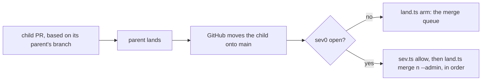

# 0603: No pull request is in a native stack, each layer lands on its own, and in a sev0 the lead admin-merges every ready pull request in order, docs at once, with only format and the leak grep before a push



```sh
gh stack unstack 1554                                         # once, for an old native stack
node .agents/skills/lead/scripts/land.ts arm 1583             # a normal day
node .agents/skills/sev/scripts/sev.ts allow fabrikalfa/kalfa-config-package
node .agents/skills/lead/scripts/land.ts merge 1583 --admin   # in a sev0
```

**What this decides:** stacks are dropped on every day: no native stack link, and each layer lands
on its own, bottom first. While a sev0 is open, the lead also lands every ready pull request itself
by admin merge, in order, docs at once, and agents run no hand check that CI runs.

## Context

In the sev0 of 2026-11-18, thirteen fixes took about six hours to land through the merge queue. A
three-layer stack could not land whole: [0599](0599-native-stack-upkeep.md) and `land.ts stack` asked
for one merge of every layer while main's queue built two entries at once, and GitHub refuses
`gh pr merge` on a pull request in a native stack. Agents ran lint, typecheck and `--changed` runs
before each push, and CI ran them all again. The owner ruled on 2026-11-18: stacks go for good,
since they fight the merge queue, and the rest holds in a sev0, for now.

## Decision

**Always: no native stack links. Each layer of a chain is a plain pull request and lands on its own,
bottom first.**

- A child pull request targets its parent's branch. When the parent lands, GitHub moves the child
  onto main (the repo deletes merged branches), and the child lands next: through the merge queue on
  a normal day, by admin merge in a sev0.
- An open child stays current by merging its parent's head, as 0599 says, never by a rebase.
- An old native stack is unstacked once with `gh stack unstack <number>`.
- `land.ts stack` and the code that only served it are deleted.

**In a sev0: the lead admin-merges every ready pull request itself, one at a time, in order, past
the queue.**

- **Ready** means: its steps passed, `ci-required` is a success at its head, and the leak gate is
  clean on its change, its commits and its words. The lead allows its branch with
  `sev.ts allow <branch>` and lands it with `land.ts merge <pr> --admin`, whose gate does not change.
- **The order:** the sev fixes, then the format and code-quality sweeps (format, lint, Effect, mock
  and exam sweeps, which touch many files), then the rest in the order they became ready, a child
  right after its parent.
- **One at a time:** the lead reads each merge's answer before the next. A green pull request is not
  caught up with main first. One that conflicts after an earlier merge gets main merged in, as the
  bot, and takes its place again once its new head is green.
- **Decision and docs pull requests land at once,** on the lead's read
  ([0183](0183-the-lead-admin-merges-docs-only.md)), with no wait for the sev0 to end.
- **Before a push, agents run only `pnpm format` and the leak grep.** No local lint, typecheck,
  `--changed` or full test run, and no repeat run of a green law: CI judges them. Work-loop runs
  stay (a law seen red, a plant gone red, the builder's narrow test), and so does any check CI does
  not run for that change.
- **The lead signs a narrowed proof bar** that keeps every law and files the dropped cause as its
  own ticket, in the same read. A loosened or removed law still goes to the owner.

**Binding constraints**

- Outside a sev0 the merge queue stays the route: merge when ready, `land.ts arm` and `queue`
  ([0162](0162-no-friction-before-a-merge.md), [0530](0530-lead-turns-on-merge-when-ready.md),
  [0544](0544-every-reviewed-pull-request-is-armed.md)), and the checks in `AGENTS.md`.
- Every merge goes through `land.ts`, never a bare `gh pr merge`. In a sev0 only the lead session
  merges.
- Still never: a force push, or a change to the bypass list by an agent.

## Consequences

- [0599](0599-native-stack-upkeep.md) and [0004](0004-squash-merges-and-native-stacks.md) change in
  part: no native stack links, and no stack lands in one merge. Merging a parent's head into a child
  still holds.
- [0532](0532-a-sev0-freezes-ci.md), the sev0 rule, changes in part: in a sev0 every ready pull
  request lands by admin merge, not only the fixes, and a green one is not caught up with main first.
- `land.ts merge --admin` keeps its gate: a docs-only pull request, or a branch an open sev0 allows,
  with green `ci-required` and the leak gate. The lead allows each branch as its turn comes.
- Not decided here: whether the sev0 rules become the normal-day route.
