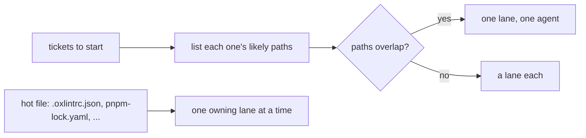

# 0604: Tickets that will touch the same files share one lane and one agent, each hot shared file has one owning lane at a time, and a sweep lands before new lanes start on its files



```text
ticket 1170  .github/ci/progress-reporter*.ts                -> lane A
ticket 1172  next/packages/libfabrika/src/node/dev/watch.laws*  -> lane B
ticket 1168  next/apps/fabrika/e2e/node/P19Launchd*.ts       -> lane C
ticket 1169  next/apps/fabrika/e2e/node/P19Launchd*.ts       -> lane C (same files as 1168)
```

**What this decides:** the lead splits parallel work so that no two agents edit the same files at
once, on every day, not only in a sev.

## Context

[0597](0597-eight-workers-before-twelve.md) already says "keep one owner per file", and `AGENTS.md`
says "Keep one file owner", but nothing said how the lead keeps it when it starts lanes. On
2026-11-18 lanes ran side by side on the same files. 1603 had to merge main twice, and 1504 came back
with 50 conflicts. The shared hot files that night were `.oxlintrc.json`, `pnpm-lock.yaml`,
`boundary-rules.json`, `vitest.config.ts` and `layer-rules.json`. The owner ruled on 2026-11-18. The
agent limits stay as [0012](0012-twelve-agents-at-once.md) and 0597 set them.

## Decision

**Tickets that will touch the same files go into one lane, given to one agent, so two agents never
edit the same files at once.**

- **Before starting lanes,** the lead lists each ticket's likely paths, from its plan, or from a
  quick `rg` when there is no plan yet, and merges tickets whose paths overlap into one lane.
- **Hot shared files** (tonight: `.oxlintrc.json`, `pnpm-lock.yaml`, `boundary-rules.json`,
  `vitest.config.ts`, `layer-rules.json`) are owned by one lane at a time. Another lane that needs
  one waits, or hands its change to the owning lane.
- **A sweep** (format, lint, Effect, mock) runs when few pull requests are open, and lands before new
  lanes start on the files it touches.

## Consequences

- Fewer lanes may run at once when tickets share files. The staffing targets of 0597 count
  productive workers; a lane that waits on a hot file is not one.
- The lead's lane list records each lane's paths, so a new ticket's overlap can be checked.
- Not decided here: a tool that computes the overlap. Today it is the lead's `rg` and the plans'
  files tables.
