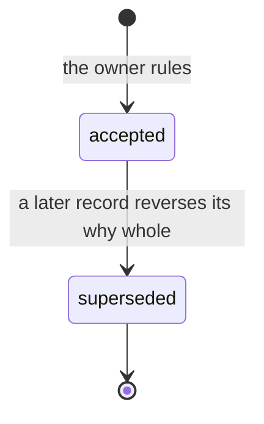

# 0606: A record's status is accepted, or superseded with the one record that replaced it, typed as a Schema in @kalfa/records, never amended in part



```ts
// A sketch, in @kalfa/records. A tagged union (0214): "amended in part by five records,
// one of them superseded" is not a value it can hold.
const Status = Schema.Union([
  Schema.TaggedStruct("accepted", {}),
  Schema.TaggedStruct("superseded", { successor: DecisionId }),
]);
```

**What this decides:** the cases of a record's status, and that the status is typed data.

## Context

The [rules and records guidelines](../docs/guidelines/rules-and-records.md), R4, approved in
[0604](0604-rules-and-records-guidelines-approved.md). On 2026-11-18, 126 records said
`amended-in-part by` a list of Markdown links, and three were patched by a record that was itself
superseded ([experiment 298](../experiments/298-rules-and-records-guidelines.md)). MADR's statuses
have no "amended" case ([MADR](https://adr.github.io/madr/)), and Nygard marks a reversed record
superseded and keeps it
([Nygard](https://cognitect.com/blog/2011/11/15/documenting-architecture-decisions)).

This changes the [adr skill](../.agents/skills/adr/SKILL.md)'s step 4 table and the status reader in
[`records.ts`](../.agents/skills/lead/scripts/records.ts), which read `amended-in-part`.

## Decision

**A record's status has two cases, `accepted` or `superseded` naming the one record that replaced
it, and it is decoded by a Schema in `@kalfa/records` ([0585](0585-kalfa-is-six-domain-packages.md)),
never written as Markdown links in a string.**

- A partial change edits the rule's home ([0605](0605-no-record-patches-another.md)); the old record
  stays `accepted`, and the new record says in its context what it changed.
- A record that does not decode fails `pnpm lint`, with a message that names the file and the two
  cases.
- Nobody deletes a record.

## Consequences

- Every `amended-in-part` status becomes `accepted` once its record's text is current, and every
  superseded record takes the new shape, before the check turns on
  ([the build plan](../docs/plan/quests/rules-and-records-build-PLAN.md)).
- `records.ts resolve` prints the live record for a superseded one and no longer prints "amended
  by".
- Not decided here: the frontmatter key that names the successor; the build plan picks it.
