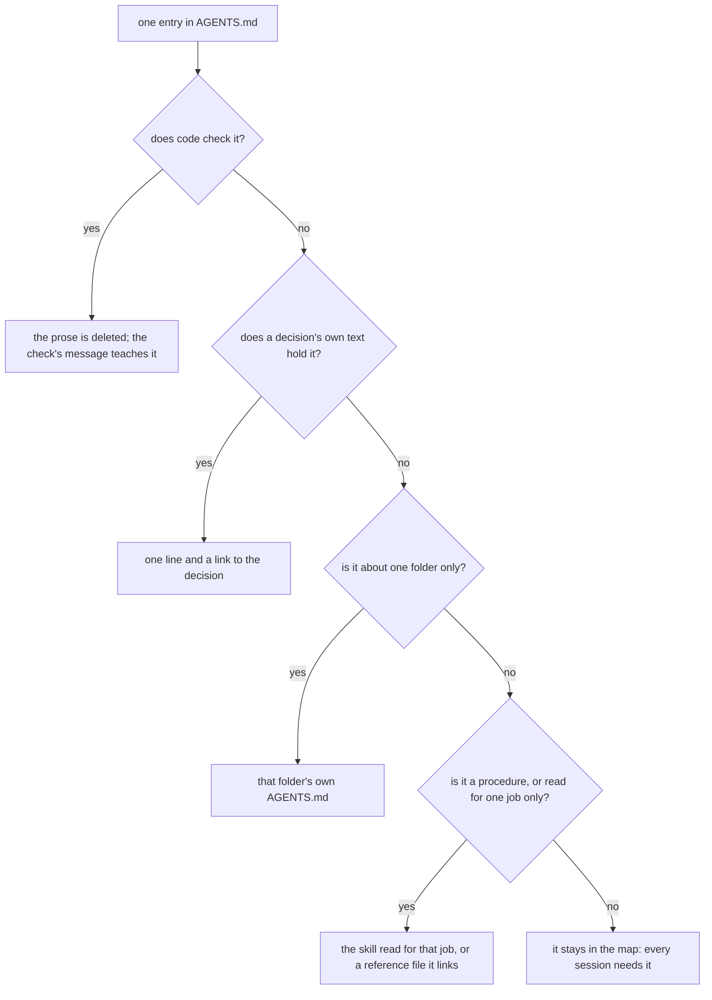

# 0609: AGENTS.md follows Claude Code's memory guide, under 200 lines of facts every session needs, with each procedure in the skill read for that job and each folder's rules in that folder's file



```text
before   AGENTS.md          483 lines, 39,370 bytes, and 0608's limit of 32,768 bytes for the root
                            with next/AGENTS.md read after it
after    AGENTS.md          under 200 lines: what the repo is, the two versions, where to read and
                            write, how to find decisions, finish your task, the checks and the
                            machine caps in short, this repo is public, how to write here, changing
                            files; each moved section leaves its heading and one pointer line
         next/AGENTS.md     under 200 lines, read after the root for next/ work
         skills             How a change lands, the tool facts and the long caps (lead skill);
                            Before you design anything (plan skill); Changing the product
                            (guidelines skill)
```

**What this decides:** how big the always-read map may be, what stays in it, and where a moved
entry goes.

## Context

[0129](0129-agents-md-becomes-a-short-map.md) made `AGENTS.md` a short map, cut by three moves
with a table of every line removed. [0608](0608-the-map-fits-its-readers-limits.md) set its size as
a byte limit, Codex's 32 KiB `project_doc_max_bytes` default, for the root alone and for the root
with each folder's file. Slice 6 of the
[rules and records build plan](../docs/plan/quests/rules-and-records-build-PLAN.md) could not reach
that limit by 0129's three moves without dropping a rule: the pair stood at 41,773 bytes after
every safe move (PR 1633, and the field note
`field/notes/2026-11-18-map-cut-cannot-fit-by-three-moves.json`). Most of what stayed was
procedure or guidance read for one job, such as writing a plan, changing a window or landing a pull
request, which 0129 had no move for.

Claude Code's own guidance says what a memory file should hold
([memory](https://code.claude.com/docs/en/memory),
[best practices](https://code.claude.com/docs/en/best-practices)): "target under 200 lines per
CLAUDE.md file. Longer files consume more context and reduce adherence"; keep it to facts Claude
should hold in every session; "If an entry is a multi-step procedure or only matters for one part
of the codebase, move it to a skill or a path-scoped rule instead." This repo's `CLAUDE.md` files
read `AGENTS.md` through `@AGENTS.md`.

The lead session decided this on 2026-11-18, in place of the owner call slice 6 had stopped for.
It supersedes 0129 and 0608 whole and holds what of them is still live.

## Decision

**The root `AGENTS.md` stays under 200 lines and holds only the facts every session needs; a
procedure or an entry read for one job lives in the skill for that job, and a rule for one folder
lives in that folder's `AGENTS.md`.**

- **What stays in the root:** what the repo is, the two versions, the table of where to read and
  where to write, how to find decisions, finish your task, the checks (the commands, the
  narrowest-check table and the machine caps in a few lines), this repo is public, how to write
  here, and changing files.
- **Each entry leaves the map by one of four moves, and none is dropped:**
  - code checks it: the prose is deleted, and the check's own message says what to do;
  - a decision's own text holds it: one line with a link to that decision;
  - it is about one folder: it moves to that folder's own `AGENTS.md`, such as `next/AGENTS.md`;
  - it is a procedure, or read for one job only: it moves whole to the skill read for that job, or
    to a reference file that skill links, word for word, and the map keeps its heading and one
    line that says when to read it and links it.
- **The table:** a pull request that moves entries out of the map carries a table with one row for
  every line or bullet it removes: where it went, or which check holds it. A rule with no row
  blocks the merge.
- **A rule conflict is resolved, not kept.** A map line that an accepted decision has overruled
  takes that decision's rule in the same pull request, and its row in the table names the
  decision.
- **Folder files:** `next/AGENTS.md` and any other folder's file also stay under 200 lines, and add
  no rule that the map or a decision contradicts.
- **The check:** the map size check in `@kalfa/records` counts lines, not bytes: an advice-level
  finding when a tracked `AGENTS.md` is over 200 lines, with this decision and Claude Code's memory
  docs as its source. The `records.map.max-bytes` setting goes, and no byte limit is held.

**Binding constraints**

- A move changes no rule except a conflict it resolves, which the table names.
- A section that moves keeps its heading in the map while any file links its anchor.

## Consequences

- An agent's first read gets shorter, and a procedure is read with the skill for its job. The cost:
  a rule read only in a skill is missed by an agent that never opens that skill, so each pointer
  line in the map says when to read it.
- 0608's Codex reading is given up as the limit: a 200-line root of about 100 bytes a line stays
  near 20 KB, under Codex's 32 KiB default, but nothing checks the bytes now. Whether our Codex
  steps load `AGENTS.md` at all is still not tested.
- The rules and records build plan's slice 8 drops the setting and counts lines; slice 6 lists that
  under its plan corrections.
- Not decided here: which other folders get a file of their own.
