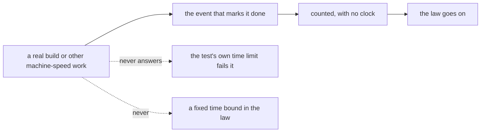

# 0609: A law waits on the event that marks machine-speed work done, never on a fixed time bound, and a speed claim is its own measured law



```ts
// Yes: wait for the event, counted. Only the test's own time limit backstops it.
yield* Stream.runDrain(builds.pipe(Stream.take(1)));
// No: a fixed bound on work whose speed the machine sets.
yield* Effect.timeout(build, "2 seconds");
```

**What this decides:** a law never puts a fixed time bound on a real build or other machine-speed
work; it waits on the event that marks the work done.

## Context

Ticket 1172, the L10 watcher law
(`next/packages/libfabrika/src/node/dev/watch.laws.integration.test.ts`). Two live rules seemed to
clash on it. [0036](0036-a-flaky-test-is-fixed.md) says a flaky test's fix never widens a timeout.
[0052](0052-tests-never-depend-on-the-machine.md) says a test never depends on the machine. A fixed
time bound on a build fails on a slow machine, so it depends on the machine (0052). Widening it is
what 0036 forbids. Neither rule changes. This record refines how both apply to a law that waits on
machine-speed work. It patches neither file ([0605](0605-no-record-patches-another.md),
[0606](0606-a-record-is-accepted-or-superseded.md)).

## Decision

**A law waits on the event that marks machine-speed work done, counted with no clock.**

- A real build, a watcher rebuild, a process start or any other work whose speed the machine sets is
  waited on by its done event: a stream element, a message, an exit.
- The wait is counted in events ("the second rebuild"), never in time.
- Only the test's own time limit backstops a part that never answers. That limit is the test
  runner's, and it fails the test. It is not a bound in the law.
- A speed claim ("a rebuild takes under N ms") is wanted only as its own law, measured on a fixed
  machine. It is never a bound hidden inside another law.

**Binding constraints:**

- No law wraps a real build or other machine-speed work in a fixed time bound.
- A fix for a flaky wait removes the clock. It does not widen it (0036) and does not catch the
  error (0052).

## Consequences

- A law that waited on a clock is rewritten to wait on an event. The L10 watcher law is the first.
- A slow machine makes a law slower, never red. A part that hangs still fails, at the test's limit.
- A speed claim now needs its own law and a fixed machine to run it on. Which machine is not
  decided here.
