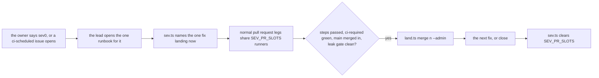

# 0611: Sev handling is a set of runbooks, a sev fix is admin-merged one at a time on current main in both levels, normal pull requests share SEV_PR_SLOTS runners while a sev is open, and run priority moves into @kalfa/ci



```text
.runbooks/sev-main-is-red.md          sev1   a "Scheduled CI is red on main" issue opens
.runbooks/sev-ci-is-slow.md           sev1   a "CI speed: a stage is over its goal" issue opens
.runbooks/sev-nothing-lands.md        sev0   the owner says sev0
.runbooks/sev-a-fix-is-red.md         both   a fix's ci-required or review comes back red
.runbooks/sev-two-fixes-at-once.md    both   a second fix is ready while one lands
.runbooks/sev-main-red-in-a-freeze.md sev0   main goes red while the freeze runs
.runbooks/sev-rate-limit-runs-out.md  both   GitHub's REST limit for the login reaches 0
.runbooks/sev-close-and-walk.md       both   every fix merged, the owner calls it off, or the issue closed
```

**What this decides:** where the steps for each sev situation live, how a sev fix lands at either
level, which runs a sev keeps, and how a sev holds runners back for its fix until run priority
exists.

## Context

The [sev runbooks plan](../docs/plan/quests/sev-runbooks-PLAN.md)
([pull request 1646](https://github.com/kamp-us/tea-fabrika/pull/1646)) read the sevs of
2026-11-14, 2026-11-15 and 2026-11-18 and the field notes they left. The sev skill had grown to one
page of step lists for eight different situations. In a sev1 a fix waited on the merge queue behind
every other pull request. Two fixes that landed side by side were each green on a main without the
other. The freeze canceled main's own check runs, so a red main went unseen
(`field/notes/2026-11-18-ci-sev0-integration-and-visual-laws-left-the-merge-line.json`). A fix's
legs waited for runners behind normal pull requests, since GitHub Actions has no job priority
([0598](0598-merge-line-leaves-scheduled-groups.md)). The owner ruled on 2026-11-18 that sev
handling becomes runbooks, that a sev fix is admin-merged in both levels, and that a sev holds
runners back for its fix.

The known way: Google's SRE book gives an incident one commander who "holds the high-level state
about the incident" and asks for procedures written "in advance"
([Managing Incidents](https://sre.google/sre-book/managing-incidents/)), and PagerDuty's and
Atlassian's playbooks give each situation a trigger, roles, steps, an exit and its messages
([PagerDuty](https://docs.pagerduty.com/ops-guides/incident-response-guide/during-an-incident),
[Atlassian](https://www.atlassian.com/incident-management/handbook/incident-response)).

This changes lines in four records, which stay `accepted` since none is reversed whole
([0605](0605-no-record-patches-another.md), [0606](0606-a-record-is-accepted-or-superseded.md)):

- [0542](0542-two-sev-levels-one-skill.md): its table row "How a fix lands" for a sev1, "through
  the merge line, ahead of other changes", and its "A sev1 has no log". A sev1 fix is now
  admin-merged, and `sev.ts fix` writes one `fix` line to the log. The open issue stays the record
  of the level.
- [0544](0544-every-reviewed-pull-request-is-armed.md): "A sev1 fix still goes ahead of other
  changes: the lead turns the others off until it has landed." The others stay armed; the fix goes
  ahead by admin merge. 0544 was that line's only home, so it is edited in place in this pull
  request.
- [0532](0532-a-sev0-freezes-ci.md): "Every unfinished run is canceled, pull request runs, push runs
  on main and dispatched runs alike", for `check` runs on a push to main only. Main's full run is
  still canceled.
- [0603](0603-no-stacks-and-sev0-admin-merges.md): "A green pull request is not caught up with main
  first", for sev fixes only.

The other homes of those lines, the [sev skill](../.agents/skills/sev/SKILL.md), the runbooks,
`pr/Merge.ts`, `land.ts`, `Freeze.ts` and `sev.ts`, change in the plan's pull requests.

Run priority, Kubernetes' priority classes and preemption, is [0612](0612-kalfa-ci-holds-the-ci-protocol-once.md)'s:
it lives in `@kalfa/ci`. 0612 left open how a sev reserves runners meanwhile, and named this plan
for it. Today's `WorkflowRuns` and the new `Variables` services in `.agents/skills/sev/scripts/`
are typed contracts with one GitHub Layer each, the shape 0612's `Runs` takes, and move into
`@kalfa/ci` when its build plan runs.

## Decision

**Each sev situation has one runbook in `.runbooks/`, the lead is its incident commander, a sev fix
is admin-merged one at a time on current main at either level, and while a sev is open normal pull
request test legs share `SEV_PR_SLOTS` runners so the fix gets the rest.**

- **Runbooks.** One file per sev situation, flat in `.runbooks/` and prefixed `sev-`
  ([0571](0571-runbooks-live-in-top-level-runbooks.md)), each from a sev that ran for real. Each
  has frontmatter `summary` and `follows`, and five parts: Trigger, Roles, Steps, Exit, Comms.
- **The skill keeps judgment.** The sev skill keeps the level table, when unsure which level, the
  many-agents lines, the write-up's fields and a list of every runbook. Step lists move to the
  runbooks, and a rule that code checks leaves the prose ([0408](0408-skills-keep-only-judgment.md)).
- **The lead is the incident commander.** It holds the state, picks the order of fixes and lands
  them. One agent owns each fix until it lands, and only fix owners change code.
- **A sev fix is admin-merged, at both levels.** `land.ts merge <pr> --admin` admits a fix only when
  its steps passed, `ci-required` is a success at its head, `origin/main`'s head is an ancestor of
  that head, and the leak gate is clean on its change, its commits and its words.
- **One fix at a time.** In a sev0 by `sev.ts next`, as today. In a sev1 by `sev.ts fix <branch>`,
  which names the one fix landing now and refuses a second until the first has merged or
  `sev.ts fix --drop`.
- **Everything else is unchanged.** In a sev1 every other pull request stays on the merge queue
  (0544). In a sev0 every other ready pull request lands as 0603 says, with no catch-up first.
- **A sev1 fix is still proven by main's next full run** (0542); the admin merge only lands it sooner.
- **The freeze keeps main's `check` runs** on a push to main. It still cancels main's full run
  (`scheduled`), and `close` starts that run on main itself, never a rerun.
- **The runner reserve.** While a sev0 is open, or a sev1 has a named fix, the repository Actions
  variable `SEV_PR_SLOTS` is set, and `check.yaml`'s test legs of a normal pull request share that
  many slot groups. A pull request labeled `sev` takes no group. When it is unset, every leg runs
  in a group of its own, so a normal day has no cap.
- **Code sets and clears the reserve, never a person.** `sev.ts` reads the level after each command
  it runs and writes the variable only when it differs. A stale value after an issue closes lasts
  until the next `sev.ts` call; CI's own token is not given a variables scope
  ([0595](0595-scheduled-runs-share-slots.md)).
- **The `sev` label grants nothing alone.** `land.ts` refuses an admin merge of a labeled pull
  request that the open sev0 or the sev1 `fix` line does not name.

**Binding constraints:**

- A runbook holds no rule a decision file does not hold (0571), and none is written before its
  situation ran for real.
- At most one sev fix lands at a time, at either level.
- No sev fix is admin-merged without current main in its head.
- Only `sev.ts` writes `SEV_PR_SLOTS`. No workflow and no person sets it.
- A normal day has no runner cap from this record.

## Consequences

- The plan lands in three pull requests after this one: the runbooks and the fix route, then the
  runner reserve, which waits for any open pull request that edits `check.yaml`
  ([0598](0598-merge-line-leaves-scheduled-groups.md)), then `@kalfa/ci`'s own plan (0612).
- The size of the reserve is a setting, `SEV_PR_SLOTS = 3` in `sev.ts` beside `SEV_SECONDS`
  ([0069](0069-choices-are-settings.md)), sized on the Free plan's documented 20 concurrent jobs. On
  2026-11-18 up to 34 jobs ran at once, so 3 may be tighter than it needs to be.
- While a sev1 is open, a normal pull request's ready run takes longer, about 25 to 30 minutes in
  place of about 12, a guess from three waves of legs. A leg that started before the reserve turned
  on finishes first, so a sev1 fix can still wait up to one leg's time.
- A runbooks check in `@kalfa/records`, run by `pnpm lint`, holds the runbooks' frontmatter, five
  parts and the skill's list.
- Not decided here: the order of fixes beyond 0532's, whether main's full run is ever kept in a
  sev0, and the priority classes' names and values, which are `@kalfa/ci`'s.
