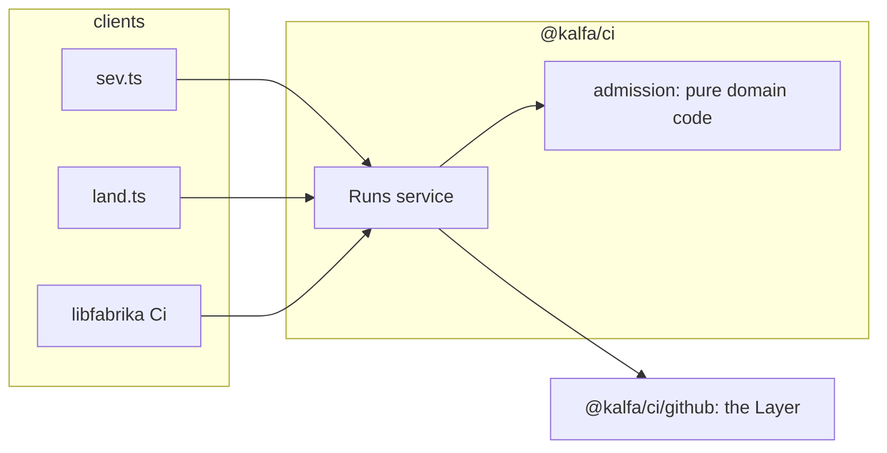

# 0612: The CI protocol lives once, in @kalfa/ci, as Effect services with our own admission logic as pure domain code and GitHub Actions as one Layer at @kalfa/ci/github, and every CI user is a client of it, never a second protocol



```ts
// A sketch, in @kalfa/ci. The key names are the build plan's to pick.
class Runs extends Context.Service<Runs, {
  readonly dispatch: (run: RunRequest) => Effect.Effect<RunId, DispatchError>
  readonly cancel: (id: RunId) => Effect.Effect<void, CancelError>
  readonly states: (id: RunId) => Stream.Stream<RunState, ObserveError>
}>()("@kalfa/ci/Runs") {}

// Priority classes, after Kubernetes PriorityClass. A higher class may preempt a lower one.
const Priority = Schema.Literals(["sev_fix", "main_full", "normal"]) // highest first
```

**What this decides:** where the CI protocol lives, how runs are admitted and preempted, and that
every user of CI is a client of that one place.

## Context

CI is spoken in more than one place. Today's lead tooling (`sev.ts`, `land.ts`) calls GitHub itself
to dispatch and cancel runs. `next/`'s libfabrika has its own `Ci` contract in
`next/packages/libfabrika/src/ci/Ci.ts`. Two protocols for one thing drift apart, and a sev needs
one place that knows which run may displace which.

On 2026-11-18 the owner ruled that the protocol lives once, in `@kalfa/ci`, and that the tooling is
built in one place and everything uses it.

It builds on [0585](0585-kalfa-is-six-domain-packages.md), which made `@kalfa/ci` the home of CI
tooling (legs, changes, checks, ship), and on [0556](0556-kalfa-holds-our-tooling-packages.md) and
[0601](0601-program-make-with-optional-pipes.md), which say a `@kalfa` package may be a protocol
that others use. It follows [0231](0231-ledger-and-codehost-are-separate.md), where code reaches
the code host through a typed service and never a direct `gh` call. The sev behavior in
[0532](0532-a-sev0-freezes-ci.md) and the slot sharing in
[0595](0595-scheduled-runs-share-slots.md) are rules about what CI does. This record says where
the code that does it lives.

No other record gives libfabrika's `Ci` contract or a tool's own `gh` calls a rule that this
reverses, so nothing is superseded.

## Decision

**`@kalfa/ci` holds the CI protocol once, as Effect services. Our admission logic is pure domain
code beside it, and GitHub Actions is one Layer at `@kalfa/ci/github`. Every user of CI is a client.**

- **The protocol is services.** A `Runs` service dispatches a run, cancels it, and streams its
  states. More services join it in the same package as the work needs them.
- **Admission is ours and pure.** Which run may start, wait or be displaced is decided by domain
  code with no I/O, in three priority classes, highest first:
  1. a sev fix,
  2. main's full run,
  3. normal pull requests and the queue.
- **A higher class preempts a lower one.** The model is Kubernetes
  [PriorityClass and preemption](https://kubernetes.io/docs/concepts/scheduling-eviction/pod-priority-preemption/).
  Preemption cancels through `Runs.cancel`, so the Layer under it does the real cancel.
- **GitHub Actions is a Layer,** `@kalfa/ci/github`. Another CI is another Layer, and no client
  changes. The Layer is where the GitHub API is called; nothing else calls it
  ([0231](0231-ledger-and-codehost-are-separate.md)).
- **Every user is a client.** Today's lead tooling (`sev.ts`, `land.ts`) and `next/`'s libfabrika
  call `Runs`. `next/packages/libfabrika/src/ci/Ci.ts` becomes a client of `@kalfa/ci`, not a
  second protocol.
- **The tooling is built in one place.** A new CI behavior is added to `@kalfa/ci` once and every
  client gets it.

**Binding constraints:**

- No tool, script or libfabrika module defines its own CI protocol, or dispatches or cancels a run
  by calling GitHub directly. It uses `Runs`.
- Admission and preemption are pure functions of the runs and their classes, with no clock, network
  or file in them, so a test runs them as plain values.
- A priority class is an ordered, closed set. A run has exactly one class.
- `@kalfa/ci` stays one of the six packages of 0585. The Layer is a subpath, `@kalfa/ci/github`,
  never a new package.

## Consequences

- **A build plan follows,** in 0585's order for `@kalfa/ci`. It names the services' keys and moves
  `sev.ts`'s and `land.ts`'s GitHub calls behind `Runs`. It does not start until the owner says go.
- **libfabrika's `Ci`** (and its glossary row, which says the contract is in libfabrika) change
  when that plan builds. This record does not edit them.
- **The cost.** A second CI is cheaper to add later, but the first client migration touches
  `sev.ts`, `land.ts` and libfabrika at once. The services' shape is a guess until a client uses it.
- **Not decided here:** the exact service and field names, whether a class can be set per run by a
  person, when each client moves, and how a sev reserves runner slots
  ([pull request 1646](https://github.com/kamp-us/tea-fabrika/pull/1646) plans that).
