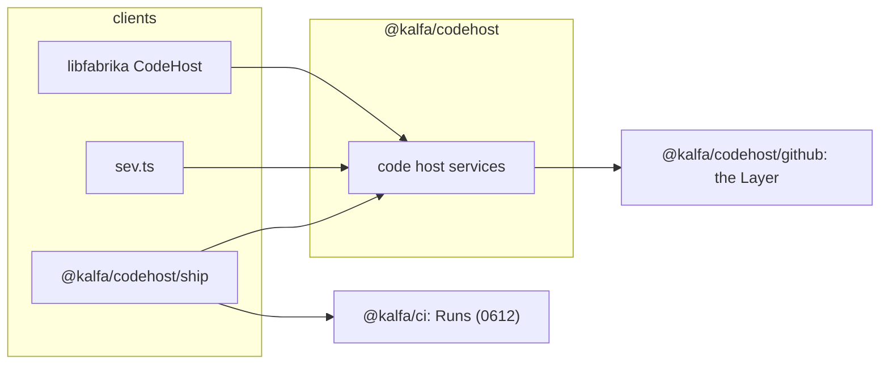

# 0614: The code host protocol lives once, in @kalfa/codehost, as Effect services with GitHub as one Layer at @kalfa/codehost/github, ship moves in from @kalfa/ci, and next/'s CodeHost is a client of it, never a second protocol



```ts
// A sketch, in @kalfa/codehost. The service and key names are the build plan's to pick.
class PullRequests extends Context.Service<PullRequests, {
  readonly open: (request: OpenRequest) => Effect.Effect<PullRequest, OpenError>
  readonly edit: (id: PullRequestId, edit: PullRequestEdit) => Effect.Effect<void, EditError>
}>()("@kalfa/codehost/PullRequests") {}
```

**What this decides:** where the code host protocol lives, that `ship` moves there from
`@kalfa/ci`, and that every user of the code host is a client of that one place.

## Context

The code host is spoken in more than one place. Today's lead tooling (`land.ts` and the `pr/`
scripts) calls GitHub itself. `next/`'s `CodeHost` is a second contract, in
`next/packages/libfabrika/src/codehost/CodeHost.ts`. Two protocols for one thing drift apart.

On 2026-11-18 the owner ruled that there is a `@kalfa/codehost` package, the same move
[0612](0612-kalfa-ci-holds-the-ci-protocol-once.md) made for CI. Landing a change is code host
work, so `ship` goes with it.

It builds on [0231](0231-ledger-and-codehost-are-separate.md) (code reaches the code host through
a typed service, never a direct `gh` call) and on
[0585](0585-kalfa-is-six-domain-packages.md), which placed `ship` at `@kalfa/ci/ship`.

Per [0605](0605-no-record-patches-another.md), this record does not patch 0585. In the same pull
request it edits 0585, where the package list, the `kalfa` command shape, the build order and the
`ship` constraints now say `@kalfa/codehost`. It also edits
[0587](0587-new-helpers-and-names-cite-sources.md)'s two mentions of the `ship` path and
[0612](0612-kalfa-ci-holds-the-ci-protocol-once.md)'s package count. Nothing is superseded.

The name stays "code host": it is the industry word (Sourcegraph's "code host connections") and
our glossary word.

## Decision

**`@kalfa/codehost` holds the code host protocol once, as Effect services, with GitHub as one
Layer at `@kalfa/codehost/github`. `ship` lives in it. Every user of the code host is a client.**

- **The protocol is services,** one family for each job a code host does:
  - pull requests: open, edit, labels, body;
  - merges: the queue, admin merge, enqueue;
  - pushes and commits;
  - reviews and comments;
  - repo labels and variables.
- **GitHub is a Layer,** `@kalfa/codehost/github`. Another code host is another Layer, and no
  client changes. The Layer is where the GitHub API is called; nothing else calls it (0231).
- **`ship` moves in,** as `@kalfa/codehost/ship`: today's `land.ts` and `pr/`. Its rules stay: it
  never merges without a leakgrep pass in the same run and never arms a pull request whose text is
  draft text. Its CI calls go through `Runs` (0612).
- **Every user is a client.** `next/`'s `CodeHost` (0231) becomes a client of `@kalfa/codehost`,
  the way 0612 makes libfabrika's `Ci` a client of `@kalfa/ci`. Today's lead tooling calls the
  services too.
- **`@kalfa/codehost` may import another kalfa package's protocol,** `@kalfa/ci`'s `Runs` for
  one. It imports protocols, not another package's tools.
- **`@kalfa/ci` keeps only CI runs** (0612), plus its legs and checks.

**Binding constraints:**

- No tool, script or libfabrika module defines its own code host protocol or calls GitHub for
  pull requests, merges, pushes, reviews, comments or repo labels and variables directly. It uses
  `@kalfa/codehost`.
- `@kalfa/codehost` is one package. The Layer is a subpath, `@kalfa/codehost/github`, never a new
  package.
- `ship` is `@kalfa/codehost/ship`. It is not in `@kalfa/ci`.

## Consequences

- **A build plan follows,** after `@kalfa/ci` in 0585's order. It names the services' keys and
  moves `land.ts`'s and the `pr/` scripts' GitHub calls behind them. It does not start until the
  owner says go.
- **libfabrika's `CodeHost`** and its glossary row change when that plan builds. The row names the
  package now.
- **The cost.** Another code host is cheaper to add later, but the first client migration touches
  `land.ts`, `pr/` and libfabrika at once. The services' shape is a guess until a client uses it.
- **Not decided here:** the exact service and field names, and when each client moves.

## Records

- `.glossary/TERMS.md`: the `CodeHost` row names `@kalfa/codehost`. No new word is coined.
