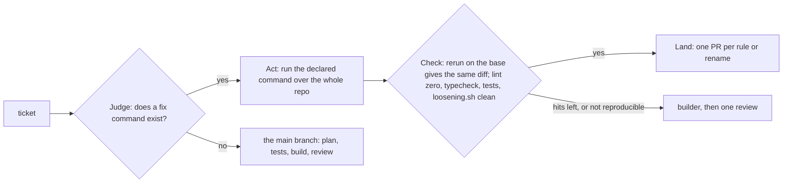

# 0615: A ticket with a fix command takes a mechanical branch of the pipeline, built from Judge, Act and Check with no plan and no test writer, and leaves it for builder and review when the command cannot finish it



```ts
// A sketch. Six primitives (0421), packages/pipeline/src/primitives.ts, wired as a branch.
// Judge  -> "is there a command that makes this whole change?"  ("I don't know" = no)
// Act    -> run it: `oxlint --fix --rule X`, or a codemod
// Check  -> same command on the PR's base, same diff; then the usual checks
```

**What this decides:** the pipeline has a second branch, for tickets a command can finish, and which steps it skips.

## Context

The owner read how [kamp-us/demlik](https://github.com/kamp-us/demlik) works. Its CLAUDE.md, "Work
flows through fabrika", has one operator run builder, then reviewer, then shipper; a plan only for an
epic; and a big change lands as one pull request (the `_tag` rekey touched about 100 files in one).
Our new pipeline is built on the same ideas. What it lacks is a branch for tickets that are
mechanical. Here, sweeps were sliced by folder, each slice with a plan, tests and a review, and the
slices conflicted with each other and with every other pull request.

*Software Engineering at Google*, chapter 22 (large-scale changes): a tool-made change is generated
once and one global approver reads it whole, in place of many local approvers reading slices. Splitting
adds merge conflicts and review cost, and the checks stay the proof.

This builds on [0589](0589-agents-edit-files-with-any-tool.md) (a mechanical fold gets no review
agent) and [0099](0099-no-number-caps-a-pull-request.md) (no number caps a pull request). It changes
the sentence "every pull request goes through the steps" in its homes, per
[0605](0605-no-record-patches-another.md): [AGENTS.md](../AGENTS.md), the
[lead skill](../.agents/skills/lead/SKILL.md#how-a-change-lands), the
[plan skill](../.agents/skills/plan/SKILL.md), the [sev skill](../.agents/skills/sev/SKILL.md),
[the plan](../docs/plan/README.md#how-a-change-lands) and
[the direction note](../docs/direction/next-is-a-pipeline-pre-run.md#the-mechanical-branch). The records
that link that note's title ([0059](0059-pipeline-starts-from-the-work.md),
[0072](0072-a-churning-lane-is-redone.md)) are unchanged: the main branch still takes every step.

## Decision

**A ticket for which a fix command exists takes the mechanical branch: Judge, Act, Check, Land, with no plan and no test writer.**

- **Judge:** is this ticket mechanical, meaning a fix command exists for it (a lint rule with an
  autofix, a format change, a rename, a codemod)? A rule with no fixer first gets its fixer written
  into the rule, as one small pull request on the main branch, then comes back here.
- **Act:** run the declared command over the whole repo. One pull request per rule or rename, never
  sliced by folder.
- **Check:** the proof is reproducibility. The lead or CI reruns the same command on the pull
  request's base and gets the same diff. Then lint is at zero, typecheck passes, tests are green and
  `loosening.sh` is clean, plus the lead's read of the diff.
- **Land:** as any pull request does.
- **The "I don't know" exit:** if the command leaves hits it cannot fix, or the diff does not
  reproduce, the ticket leaves the branch for builder, then one review.
- **A rule we write ships with its fixer** wherever the fix is deterministic, as
  `context.report({ fix })`, and a rule with no fixer says why in one line in its file ("the fix
  needs judgment: which service to inject"). Existing rules get fixers backfilled, the ones with the
  most hits first, each as one small pull request.
- **Judgment sweeps** (the mock sweep, async to `Effect.gen`) have no single command: builder, then
  one review, with no plan per slice.
- **Product work** keeps plan, tests, build, review.

**Binding constraints**

- A new rule in `oxlint-plugins/` without a fixer and without its one-line reason is refused in
  review. [`oxlint-plugins/README.md`](../oxlint-plugins/README.md#a-rule-ships-with-its-fixer) holds
  the shape; 4 of 64 rules had a fixer on 2026-11-18, for example `prefer-namespace-import.ts`.

- The command is declared in the ticket, so a reader can rerun it.
- A change that needs a person's read of each site is not mechanical, even when a tool types it.
- It loosens no law. A `loosening.sh` hit waits on the owner ([0014](0014-the-lead-merges-when-every-step-passed.md)).
- Merge rules are unchanged: the queue, or the sev0 route in [0603](0603-no-stacks-and-sev0-admin-merges.md).

## Consequences

- Today's version: the lead runs the branch by hand, as the lead skill's steps. `next/` gets it as a
  pipeline branch, named in the direction note; its machine is built later from the six primitives.
- A sweep costs one big diff for the lead to read, by rule: the command, a sample, the checks. Conflicts
  fall to one merge per rule.
- What the plan step absorbed here: the case nobody listed. The "I don't know" exit and the
  reproducibility check catch it, since a fixer that does too much fails the rerun.
- Not decided here: how large a codemod pull request may get before the read is split; no number caps it (0099).
