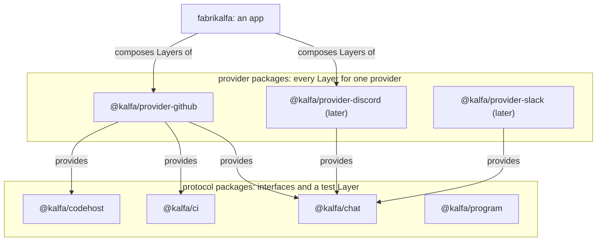

# 0616: A protocol package holds interfaces and a test Layer only, and each provider is one package named @kalfa/provider-<name> holding every Layer for it, as @effect/platform and @effect/platform-node do, never a provider's code inside a protocol package



```ts
// A sketch. In @kalfa/chat: the service and its test Layer. No provider code.
class Chat extends Context.Service<Chat, {
  readonly incoming: Stream.Stream<Message, ChatError>
  readonly reply: (to: MessageId, text: string) => Effect.Effect<void, ChatError>
}>()("@kalfa/chat/Chat") {
  static readonly test: Layer.Layer<Chat> = /* in memory */
}

// A sketch. In @kalfa/provider-github: one Layer for each protocol GitHub speaks.
export const Codehost: Layer.Layer<CodeHost, never, Credentials>
export const Runs: Layer.Layer<Runs, never, Credentials>
export const Chat: Layer.Layer<Chat, never, Credentials> // a comment that mentions the bot
```

**What this decides:** that a protocol package holds only interfaces and a test Layer, that each
provider is one package holding all its Layers, that `@kalfa/chat` is a new protocol package, and
that fabrikalfa is an app that composes them. Each provider package is named
`@kalfa/provider-<name>`, and `Journal` lives in `@kalfa/program` while `@kalfa/ledger` builds on it.

## Context

[0612](0612-kalfa-ci-holds-the-ci-protocol-once.md) put the GitHub Actions Layer at
`@kalfa/ci/github`, and [0614](0614-kalfa-codehost-holds-the-code-host-protocol-once.md) put the
GitHub code host Layer at `@kalfa/codehost/github`. That puts GitHub code in two protocol packages,
and a third provider would add a subpath to each. Swapping a provider would touch every protocol.

On 2026-11-18 the owner ruled that a protocol package holds only the interface, and each provider
is one package that holds every Layer for that provider.

The name follows Terraform. Its registry requires every provider repository to match
`terraform-provider-{NAME}`
([HashiCorp, publishing providers](https://developer.hashicorp.com/terraform/registry/providers/publishing)).
So the packages are `@kalfa/provider-github`, `@kalfa/provider-cloudflare` (the Ledger on Durable
Objects, and program hosting on Workers), `@kalfa/provider-discord` and `@kalfa/provider-slack`.

The model is Effect's own split: `@effect/platform` holds the protocols (`FileSystem`, `Path`,
`Terminal`, `HttpClient`) and `@effect/platform-node`, `@effect/platform-bun` and
`@effect/platform-browser` hold the implementations
([Effect-TS/effect, `packages/platform`](https://github.com/Effect-TS/effect/tree/main/packages/platform)).
A program written against the protocols runs on any of them, and a new runtime is one new package.

It builds on [0585](0585-kalfa-is-six-domain-packages.md), [0612](0612-kalfa-ci-holds-the-ci-protocol-once.md)
and [0614](0614-kalfa-codehost-holds-the-code-host-protocol-once.md), which make each protocol live
once; on [0601](0601-program-make-with-optional-pipes.md), which puts `@kalfa/program` among the
small libraries; and on [0231](0231-ledger-and-codehost-are-separate.md) (typed services, never a
direct `gh` call) and [0613](0613-kalfa-package-imports-are-a-guideline.md) (a kalfa package may
import another's protocol). Per [0605](0605-no-record-patches-another.md), 0612, 0614 and 0585 are
edited in place in the same pull request: their GitHub Layers moved from subpaths to
`@kalfa/provider-github`. Nothing is superseded.

## Decision

**A protocol package holds its Effect services (tags and types) and a test Layer, and no provider
code. Each provider is one package that holds every Layer for that provider. fabrikalfa is an app
that composes them.**

- **Protocol packages:** `@kalfa/codehost`, `@kalfa/ci`, `@kalfa/chat` and `@kalfa/program`.
  - Each holds services and a test Layer. The test Layer is the blueprint for the first real
    implementation: it shows what a Layer must do.
  - `@kalfa/chat` is new. It is how we talk to third-party chat providers: messages, threads,
    mentions, replies and buttons.
- **Provider packages:** one per provider, holding all its Layers.
  - `@kalfa/provider-github` provides codehost (pull requests, merges, pushes, labels, variables), ci
    (Actions runs) and chat.
  - GitHub chat is issue and pull request comments. A comment that mentions the bot is a chat
    message, the same as a Discord message.
  - Later: `@kalfa/discord` and `@kalfa/slack`, for chat.
  - Swapping a provider is one new package. No protocol package changes.
  - The name is `@kalfa/provider-<name>`, where `<name>` is the vendor's own short name, as
    Terraform's `terraform-provider-{NAME}` is. Others named so far: `@kalfa/provider-cloudflare`
    (the Ledger on Durable Objects, and program hosting on Workers), `@kalfa/provider-discord` and
    `@kalfa/provider-slack` (chat).
- **The Journal and the ledger.** The `Journal` interface and its memory test Layer live in
  `@kalfa/program`. `@kalfa/ledger` exports a `journal` Layer that builds a Journal on any `Ledger`.
  So ledger depends on program's interface, never the reverse. `@kalfa/ledger` names no storage.
  The storage is a provider's Ledger Layer, such as `@kalfa/provider-cloudflare`'s.
- **fabrikalfa is an app,** the same tier as fabrika: a tiny fabrika (one server, many clients)
  that composes kalfa packages into a bot usable from anywhere: this terminal, Discord, Slack or a
  fabrika tile.
  - Push and the other code host verbs work the same for a person and for a bot. Who acts is the
    credentials Layer that is provided ([0401](0401-agents-commit-as-the-fabrikalfa-bot.md) is the
    bot's identity).
  - Who may ask the bot for what is fabrikalfa's own rule. It is not in any kalfa package.

**Binding constraints:**

- No provider code (no GitHub, Discord or Slack API call) lives in a protocol package.
- A provider package holds Layers for protocols. It holds no pipeline logic and no app rule.
- A provider package imports protocols, never another provider package.
- A client asks a protocol, never a provider package, except the app that composes Layers.

## Consequences

- **Build plans change their target.** The ci and codehost plans of 0585's order put the GitHub
  Layers in `@kalfa/provider-github`. This record builds nothing and starts no plan.
- **The cost.** A provider package grows with each protocol it speaks, and `@kalfa/provider-github` is the
  first large one. A protocol's shape is a guess until two providers use it, and chat will have its
  second only with Discord or Slack.
- **Not decided here:** the service and field names, how a mention is told from other comments,
  who fabrikalfa lets ask for what, and when `@kalfa/chat` or `@kalfa/provider-github` is built.

## Records

- `.glossary/TERMS.md`: new rows for protocol package, provider package, `@kalfa/chat` and
  fabrikalfa. The kalfa row names the new packages.
