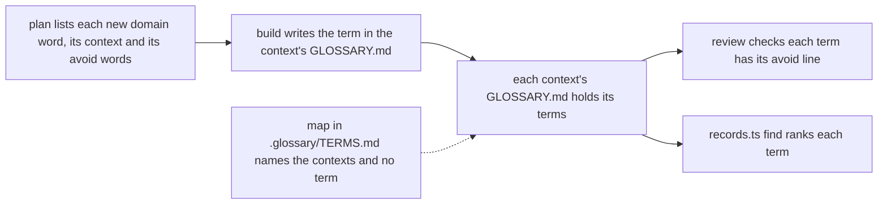

# 0617: The old glossary is reset: the map in .glossary/TERMS.md defines no term, and each context's words live in its own GLOSSARY.md



```md
**Term**:
What the word means here.
_Avoid_: the words to use instead
```

**What this decides:** the old glossary is reset, the map in `.glossary/TERMS.md` names the contexts and defines no term, and each context writes its own `GLOSSARY.md` when its words are decided.

## Context

- The owner ruled on 2026-11-18 that the old glossary is reset. The old file is 704 lines and about 460 term rows, and it stays in git history at commit 52aebb8. Nothing reads it as a source. Its words are decided again, one context at a time ([we follow DDD](../docs/direction/we-follow-ddd.md)).
- [0587](0587-new-helpers-and-names-cite-sources.md) has review check each new name against `.glossary/TERMS.md`. After the reset that file holds no term, so the check had nothing to read, and no step wrote a new word down. The reset is in [pull request 1669](https://github.com/kamp-us/tea-fabrika/pull/1669).
- [0001](0001-decisions-live-in-the-repo.md) and [0115](0115-decided-rules-live-in-decision-files.md) ask that a settled rule have a decision file. The reset had none until this one.
- [Use the industry's names](../docs/direction/use-the-industrys-names.md) keeps its rule. Its glossary lines change in the same pull request, so they say what the glossary is now.

## Decision

**The map in `.glossary/TERMS.md` names the contexts and defines no term. Each context's words live in its own `GLOSSARY.md`, as `**Term**:` entries with an `_Avoid_:` line, written when a word is first decided.**

- The plan lists each new domain word with its context and its `_Avoid_` words, and names `<context>/GLOSSARY.md` in its files table.
- The build writes those terms in that file, and creates the file when its context has none yet.
- The review checks that each new domain word is in its context's `GLOSSARY.md` with an `_Avoid_` line, or sends the diff back.
- `records.ts find` ranks every term of every `GLOSSARY.md` with the decisions, notes and experiments.

**Binding constraints:**

- The map's context list is a draft, checked with Event Storming on real flows. Its borders may move without a new decision.
- A word is written when it is decided, never copied from the old file.

## Consequences

- This record changes part of [0587](0587-new-helpers-and-names-cite-sources.md). Its text is not patched ([0605](0605-no-record-patches-another.md)). The rule's home is the review skill, which this pull request changes: review checks each name against its context's `GLOSSARY.md`, not against `.glossary/TERMS.md`. 0587 stays `accepted`, and its title still names what it decides.
- The 54 records that name `.glossary/TERMS.md`, and the records that name rows of the old glossary, such as 0081's, say what a past change added or read at the time. Those lines are history and stay as written ([0605](0605-no-record-patches-another.md) keeps a history line as it is).
- Older records word a rule in the old glossary's shape. [0091](0091-modules-and-layers.md) says "the glossary's sections are the contexts" and names "the glossary's term column", and [0607](0607-every-link-lands-on-a-live-record.md)'s title says "glossary row". The rules they state still hold in the form this record gives, and their text stays as written ([0605](0605-no-record-patches-another.md)).
- No old term moves into the new files. A context gets its `GLOSSARY.md` in the pull request that decides its words.
- This record coins no domain word, so it adds no term.
- Not decided here: which contexts are real (the map's Event Storming check), and whether a weekly drift check runs. [We follow DDD](../docs/direction/we-follow-ddd.md) says that check is not built.
