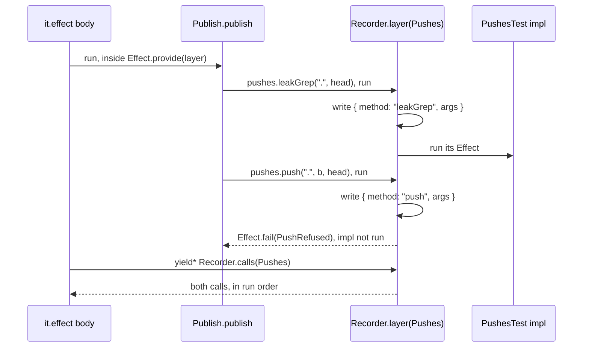

# A law watches a service's calls with a `Recorder`



```ts
// .agents/skills/lead/scripts/pr/PushesTest.ts:17-31
export type Failing = Recorder.Fails<Pushes["Service"]>;

export const layer = (r: Remote, fails: Failing = {}): Layer.Layer<Pushes | Recorder.Recorded<Pushes>> =>
  Recorder.layer(
    Pushes,
    {
      leakGrep: () => Effect.void,
      leakChange: () => Effect.void,
      leakText: () => Effect.void,
      push: (_dir, branch, head) =>
        Effect.sync(() => {
          r.branches.set(branch, head);
        }),
    },
    { fails },
  );

// .agents/skills/lead/scripts/pr/Publish.test.ts:94-104, trimmed: the read sits inside the provide
const m = memory([], { pushes: { push: new PushRefused({ reason: "rejected" }) } });
return Effect.gen(function* () {
  const e = yield* Effect.flip(Publish.publish(ask(b, head)));
  expect(e._tag).toBe("PushRefused");
  expect(yield* Recorder.calls(Pushes)).toEqual([
    { method: "leakGrep", args: [".", head] },
    { method: "push", args: [".", b, head] },
  ]);
}).pipe(Effect.provide(m.layer));
```

`Recorder.layer(Service, impl, { fails })` (`next/packages/vitest/src/Recorder.ts:162`) provides
the service and records each run of its effectful members as `{ method, args }`. `impl` has the type
Effect's `Layer.mock` takes, `Layer.PartialEffectful<S>`, and the Recorder hands it to `Layer.mock`
(`Recorder.ts:169`), so a member the law leaves out dies with `UnimplementedError` when used, and
is not recorded (law R10, `next/packages/vitest/src/Recorder.test.ts:276`).

- **A call is a run.** The record is written when the Effect runs, not when the method is called
  (`Recorder.ts:125`). An Effect built and dropped leaves no record, one retried leaves two, and one
  that never ends is recorded at its start (law R8, `Recorder.test.ts:210`). A Stream method is
  recorded when its stream starts (`Recorder.ts:146`).
- **`fails` is a record of error values,** one per method, each of that method's own error type
  (`Recorder.Fails`, `Recorder.ts:78`). A named method is recorded, then fails with that very value,
  and the implementation's Effect or Stream is not run. A method that cannot fail cannot be named
  (law R3, `next/packages/vitest/src/Recorder.types.test.ts:49`). A test layer that switched
  failures by hand takes `Recorder.Fails<S>` as its `Failing` type, as `PushesTest.ts:17` does.
- **Read inside the provide.** `yield* Recorder.calls(Service)` needs `Recorded<I>` in its
  environment (law R4, `Recorder.types.test.ts:61`), and each build of the layer starts with no
  calls. So the read goes in the same Effect the layer is provided to, never after it.
- **One method's args:** `Recorder.calls(Service, "readFileString")` answers that method's argument
  lists, typed to its own parameters, so a law does not filter on `method` by hand
  (`next/packages/libfabrika/src/node/settings/Command.test.ts:131`).
- **A service we did not write** works the same: the settings law wraps Effect's
  `FileSystem.makeNoop(...)` in `Recorder.layer` (`Command.test.ts:97`), and types its list of write
  methods as `Recorder.Method<FileSystem.FileSystem>` (`Command.test.ts:66`), so a misspelled name
  does not compile.

## Where it applies

Any law in `next/` or our tooling that checks which calls code made on an Effect service. It stops
at what a call record is: method and args. The record keeps no answer, since the law wrote the
implementation. A stateful fake, such as `PushesTest`'s remote branches, stays in its service's own
test layer, beside the service (0538), and the Recorder wraps it. A plain function argument, a
platform object or a global such as `fetch` or `console` is not a service, so it needs a product
change to a service first (0555, 0579).

## Why it is not obvious

The plain ways are worse. `vi.fn` and `vi.spyOn` record `any` args, so a wrong arg still compiles,
and 0555 bans them in our code. A hand-written log in each test layer, as `PushesTest` kept before (one
string per call, such as `leakgrep <head>`), drops args it did not think of, `dir` there, and
repeats a failure switch per method. The Recorder is typed against the service's own interface: a method the
service lacks, a wrong arg type, or a wrong error in `fails` does not compile (laws R1 to R3).

## Decision

[0579](../.decisions/0579-property-laws-use-it-prop.md) names the Recorder; the shape is the
approved plan of ticket 1067.

> Derived from `effect@4.1.3` (`Layer.mock`, `Layer.PartialEffectful`); re-verify on pin bump.
