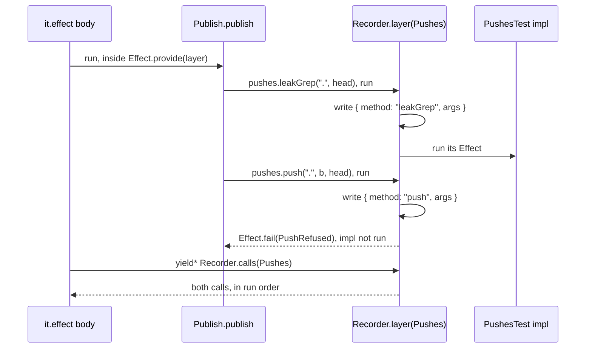

# A law watches a service's calls with a `Recorder`



```ts
// .agents/skills/lead/scripts/pr/PushesTest.ts:17-31
export type Failing = Recorder.Fails<Pushes["Service"]>;

export const layer = (r: Remote, fails: Failing = {}): Layer.Layer<Pushes | Recorder.Recorded<Pushes>> =>
  Recorder.layer(
    Pushes,
    {
      leakGrep: () => Effect.void,
      leakChange: () => Effect.void,
      leakText: () => Effect.void,
      push: (_dir, branch, head) =>
        Effect.sync(() => {
          r.branches.set(branch, head);
        }),
    },
    { fails },
  );

// .agents/skills/lead/scripts/pr/Publish.test.ts:94-104, trimmed: the read sits inside the provide
const m = memory([], { pushes: { push: new PushRefused({ reason: "rejected" }) } });
return Effect.gen(function* () {
  const e = yield* Effect.flip(Publish.publish(ask(b, head)));
  expect(e._tag).toBe("PushRefused");
  expect(yield* Recorder.calls(Pushes)).toEqual([
    { method: "leakGrep", args: [".", head] },
    { method: "push", args: [".", b, head] },
  ]);
}).pipe(Effect.provide(m.layer));
```

`Recorder.layer(Service, impl, { fails })` (`next/packages/vitest/src/Recorder.ts:215`) provides
the service and records each run of its effectful members as `{ method, args }`. `impl` has the type
Effect's `Layer.mock` takes, `Layer.PartialEffectful<S>`, and the Recorder hands it to `Layer.mock`
(`Recorder.ts:222`), so a member the law leaves out dies with `UnimplementedError` when used, and
is not recorded (law R10, `next/packages/vitest/src/Recorder.test.ts:276`). So `fails` may name
only a method `impl` gives, and a member `impl` names that the service lacks does not compile (law
R17, `next/packages/vitest/src/Recorder.types.test.ts:126`, and R18 on the call as a law writes it,
`Recorder.test.ts:310`). `layer` reads only which keys `impl` gives, never their values: an inline
`impl` widens a unique symbol member such as `[ShelfId]: ShelfId` to `symbol`, and a type read from
the whole `impl` would then miss what it left out.

- **A call is a run.** The record is written when the Effect runs, not when the method is called
  (`Recorder.ts:177`). An Effect built and dropped leaves no record, one retried leaves two, and one
  that never ends is recorded at its start (law R8, `Recorder.test.ts:210`). A Stream method is
  recorded when its stream starts (`Recorder.ts:198`).
- **`fails` is a record of error values,** one per method, each of that method's own error type
  (`Recorder.Fails`, `Recorder.ts:96`). A named method is recorded, then fails with that very value,
  and the implementation's Effect or Stream is not run. A method that cannot fail cannot be named
  (law R3, `next/packages/vitest/src/Recorder.types.test.ts:71`). A test layer that switched
  failures by hand takes `Recorder.Fails<S>` as its `Failing` type, as `PushesTest.ts:17` does.
- **Read inside the provide.** `yield* Recorder.calls(Service)` needs `Recorded<I>` in its
  environment (law R4, `Recorder.types.test.ts:83`), and each build of the layer starts with no
  calls. So the read goes in the same Effect the layer is provided to, never after it.
- **One method's args:** `Recorder.calls(Service, "readFileString")` answers that method's argument
  lists, typed to its own parameters, so a law does not filter on `method` by hand
  (`next/packages/libfabrika/src/node/settings/Command.test.ts:131`).
- **A service we did not write** works the same: the settings law wraps Effect's
  `FileSystem.makeNoop(...)` in `Recorder.layer` (`Command.test.ts:97`), and types its list of write
  methods as `Recorder.Method<FileSystem.FileSystem>` (`Command.test.ts:66`), so a misspelled name
  does not compile.

## Two cases where the law does not write `impl` itself

**The real service, recorded.** When a law needs the real implementation to run and only wants to
see its calls, the impl is the built service itself. It exists only inside an Effect, so the law
reads it there and turns it into the Recorder's layer with `Layer.unwrap`:

```ts
// next/apps/fabrika/src/door.integration.test.ts:3083-3086, :3127 and :3129
const clients = Layer.unwrap(
  ClientManager.pipe(Effect.map((real) => Recorder.layer(ClientManager, real))),
).pipe(Layer.provide(w.env));
// ...
expect(yield* Recorder.calls(ClientManager, "write")).toEqual([]);
// ...
}).pipe(Effect.provide(Gateway.layer(w.settings).pipe(Layer.provideMerge(Layer.merge(w.env, clients)))));
```

A whole service is a `Layer.PartialEffectful` of itself, so it passes as `impl` with no wrapper,
and every member still runs the real code: the Recorder's proxy calls the member on the real object
(`next/packages/vitest/src/Recorder.ts:191`). `clients` comes after `w.env` in the merge, so the
code under test gets the recorded `ClientManager`. The worse version this stops is a hand wrap,
`{ ...real, write: (...args) => { called(); return real.write(...args); } }` with a `vi.fn`: it
records one method, with `any` args, and a method added later is not wrapped.

**Code that provides its own layers.** When the code under test builds its layers itself, such as
an entry file that reads a layer the law sets and provides it, the law's own provide would build the
Recorder a second time. Each build makes a new store (`Recorder.ts:221`), so the law would read an
empty list from its own build and miss every call. The law builds the Recorder once, in a scope,
and hands the built context to the code with `Layer.succeedContext`, then reads the calls from that
same context with `Effect.provideContext`:

```ts
// next/apps/fabrika/src/file-services.laws.integration.test.ts:86-101, trimmed
Effect.scoped(
  Effect.gen(function* () {
    const files = yield* Layer.build(
      Recorder.layer(FileSystem.FileSystem, FileSystem.makeNoop({ makeDirectory: () => Effect.never })),
    );
    cli.layer = Layer.merge(Layer.succeedContext(files), Path.layer);
    vi.resetModules();
    yield* Effect.promise(() => import("../dev.ts"));
    instanceFailure(yield* Effect.exit(cli.work!), "parent_gone");
    expect(
      yield* Recorder.calls(FileSystem.FileSystem, "makeDirectory").pipe(Effect.provideContext(files)),
    ).toEqual([]);
  }),
);
```

`cli.layer` is the hoisted slot the file's `@effect/platform-node` stand-in hands to `dev.ts` as
`NodeServices.layer` (`file-services.laws.integration.test.ts:30-46`). However many times `dev.ts`
provides it, `Layer.succeedContext` builds nothing new, so there is one store. The scope keeps the
built context alive until the law has read it, and closes it after.

## Where it applies

Any law in `next/` or our tooling that checks which calls code made on an Effect service. It stops
at what a call record is: method and args. The record keeps no answer, since the law wrote the
implementation. A stateful fake, such as `PushesTest`'s remote branches, stays in its service's own
test layer, beside the service (0538), and the Recorder wraps it. A plain function argument, a
platform object or a global such as `fetch` or `console` is not a service, so it needs a product
change to a service first (0555, 0579). `Console` is the one service the Recorder cannot watch,
since its members answer `void`: a law provides Effect's `TestConsole.layer` and reads
`TestConsole.warnLines` (ours, through `patches/effect@4.1.3.patch`), as L17 does after `bundle.ts` prints through `Console.Console`
(`next/apps/fabrika/e2e/reload.visual.test.ts:302`).

## Why it is not obvious

The plain ways are worse. `vi.fn` and `vi.spyOn` record `any` args, so a wrong arg still compiles,
and 0555 bans them in our code. A hand-written log in each test layer, as `PushesTest` kept before (one
string per call, such as `leakgrep <head>`), drops args it did not think of, `dir` there, and
repeats a failure switch per method. The Recorder is typed against the service's own interface: a
method the service lacks, a wrong arg type, a wrong error in `fails`, or a `fails` entry for a
method `impl` leaves out does not compile (laws R1 to R3, R17 and R18). That holds for a union of names
and for an optional method too (laws R14 and R15). It has one limit: TypeScript's `infer` reads
only an overloaded method's last signature, so no one argument list types every call, and a service
with an overloaded method does not compile as a Recorder layer (law R16). Neither `Pushes` nor
Effect's `FileSystem` has one.

## Decision

[0579](../.decisions/0579-property-laws-use-it-prop.md) names the Recorder; the shape is the
approved plan of ticket 1067.

> Derived from `effect@4.1.3` (`Layer.mock`, `Layer.PartialEffectful`); re-verify on pin bump.
