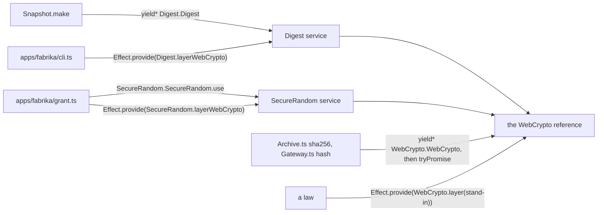

# Hashing, HMAC and random bytes go through Effect's crypto services



```ts
// next/packages/libfabrika/src/settings/Snapshot.ts:9 and :50-51
import { Digest } from "effect/crypto";

  const digest = yield* Digest.Digest;
  return yield* digest.digestHex(Digest.sha256, new TextEncoder().encode(text));

// next/apps/fabrika/cli.ts:16: the edge picks the implementation.
    Effect.provide([NodeServices.layer, TomlParser.layer, Digest.layerWebCrypto]),

// next/packages/libfabrika/src/telemetry/Archive.ts:38-41: a hash whose failure stays typed.
  const fail = (cause: unknown) => new SinkError({ reason: "storage", held: 0, cause });
  const crypto = yield* WebCrypto.WebCrypto;
  // oxlint-disable-next-line fabrika/no-promises -- edge: WebCrypto answers only with a Promise
  const work = Effect.tryPromise({ try: () => crypto.subtle.digest("SHA-256", bytes), catch: fail });
```

Domain code asks for a crypto service with `yield*` and never touches the global `crypto.subtle`
or `crypto.getRandomValues`. The program's edge provides the WebCrypto layer, and a test can
provide another. Every service's `layerWebCrypto` reads Effect's `WebCrypto` reference
(`node_modules/effect/src/crypto/WebCrypto.ts:37`), a `Context.Reference` whose default is
`globalThis.crypto`, so `WebCrypto.layer(stand-in)` (`WebCrypto.ts:68`) swaps the platform object
under all of them.

How a failure comes back differs by service:

- `Mac` and `Signature` fail with a typed `CryptoError` (`Mac.ts:161`, `:166`).
- `Digest` and `SecureRandom` have a `never` error channel (`Digest.ts:139-143`,
  `SecureRandom.ts:11`). A rejected WebCrypto digest is a defect: `Effect.promise` in
  `crypto/internal/digest.ts:14`.

What `effect/crypto` ships in 4.1.3, read from `node_modules/effect/src/crypto/`:

| Need | Service and call | Layer |
|---|---|---|
| A hash | `Digest.Digest`, `digest(algorithm, data)` or `digestHex(...)` with `Digest.sha256` (`Digest.ts:139-143`, `:85`) | `Digest.layerWebCrypto` (`Digest.ts:159`) |
| A hash whose failure must stay typed | the `WebCrypto.WebCrypto` reference's `subtle.digest`, under `Effect.tryPromise` (`WebCrypto.ts:37`) | none needed; `WebCrypto.layer(crypto)` to swap it (`WebCrypto.ts:68`) |
| An HMAC | `Mac.Mac`, `sign(key, data)` and `verify(key, tag, data)` (`Mac.ts:161`, `:166`); a key from bytes with `Mac.key(Mac.hmacSha256, bytes)` (`Mac.ts:295`, `:67`) | `Mac.layerWebCrypto`, which needs `SecureRandom` (`Mac.ts:279`) |
| Random bytes, ints, ids | `SecureRandom.SecureRandom`: `randomBytes`, `intBetween`, `shuffle`, `uuidV4`, `uuidV7`, `ulid` (`SecureRandom.ts:61-122`) | `SecureRandom.layerWebCrypto` (`SecureRandom.ts:282`) |
| A signature | `Signature` (`crypto/Signature.ts`) | its own `layerWebCrypto` |

Every one of these modules is marked `@stability unstable` in 4.1.3: it may change in a minor
release. We use them anyway, and a bump re-reads them.

Rules:

- **Ask for the service; let the edge provide it.** `Snapshot.make` yields `Digest.Digest`
  (`Snapshot.ts:50`), so its type says it needs one, and `cli.ts:16` and `dev.ts:111` provide
  `Digest.layerWebCrypto`.
- **A hash whose failure must stay typed reads `crypto.subtle` through the `WebCrypto` reference,
  not `Digest`.** `Digest` would turn a rejection into a defect. `Archive.ts:36-44` (`sha256`, a
  `SinkError` `storage`) and `Gateway.ts:2111-2135` (`fingerprint` and `hash`, a `LedgerError`
  `crypto`) yield `WebCrypto.WebCrypto` and hash under one `Effect.tryPromise` whose `catch` makes
  the typed error, its `fabrika/no-promises` edge comment directly above. A reference needs no
  provide, so the callers do not change. A law hands in a stand-in with `WebCrypto.layer`
  (`next/packages/libfabrika/src/crypto.test-support.ts:29` and `:59`, read at
  `telemetry/ErrorCause.test.ts:40-41`).
- **Random bytes and ids come from `SecureRandom`.** `grant.ts:69` makes a grant id with
  `SecureRandom.SecureRandom.use((random) => random.uuidV4())`, and `grant.ts:132` provides
  `SecureRandom.layerWebCrypto`. `Id.makeGenerator` (`next/packages/libfabrika/src/Id.ts:205-211`)
  yields `SecureRandom.SecureRandom` and draws its 10 bytes with `randomBytes(10)`, and a law
  provides `SecureRandom.make(fill)` with the bytes it wants (`Id.test-support.ts`, `generatorWith`).
  One bundled layer stays on purpose: `Id.Generator.layer` (`Id.ts:263-265`) provides
  `SecureRandom.layerWebCrypto` inside itself, so its about 50 callers need nothing. It stays until
  a law needs an edge to pick (the mock sweep's lib-top plan, amendment 2026-11-16).
  The service's `uuidV7` reads the `Clock`, so a test clock moves it
  (`SecureRandom.ts:90-107`); the module-level `uuidV7Unsafe` reads `Date.now()` and does not
  (`:381`).
- **An HMAC is `Mac.sign` and `Mac.verify`,** never `crypto.subtle.sign("HMAC", ...)`.
  `verify` compares tags in constant time inside the service (`Mac.ts:252`).
- **The bytes in are the same bytes.** `new TextEncoder().encode(text)` as before; only the call
  changes.

## Where it applies

Every hash, HMAC, signature and random value in `next/` product code, `Id.ts`'s monotonic TypeID
maker included. `SecureRandom.uuidV7` cannot replace that maker without a format change: its
layout is a 42-bit counter plus 32 fresh random bits per id, where `Id.ts` keeps a 74-bit random
field that counts up, so every id's bits and the `exhausted` edge would change (checked against
`effect` 4.1.3's `SecureRandom.ts`, the `uuidV7` doc).

## Not yet

- `next/packages/libfabrika/src/runtime/Built.ts:30-31` uses `Digest` but provides
  `Digest.layerWebCrypto` inside `hash` itself, so its callers cannot pick the layer.
- `next/packages/libfabrika/src/gateway/Gateway.ts:732` and `:2109` call the global
  `crypto.getRandomValues`.
- `next/packages/libfabrika/src/gateway/GatewayNonce.ts:37`, `:61`, `:68`, `:71` and `:98` make a
  key and salt with `crypto.getRandomValues`, and import an HMAC key, sign and verify with
  `crypto.subtle`. The stateless nonce itself stays (a SYN cookie); only the calls move to `Mac` and
  `SecureRandom`.

## Why it is not obvious

An agent knows WebCrypto and older Effect, and older Effect had no crypto module. So it writes the
global `crypto.subtle` inside a `tryPromise`, which works on Node and workerd and passes every law.
Each copy then needs its own edge comment and its own error mapper, and none can be swapped in a
test, so a law patches the global with `vi.spyOn`. The opposite mistake is to move a typed hash to
`Digest` and lose the typed error to a defect.

## Holds it

- Effect's checker, on at `error`: `globalRandomInEffect` (`tsconfig.base.json:47`), which refuses
  `Math.random` inside an Effect. `cryptoRandomUUID` and `cryptoRandomUUIDInEffect` are off and found
  0 hits in the study's run, so they could block at no cost.
- The mock lock in `.oxlintrc.json`, a pair of oxlint's own rules over `libfabrika/src/gateway/**`
  and `telemetry/**`, refuses `vi.fn`, `vi.mock`, `vi.doMock`, `vi.spyOn` and `vi.stubEnv`, so a law
  there cannot patch `crypto.subtle` and must hand in a stand-in through `WebCrypto.layer`.
  `vitest/no-restricted-vi-methods` follows a renamed `vi` import, and
  `eslint/no-restricted-properties`, with one `vi` entry per member, refuses a call chained onto the
  `vi` call, such as `vi.fn().mockReturnValue(1)`, which the vitest rule misses
  ([oxc#29656](https://github.com/oxc-project/oxc/issues/29656)). Their plants are `VI_METHODS` and
  `VI_PROPERTIES` in `oxlint-plugins/builtin-plants.ts:87` and `:107`, run by
  `oxlint-plugins/plants.test.ts:680`.
- The laws that pass only through the reference: `telemetry/ErrorCause.test.ts` C1 (the rejected
  digest is `storage`, and the stand-in saw exactly the body) and the three paused-hash laws of
  `gateway/GatewayRevocation.integration.test.ts`.
- No check finds the global `crypto.subtle` or `crypto.getRandomValues` in product code: Effect's
  `nodeBuiltinImport` sees only `node:crypto`. A lint rule of ours is proposed in the Effect code
  guidelines study (experiment 262, not on main yet), not built.

## Decision

[Build on Effect](../docs/direction/build-on-effect.md): Effect's own modules first;
[0040](../.decisions/0040-existing-tools-before-hand-written.md): an existing tool before a
hand-written one; [0555](../.decisions/0555-no-vi-mock-or-domock.md): no `vi` mock in a law. The
typed digest through the `WebCrypto` reference is the merge session's ruling of 2026-11-15,
recorded in the plan for ticket 1067's mock sweep of `gateway`, `processes` and `telemetry`.

> Derived from `effect@4.1.3`; re-verify on pin bump.
