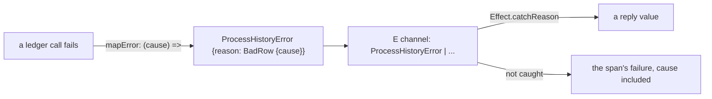

# An error keeps its cause and is caught by its tag



```ts
// A cause every caller has is required.
// next/packages/libfabrika/src/processes/ProcessHistory.ts:26, :34 and :42-44
export class BadRow extends Schema.TaggedError<BadRow>()("BadRow", { cause: Schema.Defect() }) {}
export class Storage extends Schema.TaggedError<Storage>()("Storage", { cause: Schema.Defect() }) {}
export class ProcessHistoryError extends Schema.TaggedError<ProcessHistoryError>()("ProcessHistoryError", {
  reason: Schema.Union([Unreachable, BadRow, Storage]),
}) {}

// next/packages/libfabrika/src/processes/ProcessHistoryLedger.ts:17: one helper makes it.
const badRow = (cause: unknown) => new ProcessHistoryError({ reason: new BadRow({ cause }) });

// A cause that may be missing is Schema.optional, never Schema.optionalKey.
// next/packages/libfabrika/src/ledger/Ledger.ts:32-36
reason: Schema.Literals(["unreachable", "bad_row", "storage", "refused", "crypto"]),
message: Schema.optional(Schema.String),
cause: Schema.optional(Schema.Defect()),

// next/packages/libfabrika/src/cloudflare/runtime.ts:508: a call with no cause to pass.
Effect.catchDefect(() => Effect.fail(new LedgerError({ reason: "storage" }))),

// A reason caught by its tag. next/packages/libfabrika/src/node/repositories/Sources.ts:167
Effect.catchReason("RepositoriesError", "MissingPath", () => Effect.succeed(null)),
```

An error is a `Schema.TaggedError`. When it wraps a failure from below (a rejected Promise, a
`SchemaError`, a throw in a SQLite callback), it has a `cause` field, and every `catch` and
`mapError` that builds it passes the cause on. A handler catches by tag with `Effect.catchTag`,
`Effect.catchTags` or `Effect.catchReason`, on an error union the type spells out.

The cause is written in one of two forms, as the Effect library writes it
([0568](../.decisions/0568-error-cause-follows-effect.md)):

| Every caller has a cause? | The field |
|---|---|
| yes | `cause: Schema.Defect()` |
| no, some call has none | `cause: Schema.optional(Schema.Defect())` |

Never `Schema.optionalKey` on a cause. In the installed `effect` 4.1.2, `node_modules/effect/src`
writes the optional form 16 times (`workers/WorkerError.ts:46`, `socket/Socket.ts:451`), the
required form 12 times (`sql/SqlError.ts:21`) and `optionalKey` around a `Schema.Defect()` never.
`Schema.optional` is `optionalKey` with `undefined` added (`node_modules/effect/src/Schema.ts:2434`).
With `exactOptionalPropertyTypes` on (`tsconfig.base.json:8`), that is what lets
`new X({ reason, cause })` compile when `cause` may be `undefined`. Ordinary optional fields are
another rule: `Schema.optionalKey` stays their default
([0566](../.decisions/0566-effect-skill-pieces-taken.md), N8).

Effect's own example error carries the cause (`node_modules/effect/AGENTS.md`, "Context.Service",
and `ai-docs/src/01_effect/03_services/20_layer-unwrap.ts`,
`catch: (cause) => new MessageStoreError({cause})`).
[clanka](https://github.com/Effectful-Tech/clanka/blob/44eb97a4eff8ae00bcf18750b387fe5a98cd191c/src/CodexAuth.ts#L50-L59),
a library by an Effect maintainer, does it on every boundary error
([`CopilotAuth.ts:47-52`](https://github.com/Effectful-Tech/clanka/blob/44eb97a4eff8ae00bcf18750b387fe5a98cd191c/src/CopilotAuth.ts#L47-L52),
[`ExaSearch.ts:46-47`](https://github.com/Effectful-Tech/clanka/blob/44eb97a4eff8ae00bcf18750b387fe5a98cd191c/src/ExaSearch.ts#L46-L47)),
and catches by tag ([`Agent.ts:613`](https://github.com/Effectful-Tech/clanka/blob/44eb97a4eff8ae00bcf18750b387fe5a98cd191c/src/Agent.ts#L613))
or by reason ([`AgentTools.ts:698-700`](https://github.com/Effectful-Tech/clanka/blob/44eb97a4eff8ae00bcf18750b387fe5a98cd191c/src/AgentTools.ts#L698-L700)).

Rules:

- **Keep the cause.** `catch: (cause) => new X({..., cause})`,
  `Effect.mapError((cause) => new X({..., cause}))`. A callback with no parameter throws the reason
  away. The cause does not go in a span tag: it rides in the span's failure. A real one:
  `Effect.mapError((cause) => new TasksError({ reason: "storage", cause }))`
  (`next/packages/libfabrika/src/tasks/TasksLedger.ts:189`).
- **Pick the cause's form from the call sites.** Read every place that makes the error. If each
  one has a cause, the field is required. If one has none, it is `Schema.optional`. Never
  `Schema.optionalKey`.
- **Catch by tag.** `catchTag` / `catchTags`, never `catchIf(e instanceof X)`. The real use is
  `Effect.catchTag("PlatformError", ...)` (`next/packages/libfabrika/src/node/settings/Load.ts:53`).
- **Never `instanceof` on a Schema class.** In a handler, `catchTag`. In a guard, `Schema.is(X)`
  (`node_modules/effect/src/Schema.ts:1461`), as `next/packages/libfabrika/src/gateway/Gateway.ts:102`
  does. Effect's checker names this `instanceOfSchema`.
- **Read a typed error out of a `Cause` with `Cause.findError`,** never `Cause.squash` then
  `instanceof`. `findError` returns a `Result` of the first typed error `E`
  (`node_modules/effect/src/Cause.ts:971`; `Cause.findErrorOption`, `:997`, gives an `Option`).
  `squash` picks one value, a failure, else a defect, else a made-up `Error`, and Effect's own doc
  calls it lossy (`Cause.ts:860-889`). `squash` stays only where a span names one error's class
  (`next/packages/libfabrika/src/telemetry/Trace.ts:335`).
- **Never widen to `unknown`.** A helper takes `Effect.Effect<A, E | NotGranted>`, not
  `Effect.Effect<A, unknown>`. Once the type is `unknown`, `catchTag` cannot be written, and
  `instanceof` is all that is left.
- **Fail by yielding.** `return yield* new X(...)`, never `throw` inside `Effect.gen`
  (`fabrika/no-throw-in-effect-gen`). A throw stays only inside a sync SQLite transaction, where it
  is how the transaction rolls back, and is caught into a typed error at the Effect border.
- **The key is `reason`** (`next/packages/libfabrika/src/ledger/Ledger.ts:32`).
- **A family of cases** is one service error whose `reason` is a union of tagged errors
  ([0119](../.decisions/0119-an-errors-reason-is-a-tagged-error.md)), handled with
  `Effect.catchReason` (`ai-docs/src/01_effect/04_errors/20_reason-errors.ts`).
  `ProcessHistoryError` and `RepositoriesError`
  (`next/packages/libfabrika/src/repositories/Repositories.ts:109-110`) have that shape. Older
  errors such as `LedgerError` still hold a string literal `reason`, which `catchReason` cannot
  reach.

## Where it applies

Every error class and every error handler in `next/`. Stops at the edge where a platform hands us an
untyped value (a user's program that threw, `ProgramDown`): that value is the cause, kept as a
`Defect`, never re-tagged by guesswork.

## Today's code breaks this

A regex count on main `a16c31d54`, in `next/` product code (tests and test support left out), so a
size, not a list:

- 12 causes are `Schema.optionalKey(Schema.Defect())`, for example
  `next/packages/libfabrika/src/client/Journal.ts:58` and `next/apps/fabrika/dev.ts:22`. Each
  becomes required or `Schema.optional` once its call sites are read (0568). The other causes are
  58 required and 14 `Schema.optional`.
- 27 `mapError(() =>` and 80 `catch: () =>`, `catch: fail` or `catch: unreachable`. For example
  `next/apps/fabrika/src/exam/compiler.ts:17` drops the read failure and keeps only the path.
- 13 `catchIf` calls, some with an `instanceof` guard.

## Why it is not obvious

`mapError(() => new LedgerError({reason: "bad_row"}))` compiles, passes every law and reads clean.
What it loses shows only when someone debugs a live failure and the span says `bad_row` and nothing
else. `instanceof` on a Schema class is correct JavaScript too, so nothing flags it; it only stops
working once the error type has been widened, which is why the two slips travel together. And
`Schema.optionalKey` on a cause reads like the default for any optional key, which it is for other
fields, but the library never writes it there, and it makes every call that may have no cause
spread the field in by hand. The repo wants errors as data with their facts
([errors are diagnostics](../docs/direction/errors-are-diagnostics.md), proposed), and a dropped
cause is a dropped fact.

## Holds it

- Lint, on: `fabrika/no-data-taggederror`, `fabrika/no-throw-in-effect-gen` and
  `fabrika/no-cause-squash` (`.oxlintrc.json:38`, `:44`, `:667`), with oxlint's
  `no-restricted-properties` on `Data.TaggedError` beside the first (`:56`). Ours stays because
  only it refuses `Data.TaggedError` in a type position
  ([0573](../.decisions/0573-trusted-lint-rule-replaces-ours.md)).
- Effect's checker, on in `next/`: `preferSchemaTaggedError` (`tsconfig.base.json:55`) and
  `errorPayloadShadowsName` (`tsconfig.base.json:81`). Not yet on:
  `anyUnknownInErrorContext` and `instanceOfSchema`; [0565](../.decisions/0565-effects-own-checks-block.md)
  turns every check on, one at a time.
- No check holds the cause's form. Whether a lint rule or a checker check holds "no `optionalKey`
  on a cause" is for the cleanup's plan (0568).
- A dropped cause has no built-in check. A custom oxlint rule could flag a `catch:` or `mapError`
  callback with no parameter; not built.

## Decision

[0568](../.decisions/0568-error-cause-follows-effect.md) for the cause's form,
[0119](../.decisions/0119-an-errors-reason-is-a-tagged-error.md) for tagged reasons, and
[Build on Effect](../docs/direction/build-on-effect.md): Effect's own modules and shapes first.
Credit: kamp-us/phoenix's [effect-errors.md](https://github.com/kamp-us/phoenix/blob/4802776ad4911ac025ecfbf7bc49f6c17e13e2bb/.patterns/effect-errors.md)
and [effect-error-operators.md](https://github.com/kamp-us/phoenix/blob/4802776ad4911ac025ecfbf7bc49f6c17e13e2bb/.patterns/effect-error-operators.md)
(`catchTag` over `catch`, `cause: Schema.Defect()` on infra errors, no `instanceof` chains), rethought
for Effect 4.1.2 and for errors that cross object boundaries as data.

> Derived from `effect@4.1.2`; re-verify on pin bump.
