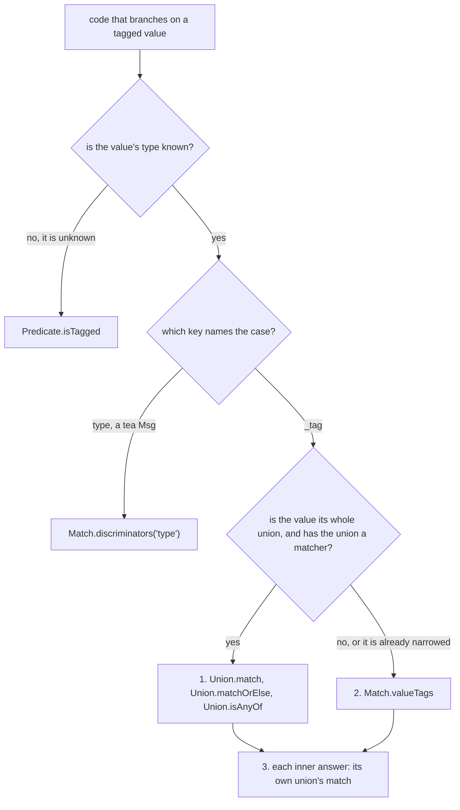

# A tagged value is matched by its union, never compared by hand



```ts
// next/packages/libfabrika/src/telemetry/Trace.ts:41: the union's own match, one key per case.
export const chainName = (chain: Chain): string =>
  Chain.match(chain, { job: ({ process }) => `job/${process}`, spans: () => "spans" });

// next/packages/libfabrika/src/transport/Answer.ts:94 and :106: Effect's own guard for an Exit,
// then the answer inside it matched by its own union.
  if (Exit.isFailure(exit)) {
    // ...
  }

  return Answer.match(exit.value, {
    ok: ({ result }) => ({ send: JSON.stringify({ jsonrpc: "2.0", id, result }), attached }),
    refused: ({ reason, retryAfter }) => ({ /* ... */ }),
    parked: ({ stream, after }) => ({ /* ... */ }),
```

Every union we define is a `Schema.TaggedUnion`, and each one carries its own `match`,
`matchOrElse`, `isAnyOf` and `guards` (`node_modules/effect/src/Schema.ts:6543-6548`). Code that
branches on a tagged value uses them, in this order.

## The four points

1. **The union's own matcher first.**
   - `Union.match(value, {...})`: one key per case. A case with no key does not compile, and the
     error names it. In use at `next/packages/libfabrika/src/access/Access.ts:362`,
     `next/packages/libfabrika/src/ledger/internal/ledgerStore.ts:311` and about 30 calls in all
     in `next/`.
   - `Union.matchOrElse(value, {...}, orElse)`: some cases, then the rest
     (`Schema.ts:6502`). The fallback gets the value narrowed to the cases that have no key.
   - `Union.isAnyOf([...])`: a yes or no for a subset of cases, which also narrows
     (`Schema.ts:6543`). A check for one case is a subset of one, which is the decision writer's
     reading and not the owner's words (0567 says so).
   - One of Effect's own types uses its own module, by the same reading: `Exit.match` and `Exit.isSuccess`
     (`Exit.ts:776`, `:406`), `Option.match` and `Option.isSome` (`Option.ts:418`, `:385`),
     `Result.match` and `Result.isSuccess` (`Result.ts:1218`, `:744`). In use at
     `next/packages/libfabrika/src/transport/Answer.ts:94`.
2. **The `Match` module second.**
   - `Match.valueTags(value, {...})` (`Match.ts:474`), where the value is already narrowed to some
     of the union's cases, or the union has no matcher of its own. `Union.match` wants a key for
     every case of the union, the ones the value can no longer be included.
   - `Match.discriminators("type")({...})` (`Match.ts:1121`) for a tea Msg, which is keyed by
     `type`. It leaves the matcher open, so `Match.exhaustive` or `Match.orElse` follows it.
3. **Each inner answer is matched by its own union,** inside the case that holds it: the outer
   matcher picks the state, and the answer the Msg carries is matched with that answer's union.
   In use at `next/packages/libfabrika/src/transport/Answer.ts:106`.
4. **Never `Predicate.isTagged` on a value whose type is known.** Its input is `unknown`
   (`Predicate.ts:1452`), so it checks nothing about the tag you wrote. It is for a value from
   outside, as at `next/apps/fabrika/src/local-instance.ts:16`, where the error is `unknown`.

## All four in one handler

A sketch, not on main. It is the merge machine's `reduce` and `refuse`
(`next/programs/pipeline/src/Merger.ts:262` and `:408` today), rewritten and type-checked against
effect 4.1.2 and tea 0.25.0 for the decision. Its own 12 laws pass against it.

```ts
    return Match.valueTags(s, {                      // point 2: `s` is narrowed, `idle` is gone
      updating: (s) => {
        if (m.type !== "update_ok") {
          return stay(s);
        }

        return CodeHost.Updated.match(m.value, {     // point 3: the answer's own union
          current: (v) => (s.checked === null ? check(v, false) : /* ask to merge */),
          updated: (v) => (s.round === settings.rounds ? /* behind */ : check(v, true)),
          conflict: (v) => finish(s, Reply.cases.conflict.make({ ...identity(s), main: v.main, paths: v.paths })),
          moved: (v) => finish(s, Reply.cases.moved.make({ ...identity(s), head: v.head })),
          closed: (v) => finish(s, Reply.cases.closed.make({ ...identity(s), state: v.state })),
        });
      },
      // reading, checking and merging: one key each, the same way
    });

    refuse: (s, m) =>
      Match.value(m).pipe(
        Match.discriminators("type")({               // point 2: a Msg is keyed by `type`
          land: () => (idle(s) ? null : { reason: "busy" }),
          abandon: (m) =>
            Model.matchOrElse(                       // point 1: two cases, then the rest
              s,
              { idle: () => ({ reason: "idle" }), merging: () => ({ reason: "merging" }) },
              (s) => (m.ref !== s.job.ref ? { reason: "other_job" } : null),
            ),
        }),
        Match.orElse(() => null),
      ),
```

`idle` there is `const idle = Model.isAnyOf(["idle"])`, a subset of one. It was type-checked the
same way for this doc.

## Where it applies

`next/`, and our tooling under `.agents/`, `oxlint-plugins/` and `.github/ci/`, tests included. It
covers every branch on a `_tag`, and a tea machine's `update` handler like any other code. It
stops at a value of unknown type (point 4), and at today's app.

**Not yet.** Most of the tree still compares by hand, and nothing blocks it until a folder's
cleanup lands:

- `next/packages/libfabrika/src/runtime/BrainLife.ts:45`: `s._tag === "braked" || s._tag === "stopped"`,
  which is `BrainState.isAnyOf(["braked", "stopped"])`.
- `next/packages/libfabrika/src/transport/Answer.ts:102`: `exit.value._tag === "refused"`, four
  lines above that value's own `match`.
- `next/packages/libfabrika/src/runtime/Runner.ts:2007`: `exit._tag === "Failure"`, which is
  `Exit.isFailure(exit)`.
- `next/programs/pipeline/src/Merger.ts:262` and `:408`, the two rewritten above.
- `Match.valueTags`, `Match.discriminators`, `matchOrElse` and `isAnyOf` have no call in `next/`
  or our tooling yet.

## Intended scope

The cleanup goes state side first: the `_tag` checks on our states and answers and on `Exit`,
`Option` and `Result`. The checks on a Msg's `type` come last, since whether a Msg stays keyed by
`type` on the Effect side is still open. The bump to effect 4.1.3 lands before the cleanup leans
on `isAnyOf`.

## Decision

[0567](../.decisions/0567-a-tagged-value-is-matched.md) holds the rule, the two lint rules that
will block a hand comparison, the order of the cleanup and what is still open. It also says where
this is stricter than the Effect team's own code.

## Why it is not obvious

- **A plain `===` is what most code does,** Effect's own source included, and it is what an agent
  writes first. Here it will not pass lint.
- **`Predicate.isTagged(s, "idle")` looks like the fix and is the wrong one.** It passes the lint
  rule, and the rule's own message offers it. It takes `unknown`, so a misspelled tag compiles.
- **`Union.match` does not take a narrowed value.** It wants every case of the union, so a reader
  who knows point 1 gets a type error on a value that is already narrowed, and may fall back to
  `===`. `Match.valueTags` is the answer there.
- **`isAnyOf` does not check its keys on effect 4.1.2.** `isAnyOf(["typo"])` compiles
  (`Schema.ts:6543`, `<const Keys>` with no bound) and is always false. Effect 4.1.3 bounds the
  keys by the union's tags (<https://github.com/Effect-TS/effect/pull/10355>). `match`,
  `matchOrElse` and `Match.tag` already refuse a misspelled tag on 4.1.2.
- **`isAnyOf` and `matchOrElse` stay silent when the union gains a case.** Only a full
  `Union.match` makes the compiler point at every place that must handle it.

> Derived from `effect@4.1.2` and `@demlik/tea@0.25.0`; re-verify on pin bump.
