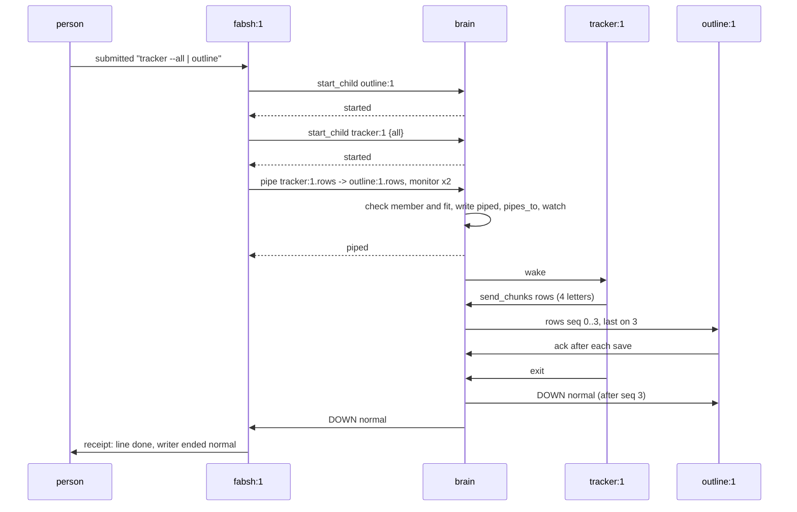

# How a pipe carries one program's output to the next one's input

**Proposed 2026-11-15.** The lead's lean, written so the owner can say yes or no before step 4 of
[Tier 1's build order](../plan/tier-1.md#the-build-order) ("Pipes, for built-ins first"). Every
claim here is about `next/`. Nothing here is decided until the owner says so.

```ts
// A sketch, next/: the whole idea in one block. `tracker` and `outline` are made up (see the list at the end).
// fabsh$ tracker --all | outline
startChild({ program: "fabrika/outline", name: "outline:1" });                  // the reader first
startChild({ program: "fabrika/tracker", name: "tracker:1", input: { all: true } });
pipe({ from: "tracker:1", output: "rows", to: "outline:1", input: "rows" });     // new: the brain checks and records it

// tracker's runner: its `rows` output changed, so it owes one chunked send, the newest value only.
sendChunks({ to: "outline:1", as: "rows", items: rows });                       // built in ticket 1041

// outline's inbox, in order: the chunks, then the writer's DOWN (end of output).
{ type: "rows", items: [/* 340 rows */], part: { id: "tracker:1/7/0", seq: 0, last: false } }
{ type: "rows", items: [/* 310 rows */], part: { id: "tracker:1/7/0", seq: 1, last: true } }
{ type: "DOWN", ref: "pipe_01h...", process: "tracker:1#1", reason: { _tag: "normal" } }
```

## What is already settled

Searched on 2026-11-15 in `.decisions/`, `docs/direction/`, `.glossary/TERMS.md`, `experiments/`,
the plan, and the open fabsh pull requests. None of these is reopened here.

- **A pipe is shell syntax over saved program mail,** one letter per chunk, never one letter per
  line and never an unsaved lane. A program can be piped with no shell present. An inbox has a cap,
  and a send to a full inbox answers `full` while the writer waits
  ([0109](../../.decisions/0109-a-pipe-is-saved-program-mail.md)).
- **Mail and pipes are two syntaxes over one transport.** The host binds the sender, saves the
  letter before it schedules the reader, and no program reads another's state or mailbox
  ([0103](../../.decisions/0103-a-program-may-mail-another-by-name.md)).
- **Programs meet on typed pipes, never by calling each other.** A pipe joins one chain and cannot
  fan in; the fit check refuses a pipe whose types do not match (G6 in the
  [program guidelines](./program-guidelines.md#g6-programs-meet-on-typed-pipes-never-by-calling-each-other)).
- **An output is a value picked from the model and sent when it changes,** never a Cmd, and `null`
  means nothing to send ([0260](../../.decisions/0260-an-output-is-a-model-value.md),
  [a program's shape](./program-shape.md)).
- **Pipes come in the order the four primitives set:** after `fabsh` is on screen, for its built-ins
  first ([0159](../../.decisions/0159-fabsh-pipes-summon-join-first.md), which lists this very
  question as not decided).
- **The shell is a regular program,** and a submitted line is a letter in its log
  ([0275](../../.decisions/0275-the-shell-is-a-regular-program.md)). It is `fabsh`, rethought from
  `tsh` and never copied ([0432](../../.decisions/0432-next-has-fabsh-rethought-from-tsh.md)).
- **A start is checked against the member whose line caused it,** and carries that member down
  ([0170](../../.decisions/0170-a-start-is-checked-against-its-sender.md),
  [0531](../../.decisions/0531-a-start-carries-its-member-down.md)). Every permission is one ReBAC
  system with relation rows on the ledger
  ([0526](../../.decisions/0526-one-rebac-permission-system.md)).
- **Settings:** a choice that fits as a `fabrika.toml` value is one
  ([0069](../../.decisions/0069-choices-are-settings.md)).
- **Built in ticket 1041, merged in
  [PR 1310](https://github.com/kamp-us/tea-fabrika/pull/1310):** an inbox holds at most
  `mail.unread` unread letters (default 256) and a `send` past it answers `full` with nothing saved;
  the reader's runner acks how far it read after each checkpoint save; `send_chunks` cuts a list
  into letters of at most `mail.chunk` bytes (default 64 KiB), in order, waits while the inbox is
  full, and mail to one name keeps its Cmd order
  (`next/packages/libfabrika/src/runtime/Send.ts`, `runtime/Chunk.ts`, `runtime/Runner.ts`,
  `processes/ProgramMailLedger.ts`). The defaults come from
  [experiment 295](../../experiments/295-inbox-cap-and-chunk-size.md).
- **Monitors are built, links are not.** A watch gets one `DOWN` when its process ends, or at once
  with `noproc` (`processes/ProcessManager.ts`; the
  [OTP table](./follows/otp.md) marks links and trap exit as Tier 4).
- **The pipe's look is decided:** a title wash and a letter, one of six hues per pipe
  ([0477](../../.decisions/0477-a-pipe-is-marked-by-a-wash.md),
  [0478](../../.decisions/0478-a-pipe-color-says-which-pipe.md)).
- **fabsh's guidelines, still proposed** in
  [PR 1254](https://github.com/kamp-us/tea-fabrika/pull/1254): answers are typed (F5), and a pipe
  is saved mail whose receipt names the pipe's letter (F6).

What today's version taught, read as lessons and not copied
([tea-program](./tea-program.md), [an input can take anything](./an-input-can-take-anything.md)):
a pipe ends only its own writer, and only the starter stops a run; a pipe into an input that acks
loses nothing to a kill; a value that must not be done twice carries its own id, kept by the
reader; and "outputs are events" made a reader wired late miss the first values, which is why
`next/` made outputs state.

### What the code does today

- A program's `outputs` are only schemas, `Record<string, Schema>`
  (`next/packages/libfabrika/src/runtime/Program.ts`), and nothing reads them. 0260's selector is
  not built yet.
- A child and its starter may mail each other with no grant; any other pair needs the host's closed
  list (`processes/ProgramMailLedger.ts`, `related`). Two programs on one line are siblings, so
  today they cannot mail each other.
- A chunk letter is `{type, items, part: {id, seq, last}}`, and `Chunk.join` gives a list back only
  for one whole send.
- An `exit` does not wait behind a `send_chunks` that is still waiting on a full inbox
  (`runtime/Runner.ts`, `behind` holds back only mail). So a writer that exits mid-send can leave
  its last value cut.
- A program has no `monitor` Cmd; only the brain, a window and the stop path write watches.
- fabsh on [PR 1232](https://github.com/kamp-us/tea-fabrika/pull/1232) reads `program [as name]`
  and four built-ins, `help`, `clear`, `history` and `programs`
  (`next/programs/fabsh/src/read.ts`). It has no `|` yet, and its built-ins answer inside its own
  process.

## The known ways

The Elm answer first, then OTP's, then the shells. Sources were read on 2026-11-15 unless marked
as a guess.

- **Elm: ports.** Two Elm programs share nothing; a value leaves through an outgoing port, a `Cmd`,
  and enters through an incoming port, a `Sub`, and the guide suggests sending `Json.Encode.Value`
  for richer data ([Elm guide, ports](https://guide.elm-lang.org/interop/ports.html)). The guide
  does not talk about back pressure or end of stream. Elm has no pipeline language at all; the
  shell's line is the named exception in [Elm first](./elm-first.md). What we take: a whole typed
  value goes out, and the reader's `update` takes it as a Msg.
- **OTP: messages and monitors.** Messages between one pair of processes keep their order; a
  monitor sends `{'DOWN', Ref, process, Pid, Reason}` when the process ends, at once with `noproc`
  if it is already gone; a link sends an exit signal both ways
  ([Erlang processes reference](https://www.erlang.org/doc/system/ref_man_processes.html)). A
  mailbox has no bound and a send does not wait, as our [OTP table](./follows/otp.md) records with
  its source. What we take: order per pair, and the `DOWN` as the end.
- **GenStage: demand.** A consumer asks for at most `max_demand` events and asks again at
  `min_demand`, so a producer never sends more than was asked. A producer buffers up to 10,000
  events by default. On the producer's exit, `cancel: :permanent` ends the consumer, `:transient`
  ends it only on an abnormal reason, and `:temporary` never
  ([GenStage docs](https://gen-stage.hexdocs.pm/GenStage.html)). What we take: the cap and the ack
  are already a demand window, and the three cancel modes name the choices for the end.
- **Unix pipes: bytes, a full buffer, end of file.** A write to a full pipe blocks until the reader
  reads; once every write end is closed, a read sees end of file; once every read end is closed, a
  write raises `SIGPIPE`, or fails with `EPIPE`; Linux holds 16 pages by default
  ([pipe(7)](https://man7.org/linux/man-pages/man7/pipe.7.html)). What we take: back pressure and
  the two ends. What we leave: bytes, which lose the types G6 needs.
- **PowerShell: objects, one at a time.** A pipeline sends objects, enumerates a list and sends its
  items "one at a time", and binds each to a parameter of the next command by value or by property
  name; a command fails when nothing binds
  ([about_Pipelines](https://learn.microsoft.com/en-us/powershell/module/microsoft.powershell.core/about/about_pipelines)).
  What we take: the reader may work on the first items before the last arrive. One letter per item
  is what 0109 refused.
- **Nushell: typed values and tables.** Commands talk in Nu's data types, a table being the usual
  one; each command declares what it takes and returns; bytes from an outside command become text
  ([Nushell pipelines](https://www.nushell.sh/book/pipelines.html)). What we take: a typed list
  between programs, and a declared input type the fit check reads.

The plain reading: OTP gives the transport, the order and the end; Unix gives the back pressure;
Nushell and PowerShell give the typed list, worked on as it comes. Nothing here is a custom
design that an industry answer already covers.

## The lean

### What one program's output is

**A piped output is a list, picked from the writer's model, sent whole each time it changes, and
only the newest value is owed.**

```ts
// A sketch, next/: 0260's output, with its selector, which Program.ts does not have yet.
export const tracker = Program.make({
	name: "fabrika/tracker",
	// ...
	outputs: { rows: Output.make(Schema.Array(Row), (m) => (m.loaded ? m.rows : null)) },
});
```

- The value is 0260's: a selector of the model, checked by tsc against the output's schema, with
  `null` for nothing yet. A pipe adds no new kind of output.
- A piped output's schema is a list (`Schema.Array`). A program with one value to give makes it a
  list of one. So every reader takes one shape, a chunk of items, and the cutting built in ticket
  1041 is the only cutting.
- When the value changes, the writer's runner owes one `send_chunks` of the whole value. If a newer
  value comes while one is still owed and not started, the newer one replaces it. A send already
  started finishes first, so the reader never sees two values mixed. This is the rule for state,
  not for events: the reader wants "what is true now", as a window does.
- The runner, not the program, sends it. The program never writes a Cmd for its output (0260), and
  it does not know who reads it.

### How the next program receives it

**In its own inbox, as letters of its input's type, in the order they were sent, folded one chunk
at a time.**

```ts
// A sketch, next/: a reader's input for a pipe is a chunk input (runtime/Chunk.ts, built).
const inputs = { rows: { schema: Chunk.input("rows", Row), description: "Rows to outline, from a pipe" } };

update: {
	// seq 0 starts a new value; later chunks add to it; `last` says it is whole.
	rows: (m, msg) => [
		{
			...m,
			rows: msg.part.seq === 0 ? msg.items : [...m.rows, ...msg.items],
			whole: msg.part.last,
		},
		[],
	],
},
```

- **Which mailbox:** the reader's own, `<name>/inbox`, the one every letter to it uses. No second
  inbox and no second lane.
- **Which tag:** the reader's input name, carried as `type` (`as` in `send_chunks`, since tea's Cmd
  input may not hold a `type`). The pipe names the input, so a reader with two list inputs is fed
  the one the line asks for.
- **Which order:** the order the writer's runner made its Cmds, which 1041 already keeps per pair,
  as OTP does.
- **Why chunk by chunk, not joined by the runner:** a reader that waits for `last` before it acks
  would hold the writer back on a list bigger than its cap times the chunk (256 letters of 64 KiB,
  16 MiB), and both would wait forever. A reader that folds each chunk acks each one, so any size
  goes through. It is also PowerShell's and Nushell's gift: an outline can draw the first rows
  while the rest come.
- **A cut send** (a final refusal after some letters were saved) shows as a seq 0 of a new `id`
  before any `last`. The reader starts the new value; nothing else is needed.

### How the pipe is made

**fabsh returns one new built-in Cmd, `pipe`. The brain checks it, records it and gives the mail
right. fabsh never carries the letters itself.**

```ts
// A sketch, next/: the operands are the line's own words; the runner binds who asks.
export const Pipe = Schema.Struct({
	from: ProcessName,
	output: Schema.NonEmptyString,
	to: ProcessName,
	input: Schema.NonEmptyString,
});

export const PipeRefusal = Schema.Literals([
	"no_name",      // `from` or `to` is not a live name
	"no_output",    // the writer declares no such output
	"no_input",     // the reader declares no such chunk input
	"does_not_fit", // the output's item schema is not the input's
	"cannot_tell",  // the fit check cannot decide; refused, as tsh's fit check refuses
	"taken",        // that input already has a pipe: a pipe cannot fan in (G6 R2)
	"forbidden",    // the member behind the line may not pipe these two
	"stale_sender",
]);

export const pipe = Cmd.make("pipe", {
	input: Pipe,
	ok: Schema.TaggedStruct("piped", { id: PipeId }),
	err: PipeRefusal.literals,
});
```

What the brain writes, in one ledger turn, when it says yes:

```ts
// A sketch, next/: the pipe's own events, on the reader's and the writer's streams.
export const PipeEvent = Schema.TaggedUnion({
	piped: {
		pipe: PipeId,
		from: ProcessName,
		output: Schema.String,
		to: ProcessName,
		input: Schema.String,
		cause: InputId, // the fabsh letter that held the line
		by: MemberId,   // the member that line was checked against (0170)
	},
	unpiped: {
		pipe: PipeId,
		reason: Schema.Literals(["writer_ended", "reader_ended", "stopped"]),
	},
});

// The mail right, as 0526 shapes every permission (a sketch of its row):
{ _tag: "related", subject: "process:tracker:1", relation: "pipes_to", object: "process:outline:1" }
```

- **The order fabsh uses:** start the reader, then the writer, then `pipe`, each after the one
  before answered. Since an output is state, the writer's runner sends its current value the moment
  it reads its `piped` row, so a writer that was quick loses nothing. The race today's version had
  with "outputs are events" is gone.
- **The fit check** reads the two declarations from the loaded builds: the writer's output item
  schema against the reader's input item schema. In v0 the two must be the same schema by its JSON
  Schema form; anything else is `does_not_fit` or `cannot_tell`. A looser fit (a subset, a named
  field as PowerShell's "by property name") waits for a real pair that needs it.
- **The right** comes from the line's member, never from fabsh's own program, as 0170 does for a
  start. It lives as long as the pipe, and `unpiped` takes it away.
- **One pipe per reader input.** G6 says a pipe joins one chain and cannot fan in, and a second
  writer's seq 0 would wipe the first one's value.

### How the end of output is said

**The OTP answer: the writer's `DOWN`, through a monitor the pipe sets for the reader, under the
pipe's id as its `ref`.**

- `pipe` also writes a watch: the reader watches the writer's live process, with `ref` = the pipe
  id. When the writer's life ends, the brain writes the `DOWN` into the reader's inbox in the same
  turn as `exited`, so it lands after the writer's last saved letter.
- The reason tells the two ends apart, as Unix's end of file and a broken upstream do: `normal` is
  "that is everything", and `crashed`, `kill` or `shutdown` is "it stopped early". The reader keeps
  what it has and shows the reason; it does not end, as `:temporary` in GenStage. A reader that
  wants to end with its writer sends itself `exit` on `DOWN`, as `:transient` does.
- **Owed before the end:** an `exit` must wait behind an owed send to a piped name, as a Unix
  `close` flushes. Today it does not (see above), so this is a small fix in `Runner.ts` that comes
  with the pipe.
- **A restart:** a pipe follows the name, like mail. If the writer crashes and its supervisor
  starts a new life, the reader gets one `DOWN` with `crashed`, then a seq 0 from the new life.
  The pipe ends (`unpiped writer_ended`) only when the name has no live process and none is coming.

### When the reader is slow or its inbox is full

**The writer waits, and only its newest value waits with it.**

- `send_chunks` already waits on `full` and tries again at its backoff (1041). The writer keeps
  working; its newer values replace the one owed, so a slow reader costs at most one value in flight
  and one waiting, never a growing queue.
- The reader's runner acks after each checkpoint save (1041), so every chunk it folds makes room.
- Nothing new is a setting here: `mail.unread` and `mail.chunk` already are, and "newest wins" is
  what an output is, not a knob a person turns.

### When either side ends or crashes

| What ends | What happens | The known way it follows |
|---|---|---|
| The writer, `normal` | The reader gets `DOWN normal` after the last chunk, keeps its value, shows "whole" | Unix end of file; GenStage `:temporary` |
| The writer, crashed | The reader gets `DOWN crashed`; a restart under the name sends again from seq 0 | OTP monitor; the supervisor's restart |
| The reader | fabsh gets its `DOWN`, writes `unpiped reader_ended`, and stops with `stop_child` each writer this line started; a writer it did not start keeps running, and its runner sends nothing more down that pipe | Unix `SIGPIPE` through the shell's job; OTP's "only the starter stops" |
| The person stops the line | fabsh stops every process the line started, reader first | a shell's Ctrl-C to the job |
| fabsh itself | Its children keep running, as 0276 keeps a tile's process to its `keep`; the pipe stays, and a new fabsh reads it from the ledger | an OTP child that outlives a dead parent with no link (links are Tier 4) |

fabsh watches each process its line starts, so it needs a `monitor` built-in Cmd, which programs
do not have yet. Links stay in Tier 4: two monitors cover a line, and no case above needs an exit
signal to kill the other side.

### What is recorded, so nothing is lost forever

- **Each letter** is a ledger entry like any letter: the sender bound by the host from the running
  process, never a field (0103), `sentAt` on the writer's clock and `arrivedAt` on the ledger's,
  its `pos` in the reader's inbox, and its trace.
- **What the writer saw:** a chunk's `part.id` is the writer's dispatched Cmd id,
  `<process>/<pos>/<index>`, so it names the exact step, and so the exact model, the value was
  picked from. Nothing new is needed for it.
- **What the reader saw:** its ack, and its checkpoint's `after`, say how far it had read.
- **Who made the pipe and why:** `piped` keeps the member and the fabsh letter that held the line.
  `unpiped` keeps why it ended. These are facts that exist only at that moment, so they go in now,
  even with nothing reading them yet.
- **What can wait, because it rebuilds from the log:** a pipe's throughput, how long the writer
  waited on `full`, how many values "newest wins" skipped. A span attribute for each is cheap and
  should be added with the build, but no field is lost without it.

### A browser is always a client

Every piece above is letters and Cmds on the brain: JSON of at most 64 KiB, ordered positions, and
the gateway's calls. No Node, no socket of its own, no file and no WebSocket frame. A fabsh tile in
a browser tab sends the same `submitted` line as one in the Electron app, and draws the same
receipts and pipe washes. A window never carries pipe letters; it sees each program's view.

### Built-ins first

0159 asks for pipes "for `fabsh`'s built-ins" first. A built-in runs inside the fabsh process, so
the lean is:

- **A built-in as the writer** (`programs | outline`, later `ps | outline`): fabsh itself is the
  writer. It starts the reader, which is its child, so the two may already mail each other, and
  sends the built-in's typed answer (F5) with `send_chunks`. It still writes `piped`, so the
  receipt and the record look the same as between two programs.
- **A built-in as the reader** (`tracker | history`) has no use yet and waits.
- So the first real pair needs one reader program. None is in `next/programs` today (`chaos`,
  `checklist`, `counter`, `inbox`, `pipeline`, `tezgah`).

## The line, traced letter by letter

`fabsh$ tracker --all | outline`, with 1,200 tickets of about 180 bytes each, so about 216 KB.

1. The person presses Enter. fabsh's inbox saves `{type: "submitted", line: "tracker --all | outline"}`
   at its next pos, say 41, stamped with the member.
2. fabsh reads the line again (0275): `tracker` a verb, `--all` a flag, `|` a pipe, `outline` a
   verb. Its line moves to `starting`, and it returns `start_child` for `outline:1`.
3. `start_child_ok` for `outline:1`. fabsh returns `start_child` for `tracker:1` with `{all: true}`.
4. `start_child_ok` for `tracker:1`. fabsh returns `pipe({from: "tracker:1", output: "rows", to:
   "outline:1", input: "rows"})` and two `monitor`s, one per process.
5. The brain checks the member behind letter 41, the names, the fit and that `outline:1`'s `rows`
   has no pipe. In one turn it writes `piped {pipe, from, output, to, input, cause: 41, by}`, the
   `pipes_to` row, and the watch with `ref` = the pipe id. It answers `piped`, and wakes
   `tracker:1`.
6. tracker's runner reads its `piped` row. Its `rows` output is already loaded, so it owes one
   `send_chunks({to: "outline:1", as: "rows", items})`, dispatched as Cmd `tracker:1/7/0`.
7. The cut gives four letters under 64 KiB: seq 0, 1 and 2 with `last: false`, and seq 3 with
   `last: true`. Each is saved in `outline:1/inbox` at pos 1 to 4, with the sender bound,
   `sentAt` and `arrivedAt`.
8. outline folds seq 0 (its rows replaced), saves, acks pos 1; then seq 1, 2 and 3. After seq 3 its
   view says the list is whole.
9. `--all` is a one-shot, so after `send_chunks_ok` tracker returns `exit`. The brain writes
   `exited normal`, and in the same turn the `DOWN` at outline's pos 5 and at fabsh's next pos.
10. outline shows "1,200 tickets, tracker ended". fabsh's receipt for line 41 says both processes
    and the pipe's letter, A, and that the writer ended `normal`.

Had outline been slow, step 7 would have met `full` at 256 unread letters, and tracker's runner
would have waited at its backoff while outline caught up. Had the person closed outline at step 8,
fabsh would have got its `DOWN`, written `unpiped reader_ended`, and stopped `tracker:1`.



## The other branches, and what each would lose

| Branch | What it would lose |
|---|---|
| A byte stream, as Unix | The types G6 and F5 rest on, and the fit check; every reader would parse text again |
| One letter per item, as PowerShell's one at a time | What 0109 refused: experiment 258 measured it slowing with each line |
| Every value as an event, no "newest wins" | 0260's "an output is state"; a slow reader would make the writer queue every past value, and a late reader would need the old ones replayed, the harm tea-program found |
| A JSON Patch of each change, as a view patch | Simple readers: each would keep a base and apply patches, and one lost base breaks it. Worth it only for a big list that changes often; no such pair exists to measure |
| The runner joins chunks and hands one whole Msg | Any list over 16 MiB (cap times chunk) would stop both sides for good, since the reader could not ack a part |
| The reader pulls the writer's query port, as GenStage's demand | The saved letters 0109 asks for, since a query is not saved, and 0103's "no program reads another's state" |
| fabsh relays every letter itself | Twice the writes, fabsh in the path of every pipe, and 0109's "a program can be piped with no shell present" |
| A link in place of two monitors | Nothing needs an exit signal to kill the other side; links are Tier 4. A link would also kill a reader that wants to keep a crashed writer's last value |
| fabsh's host grant list for the mail right | 0526: the list is one of the four 0526 replaces with relation rows |

## The owner's calls

Each is a yes or no. The lean is yes on all six.

1. **A piped output is a list, sent whole on each change, newest wins?** Lean yes, 75%. Why: it is
   0260's output as written, it keeps a slow reader's cost to one value, and it lets a late reader
   start from now. Cost: a big list that changes often is sent whole each time. The doubt: a log
   that only grows would resend everything; a measure on the first real pair, or a patch branch,
   settles it.
2. **The reader folds chunk by chunk, seq 0 starts a value and `last` closes it?** Lean yes, 85%.
   Why: it is the only shape that cannot stop on a list over 16 MiB, and the reader can draw early.
   Cost: each reader writes three lines of fold, which a libfabrika helper can give.
3. **fabsh asks with one built-in `pipe` Cmd, and the brain checks the member and the fit and
   writes `piped` and a `pipes_to` row as the mail right?** Lean yes, 70%. Why: it keeps the right
   with the member (0170, 0526) and the pipe on the record. Cost: a new Cmd, a new event and a
   relation the 0526 model must name. The doubt: 0526's model and API are a sketch, so the row's
   shape may move; the 0526 build settles it.
4. **End of output is the writer's `DOWN`, through a watch the pipe sets under its own id, and a
   pipe follows the name across a restart?** Lean yes, 70%. Why: it is OTP's monitor, already built
   and ordered after the last letter. Cost: an `exit` must wait behind owed sends, a small fix in
   `Runner.ts`. The doubt: a reader sees a crash and a restart as `DOWN` then seq 0, which may be
   too quiet for a person; the first crash in a real line settles it.
5. **When the reader ends, fabsh stops the writers its line started, and nothing else?** Lean yes,
   80%. Why: it is what a shell does to its job, and OTP's "only the starter stops". Cost: fabsh
   needs a `monitor` Cmd. The doubt: a writer someone else started keeps running with no reader,
   which is correct but may surprise.
6. **"Built-ins first" means a built-in as the writer, with fabsh itself sending, and the first pair
   needs one small reader program?** Lean yes, 80%. Why: a built-in runs in fabsh's process, so
   fabsh is the writer, and it already may mail its own child. Cost: one reader program that does
   not exist yet. The doubt: 0159 may have meant fabsh's shipped programs, not its in-process words;
   the answer changes only which pair is built first.

No new setting is proposed. Each new choice above was asked "is this a setting?": the fit rule,
"newest wins", one pipe per input and the end rule are what a pipe is, not values a person sets;
`mail.unread` and `mail.chunk` already are settings.

## What this note cannot tell us

- How the fit check should compare two Effect schemas past "the same JSON Schema". No real pair
  exists to show whether that is too strict.
- What "newest wins" skips in a real line, and whether anyone misses it. Nothing has run.
- Whether the ack after each checkpoint keeps up with a writer at 64 KiB letters on a Durable
  Object. Experiment 295 measured SQLite on the laptop only, and 0109's cloud cost was a guess.
- Whether a reader on another instance works the same. Delivery between instances is P41's later
  slice.
- How the receipt and the pipe's wash read with a screen reader. That needs a real run.
- Whether `exit` waiting behind owed sends has a case where a writer must end at once; `kill` would
  still end it, cutting the send, which the reader sees as a seq 0 with no `last`.

Made up, for the examples: the programs `tracker` and `outline` in `next/`, their `rows` output and
input, `Row`, `Output.make`, `PipeId`, `MemberId`, `pipe`, `PipeEvent` and the `pipes_to` relation.
Real: `send_chunks`, `Chunk.input`, `Part`, `full`, `mail.unread`, `mail.chunk`, `start_child`,
`stop_child`, `exit`, `DOWN` and the watch, all in `next/packages/libfabrika/src/`.
