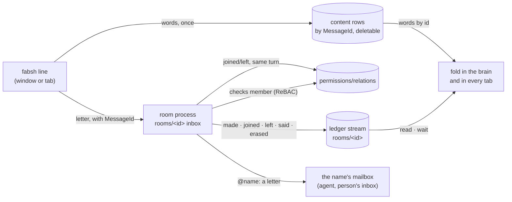

# The records a room keeps

**Proposed 2026-11-15.** This is the lead's lean for R8 of the
[summon guidelines](./summon-guidelines.md#r8-what-the-ledger-records-for-rooms-a-lean), written as
a pull request for the owner to decide, as step 8 of
[Tier 1's build order](../plan/tier-1.md#the-build-order) asks: "R8's shape is settled before any
talk line is saved." Every claim here is about `next/`. Nothing here is decided until the owner
says so.

```ts
// A sketch, next/. The whole idea: a room is a stream of five events, and the ledger's line
// around each one already says who wrote it, when on both clocks, and what the writer had seen.
// stream "rooms/room_01jx…", oldest first
{ _tag: "made",   room, name: "bug-17", via: "line", from: null }
{ _tag: "joined", room, member: { _tag: "agent", name: "scout", process } }
{ _tag: "said",   room, message: m1, from: ana, to: scout, targets: [], answers: null }
{ _tag: "said",   room, message: m2, from: scout, to: null, targets: [], answers: m1 }
{ _tag: "left",   room, member: { _tag: "person", person: ana }, reason: "left" }
// The words of m1 and m2 sit in a content row keyed by each message's id, deletable.
```

A "talk line" in the plan means one thing said in a room. This note calls it a **message**, the
word Slack, Matrix and our glossary already use for what a person or an agent sends
([`.glossary/TERMS.md`](../../.glossary/TERMS.md), the `message` row). "Line" stays the shell's
line and the ledger's line.

## Which version

`next/` only. Today's version has one person per app and keeps no rooms on a shared ledger
(R7). Nothing here changes today's code.

## What is already settled

Each point below is decided, and this note reopens none of them.

| Settled | Where |
|---|---|
| A room is a named place whose members are people and agents; `@scout` in it is a mention, and no agent owns a room | R1, [summon guidelines](./summon-guidelines.md#r1-a-room-is-a-place-with-members-an-agent-is-mentioned-in-it) |
| Every room is readable by everyone on the project; you type only in rooms you belong to; content stays deletable | R2 |
| `fork` stays; no message numbers; the data points at a message's id, never a count | R3 |
| Joining never moves the tile; a line to a room starts with `#room`; who is a member lives on the room | R5 (2026-11-07) |
| The first `@name` answers, every later one is a target; every `@name` is a mailbox address; the log keeps the line as typed and what each name meant then | [the `@` line](./summon-guidelines.md#the--line-decided-2026-11-07), A4, A5 |
| No DMs: a talk with one agent is a plain room of two that everyone can read; whether it keeps a `direct` mark is open | [0158](../../.decisions/0158-no-dms-only-rooms.md) |
| `join` puts a person in a room, one of the four primitives | [0159](../../.decisions/0159-fabsh-pipes-summon-join-first.md) |
| A lane's room is a decided room; a person's line that answers an ask is the same `answered` the window writes; an agent's line is never recorded as a person's | [0073](../../.decisions/0073-a-lane-has-a-room.md) |
| Every thread lives on the ledger, where both people can read it | [0289](../../.decisions/0289-talk-to-an-agent-never-start-it.md) |
| The ledger is a list of events with state folded from it; every entity has a stable typed id that code gives, never a place in a list | [0216](../../.decisions/0216-ledger-is-a-folded-list.md) |
| Every entry carries `seen`, filled by libfabrika, a bounded claim that never decides a lease, a limit, money or a grant; a window Msg carries no `saw` | [0225](../../.decisions/0225-entries-carry-what-writers-saw.md) |
| The ledger keeps one global order and is never sharded by stream | [0206](../../.decisions/0206-sealed-ledger-stretches-keep-one-order.md) |
| An event names its stream once; libfabrika makes its write | [0259](../../.decisions/0259-each-event-brings-its-write.md) |
| Every record names the build that wrote it | [0293](../../.decisions/0293-every-record-names-its-build.md) |
| An entry above a size keeps a hash and its bytes go to `Blobs` | [0205](../../.decisions/0205-big-bodies-go-to-blobs.md) |
| Every permission is one ReBAC system with relation rows on the ledger, rooms (`join`) included; a person connected to someone else's window starts read only | [0526](../../.decisions/0526-one-rebac-permission-system.md) |
| Unions are tagged with `_tag`, written by Effect Schema; new schemas are Effect Schema | [0214](../../.decisions/0214-unions-are-tagged-with-tag.md), [0209](../../.decisions/0209-schemas-are-effect-schema.md) |
| `arrivedAt` is the referee's clock, `sentAt` the writer's; leases and limits use only `arrivedAt` | [`next/AGENTS.md`](../../next/AGENTS.md#words) |
| A person deletes content; the row stays with who deleted it, when and why; no agent is offered the delete | [an agent run keeps its content](./an-agent-run-keeps-its-content.md) |

### Where two notes disagree, and which this follows

- **R8's `at: 14` and `to: 14` against R3.** R8 numbers messages; R3, decided the next day, says no
  message numbers, and `next/AGENTS.md` keeps `at` for a time. This note follows R3: a message has
  a typed id, and a reply points at that id.
- **R8's `saw` against 0225.** R8 puts `saw` on each reply. 0225, later, puts `seen` on every
  ledger line and says a window Msg carries no `saw`. This note follows 0225: what the writer had
  seen is the line's `seen`, and no room event repeats it.
- **R8's `bill` and `owner` on room events.** Both follow from the process the name meant, whose
  start already records its member ([0172](../../.decisions/0172-a-timers-start-is-its-owners.md)).
  This note keeps the process id, which is the fact lost if not written, and leaves the bill on the
  agent's own turn records, where money is decided. Not a walk back of T3: the bill still follows
  the agent's owner.
- **The glossary's `room` row** still shows `fork #bug-17 at 12 as bar`. R3 wins, as
  [Tier 1](../plan/tier-1.md#notes-that-disagree-with-each-other) already says. The row is not
  fixed here.

## The known ways

Read 2026-11-15 unless marked.

- **Matrix.** Every room event has `event_id`, `sender`, `origin_server_ts` ("timestamp ... on
  originating homeserver when this event was sent"), `type`, `content` and `room_id`; a state event
  adds `state_key`
  ([client-server API, events](https://spec.matrix.org/v1.16/client-server-api/)). Membership is
  the `m.room.member` state event, one of `invite`, `join`, `knock`, `leave`, `ban`, kept inside
  the room's own history. Events link to parents with `prev_events`, which makes a directed acyclic
  graph with only a partial order
  ([server-server API](https://spec.matrix.org/v1.16/server-server-api/)). Many servers write
  without one referee, so the graph is how they agree. A send carries a client `txnId`, which the
  server uses "to ensure idempotency". A redaction removes "all keys from an event that are not
  required by the protocol"; the stripped event stays and points at the redaction. A DM is an
  ordinary room marked in each account's own data (`m.direct`); the room itself carries only an
  `is_direct` flag on the invite (secondary: `m.direct`'s shape was not on the pages read).
- **Slack.** A `message` event has `channel`, `user`, `text` and `ts`, "the unique (per-channel)
  timestamp", which also serves as the message's id
  ([message](https://docs.slack.dev/reference/events/message/)). An edit is `message_changed`, and
  "the original text of the message is not available"; a delete is a hidden `message_deleted`.
  A join is `member_joined_channel` with `user`, `channel` and `inviter`, blank when the person
  joined by themselves
  ([member_joined_channel](https://docs.slack.dev/reference/events/member_joined_channel/)).
- **IRC.** `JOIN <channel>` and `PART <channel> [<reason>]` go to the joiner and to every member,
  with the mover as the source; a channel "ceases to exist when the last client leaves it"
  ([modern IRC](https://modern.ircdocs.horse/)). IRC keeps no history of its own. IRCv3 adds
  `msgid`, "a unique ID chosen by the originating server", never reused
  ([message-ids](https://ircv3.net/specs/extensions/message-ids)).
- **Erlang/OTP `pg`.** A group is a name; a process can join many groups, and the same one many
  times, leaving as often; "if a member terminates, it is automatically removed from the group";
  membership is eventually consistent across nodes; `monitor/2` sends `{Ref, join, Group, Pids}`
  and `{Ref, leave, Group, Pids}` ([pg](https://www.erlang.org/doc/apps/kernel/pg.html)). `pg`
  keeps only who is in now, never who was.
- **The Elm answer.** A room view is a fold: the model is the rooms by id, `update` takes one
  ledger event and returns the next model, and the view reads the model. Nothing edits it by hand
  ([Elm first](./elm-first.md), 0216). Elm has no room library to follow; this is the architecture
  applied, not a maker's page.

What they share: a room is a log, a message has an id given by whoever orders the log, the sender
and the room are on every event, and a join or leave is an event in the same log as the talk. Where
fabrika differs: one ledger per project has one referee, so it has a total order and needs no event
graph (Matrix needs one because it has no referee), and no clock is used as an id (Slack's `ts`).

## The lean

### Where the records live

- **One stream per room,** `rooms/<room id>`, holding all five events of that room. Matrix keeps
  membership in the room's own history, and so does this: a reader of one room reads one stream.
- **Order is the ledger's.** `rev` is the place in the whole log and `pos` the place in the room's
  stream (`Entry` in `next/packages/libfabrika/src/ledger/Log.ts`). Since the ledger is never
  sharded (0206), a message in `#bug-17` and a join in `#bar` have one order between them. No room
  event carries a number of its own, and the screen never shows `pos` as a message number (R3).
- **The list of rooms a person is in** (R5's bottom line) is a fold over the room streams, never a
  second record of membership. It can be rebuilt any day, so it waits.
- **A room is a process** of a rooms program, which owns its stream: only a name's lease writes the
  name's stream, and others write to its inbox (the glossary's `stream` row). A `join` or a `#room`
  line is a letter to the room's inbox; the room checks it and writes the event. This is OTP's
  answer for a chat room, a process holding its members, with `pg` as the other branch (below).
  Whether there is one process per room or one for all rooms is the build's call; the records read
  the same either way.

### What the ledger's line already holds

Every append is a `Line` (`Log.ts`): `by`, `for`, `sentAt`, `seen`, `parent`, `traceId`, `build`,
`_tag`, `body`, and the referee adds `id`, `stream`, `pos`, `rev` and `arrivedAt`. So a room event
never repeats these:

| Fact | Where it already is |
|---|---|
| Who wrote the entry | `by`, stamped by the door from the checked key |
| When, on the writer's own clock | `sentAt` |
| When, on the referee's clock | `arrivedAt` |
| What the writer had seen | `seen` (0225) |
| The input that caused it, so the sender of the `join` letter | `parent` |
| Which code wrote it | `build` (0293) |

Since the room process writes the entry, `by` is the room, not the person. The person who said a
message is a fact of its own, so the body carries it as `from`, copied from the door-stamped sender
of the letter that caused it, never from anything the line says. That is the one place a room
event says "who", and it reads the same whichever process wrote it.

### The records

```ts
// A sketch, next/: the room events as Effect Schema, in the shape of CodeEvent
// (next/packages/libfabrika/src/runtime/Code.ts). Not compiled.
import { Schema } from "effect";
import * as Id from "../Id.ts";
import { ProcessId } from "../ProcessId.ts";

export const RoomId = Id.make("room");
export const MessageId = Id.make("message");

/** A room's name as typed after `#`. A schema wall, as the checklist's Name is, not a setting. */
const RoomName = Schema.String.check(Schema.isPattern(/^[a-z0-9][a-z0-9-]{0,63}$/));

/** A member, as recorded at the join. An agent is its name and the process the name meant then. */
const Member = Schema.TaggedUnion({
	person: { person: Id.Person },
	agent: { name: Schema.NonEmptyString, process: ProcessId },
});

/** What one `@name` meant when the message was sent: the name and the mailbox's process (A5). */
const Named = Schema.Struct({ name: Schema.NonEmptyString, process: ProcessId });

export const RoomEvent = Schema.TaggedUnion({
	made: {
		room: RoomId,
		name: Schema.NullOr(RoomName), // null: a room of two made by an @ line, not named yet (0158)
		via: Schema.Literals(["line", "at"]), // "line": made by a verb; "at": by `@scout <text>` outside a room
		from: Schema.NullOr(Schema.Struct({ room: RoomId, message: MessageId })), // fork's parent (R3)
	},
	joined: { room: RoomId, member: Member },
	left: { room: RoomId, member: Member, reason: Schema.Literals(["left", "dismissed"]) },
	said: {
		room: RoomId,
		message: MessageId,
		from: Member, // copied from the door-stamped sender of the letter, never from the text
		to: Schema.NullOr(Named), // the first @name: who answers (A4); null when it names nobody
		targets: Schema.Array(Named), // every later @name, in order
		answers: Schema.NullOr(MessageId), // the message this one answers, such as scout's reply
	},
	erased: { room: RoomId, message: MessageId, reason: Schema.String },
});

/** The words of one message, kept apart from the ledger, keyed by its MessageId, deletable. */
export const Body = Schema.TaggedUnion({
	words: { text: Schema.String }, // as typed after the #room prefix, @names included (S2)
});
```

- **`made`.** Matrix's `m.room.create`. `via` records how the room came to be, which is the fact
  behind the `direct` question: a room of two made by `@scout <text>` says `"at"`. A mark such as
  `direct: true` is a reading of that fact, and it goes stale the day a third member joins. The
  name is `null` until the owner decides how a room of two is named (0158 leaves it open).
- **`joined` and `left`.** Who joined is `member`; who added them is the sender of the letter
  behind it (`parent`), the same split as Slack's `user` and `inviter`. `left` keeps IRC's reason
  as a closed list. `"dismissed"` is written when an agent is dismissed while a member, since `pg`
  removes a member on exit and an unwritten leave would be lost. A kick is not designed here; a
  case added later loses nothing.
- **`said`.** The resolved `to` and `targets` keep what each name meant then, as the decided `@`
  log does, since a name can be dismissed and summoned again as another process. `answers` is
  Matrix's reply relation and Slack's `thread_ts` in one key: the id, never a number.
- **`erased`.** A person deleted a message's words. The `said` stays, so who said something to
  whom, and when, is kept; the content row turns into a deleted row, as
  [an agent run keeps its content](./an-agent-run-keeps-its-content.md) does with a span's
  content.

### Why the words live apart from the entry

The ledger is append only, and its old stretches are sealed into read-only objects (0206). Words
inside an entry can never be deleted without rewriting the log, which is what Matrix's redaction
does and what our ledger refuses. So the words go into a content row keyed by the message's id,
the shape `telemetry/Records.ts` already has for a span's content (`deleteContent`, with
`Deletion = {by, at, reason}`). Keyed by id, not by hash: two messages that say "yes" are two rows,
and deleting one leaves the other. A body over 0205's size line goes to `Blobs`, as any body does.

`Body` is a union from day one, with only `words` now. A typed value (a pipe's output sent to a
room, say) is a case added later, and the messages written before it still decode. A bare string
would not leave that door open.

### What is never lost, field by field

| Field | The fact gone forever if it is not written now |
|---|---|
| `made.via` | whether a room of two was made by an `@` line or on purpose; it decides nothing today, but the `direct` question needs it |
| `made.from` | where a fork began; a later message in the parent never moves it (R3) |
| `joined.member.process` | which agent the name meant at the join, after a dismiss and a new summon |
| the `joined` and `left` events | who could read and answer a message when it was sent; today's members say nothing about last week's |
| `parent` on a join | who added the member |
| `said.from` | who said it, as the door stamped it |
| `said.to`, `said.targets` | what each `@name` meant then, and in what order |
| `said.answers` | which message a reply answers, once more land in between |
| `seen` on each line | what the writer had folded when it wrote; an agent's context, once more messages land |
| `sentAt` on each line | the writer's own time, which a person reads |
| `erased.reason` and its line's `by` | who deleted words, when and why |

`made.from` is listed for completeness: fork is built after rooms are in daily use (R3), and a
room made before fork has no parent, so the field can land with fork's build and lose nothing.

### What stays deletable

Only the words: the `Body` row of each message. Not the event, not the names, not who was a
member. `erase` is a person's act, never an agent's, as for a span's content. Who may erase whose
words (the writer, the agent's owner, an admin) is a permission row in the ReBAC model (0526), set
in the build's plan.

One gap this note cannot close alone: a `#room` line and an `@name` line reach their process as a
**letter**, and a letter is a ledger entry (the glossary's `letter` row). If the letter holds the
words, deleting the content row leaves a copy in the inbox stream. The lean: the words are written
once, as the content row, when the line arrives, and the letter carries the `MessageId`. That
touches mail as a whole, so it is a call of its own, below.

### Recorded, but not trusted

These are kept, and the code that decides who may say what never reads them:

- `sentAt` (the writer's clock), `seen` (a bounded claim, 0225) and the words (an agent's message
  that reads like an answer answers nothing, 0073).
- The deciding fold's type has none of them:

```ts
// A sketch, next/. The room's state as the room process folds it, and the only state a check
// reads. No sentAt, no seen, no words: they are not in the type, so no check can use them.
type Room = {
	readonly room: typeof RoomId.Type;
	readonly name: string | null;
	readonly members: ReadonlyMap<string, { readonly member: Member; readonly since: number }>; // since: arrivedAt
};
```

A `said` is written only when its `from` is a member in this fold, and that check is the ReBAC
member relation (0526), not a second list. The relation row and the `joined` event are written in
the same ledger turn by the room, so the permission and the history never part. A person
connected to another person's window is read only there (0526): what they type comes from their
own window, and `from` is always the sender, never the window's owner.

### A browser is always a client

Every record is plain JSON on a ledger stream, read through the gateway's `read` and `wait`
calls. A browser tab folds a room from `rooms/<id>` the same way the brain does, and fetches a
message's words by its id through the gateway. Ids are TypeIDs with a UUIDv7, which a tab can make
with WebCrypto. Nothing needs Node, a file, a socket or a frame a browser lacks
([a browser is always a client](./a-browser-is-always-a-client.md)).

### Settings

None. The name pattern and its 64 characters are a schema wall, as the checklist's 80-character
name is, never a choice a person tunes. The size past which words go to `Blobs` is 0205's line,
already the plan's. Who may erase is a permission, not a setting. Asked of each choice, as
[0069](../../.decisions/0069-choices-are-settings.md) says.

## One small room, record by record

Ana makes `#bug-17`, scout joins, each says one line, and ana leaves. The verbs and screen text are
not designed here; only the records are. `rev` values are made up.

```text
fabsh$ join #bug-17                          (the verb is the owner's call; R1 leans join)
       (scout is added to #bug-17; how is not designed here)
fabsh$ #bug-17 @scout here is the failing run
       scout answers in #bug-17: "the footer adds #7 again"
fabsh$ leave #bug-17
```

```ts
// A sketch. Each entry as `read` gives it back on "rooms/room_01jx…", with only the keys that matter.
{ rev: 40, pos: 0, by: "rooms", parent: "input_…ana", arrivedAt: 1767225600000, sentAt: "…", seen: 39,
  _tag: "made",   body: { room: "room_01jx…", name: "bug-17", via: "line", from: null } }
{ rev: 41, pos: 1, by: "rooms", parent: "input_…ana", arrivedAt: 1767225600004, seen: 40,
  _tag: "joined", body: { room: "room_01jx…", member: { _tag: "person", person: "person_01ja…" } } }
{ rev: 43, pos: 2, by: "rooms", parent: "input_…ana", arrivedAt: 1767225612000, seen: 42,
  _tag: "joined", body: { room: "room_01jx…", member: { _tag: "agent", name: "scout", process: "…" } } }
{ rev: 44, pos: 3, by: "rooms", parent: "input_…ana", arrivedAt: 1767225630000, seen: 43,
  _tag: "said",   body: { room: "room_01jx…", message: "message_01k0…",
                          from: { _tag: "person", person: "person_01ja…" },
                          to: { name: "scout", process: "…" }, targets: [], answers: null } }
// content row message_01k0…: { _tag: "words", text: "@scout here is the failing run" }
{ rev: 52, pos: 4, by: "rooms", parent: "input_…scout", arrivedAt: 1767225671000, seen: 51,
  _tag: "said",   body: { room: "room_01jx…", message: "message_01k1…",
                          from: { _tag: "agent", name: "scout", process: "…" },
                          to: null, targets: [], answers: "message_01k0…" } }
// content row message_01k1…: { _tag: "words", text: "the footer adds #7 again" }
// seen: 51 says scout had folded up to rev 51 when it wrote: it had seen ana's message at 44.
{ rev: 60, pos: 5, by: "rooms", parent: "input_…ana", arrivedAt: 1767225700000, seen: 59,
  _tag: "left",   body: { room: "room_01jx…", member: { _tag: "person", person: "person_01ja…" },
                          reason: "left" } }
```

The fold after rev 60: members `{scout}`, two messages, ana not a member. A tab that opens the room
a week later reads the same six entries and draws the same room, ana's message included, with ana
shown as no longer a member.



## The other branches, and what each would lose

- **Words inside the `said` entry, deleted by rewriting it** (Matrix's redaction). Loses the
  append-only log and the sealed stretches of 0206, and every replica's copy must be found.
- **Words inside the entry, encrypted with a key per message, with the key deleted to erase**
  (crypto-shredding, a known way for event stores; secondary: from memory, no page read today).
  Keeps the log whole, but adds key handling to every read, and the encrypted bytes stay forever.
  A fair second choice if a content store per room turns out awkward.
- **Membership only as ReBAC relation rows,** with no `joined` or `left` in the room (Zanzibar's
  way). Loses who added whom and the room's history in one stream: relation rows are written by the
  brain, and an `unrelated` row removes the tuple from the live set.
- **Membership only as a live list, as `pg` keeps it.** Loses who could read and answer a message
  when it was sent, which is R8's first point.
- **No room process; each sender appends to `rooms/<id>` with a permission check at the door**
  (`pg`'s way, no owner). Breaks the rule that only a name's lease writes its stream, and leaves
  `by` as the person, which is simpler to read. Turned down because a room then has no one place
  that folds its members before a write, so two joins at once can each see a stale list.
- **One stream for all rooms.** Easier to list rooms, but a reader of one room pages through every
  room's talk. One stream per room keeps reads small, and the one global order still joins them.
- **Message numbers per room** (R8's `at`). Walked back by R3.
- **A `direct: true` mark** (R8, Matrix's `m.direct`). Goes stale when a third member joins, and in
  Matrix it lives in each account's own data, not the room. `via` keeps the fact behind it.
- **`saw` on each reply** (R8). Repeats the line's `seen` (0225) and could disagree with it.
- **Slack's time as the id.** Two writers on two clocks can collide, and `at` is a time here.

## What this note does not design

These are the owner's other step 8 calls, left as they are:

- The verb: `join` (R1 leans join, 70%). The records name no verb.
- Two agents with one name in a room (R1 leans refuse and name both owners, 60%). The records
  keep each agent's process, so either answer can be folded from them.
- What a room of two is called on screen, and how it is named. `made.name` is `null` until then.
- The screen: the room tile, the bottom line's list, how a message is drawn.

## The owner's calls

Each one is a yes or no, with the lead's lean.

1. **A room keeps its whole life as `made`, `joined`, `left`, `said` and `erased` on one stream of
   its own, in the ledger's order, with no number of its own?** Lean yes, 85%. Why: it is Matrix's
   shape on a ledger that already has one referee and one order, and R3 rules out numbers. Cost:
   the list of rooms a person is in is a fold over every room stream.
2. **A message's words live in a deletable content row keyed by its id, never inside the
   entry?** Lean yes, 75%. Why: the ledger is append only and sealed, and R2 says content stays
   deletable. Cost: a second read for each page of a room. The doubt: whether a person ever deletes
   a room message in practice; a month of real use, or one real leaked key, settles it.
3. **The line that carries words to a room or a name holds only the `MessageId`, with the words
   written once as the content row when the line arrives?** Lean yes, 65%. Why: otherwise the
   letter keeps a copy no delete reaches. Cost: it changes how a letter's words travel for `@name`
   too, which is mail as a whole. The doubt: it may belong in a note on mail, not here; reading how
   a pipe's chunks would carry it settles it.
4. **A room of two keeps no `direct` mark, and `made.via` records how it came to be?** Lean yes,
   70%. Why: the mark is a reading that goes stale; the fact does not. Cost: a view that wants
   "rooms of two" checks `via` and the member count. The doubt: 0158 left the mark open on purpose,
   and a screen design may want it; the room-of-two naming walk settles it.
5. **An agent member is its name plus the process the name meant at the join, and stays a member
   across a restart, until it leaves or is dismissed?** Lean yes, 65%. Why: A5 makes every
   `@name` a mailbox address that reaches the name wherever it runs, and a restart is a new process
   (OTP). Cost: a fold must map a restarted process to its name. The doubt: `pg` drops a member when
   its process exits, and the two-agents-one-name call may change what a member is.
6. **A room is a process that owns its stream, writes every room event from letters, and writes the
   ReBAC member row in the same turn as `joined` and `left`?** Lean yes, 65%. Why: only a name's
   lease writes its stream, and one writer per room makes the member check and the write one step.
   Cost: `by` on a room event is the room, so "who said it" is `from` in the body. The doubt: one
   process per room or one for all is open, and whether the relation row and the event are two
   records of one fact; the build's plan settles it.

## What this note cannot tell us

- Nothing is built or compiled. The schemas are sketches in the repo's shape, not checked by
  `pnpm typecheck`.
- Nobody has talked in a shared room. Whether the fields above are the ones a person misses a month
  from now is a guess.
- How much a second read for words costs a room page in a tab was not measured.
- Matrix's `m.direct` shape and the IRC `PRIVMSG` section were not on the parts of the pages read.
  Crypto-shredding is from memory.
- Who may erase whose words is left to the ReBAC model and the build's plan.
- Whether a lane's room ([0073](../../.decisions/0073-a-lane-has-a-room.md)) needs an event of its
  own, such as a link from the room to its lane, was not looked at.
