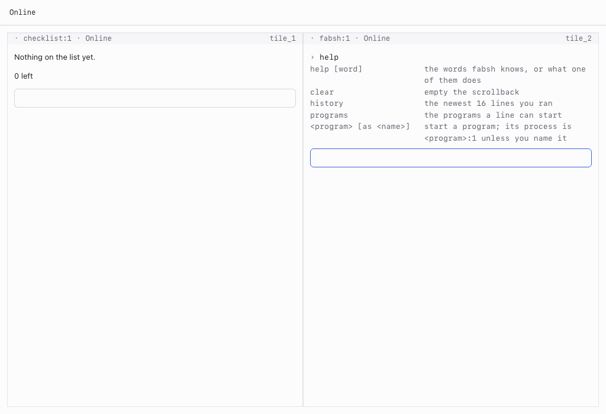
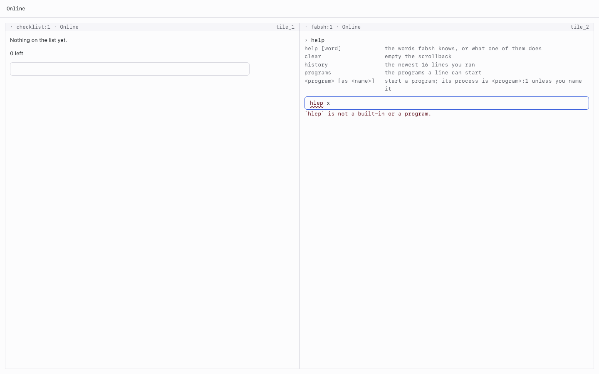
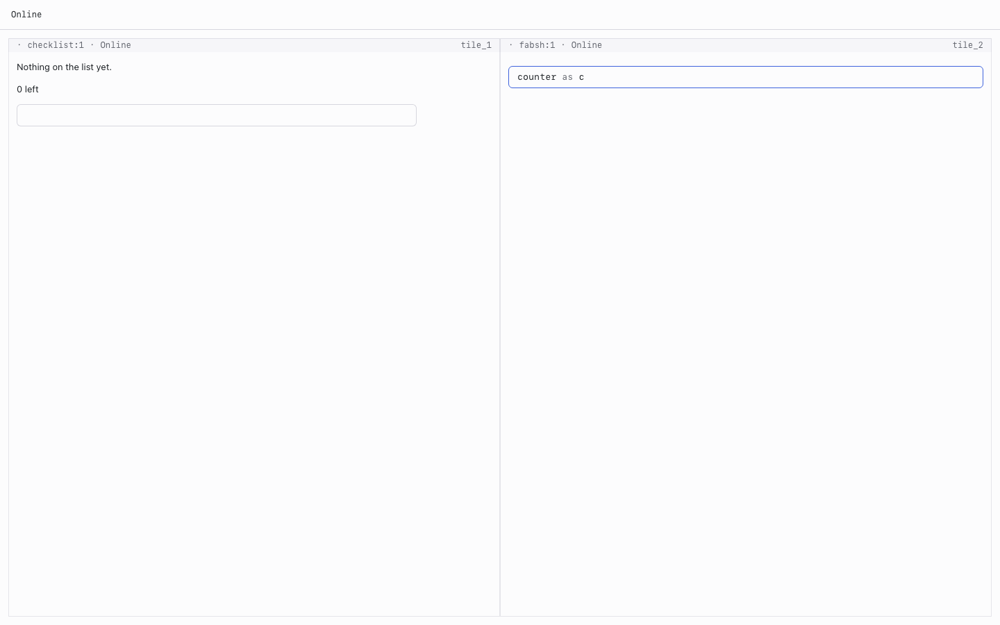
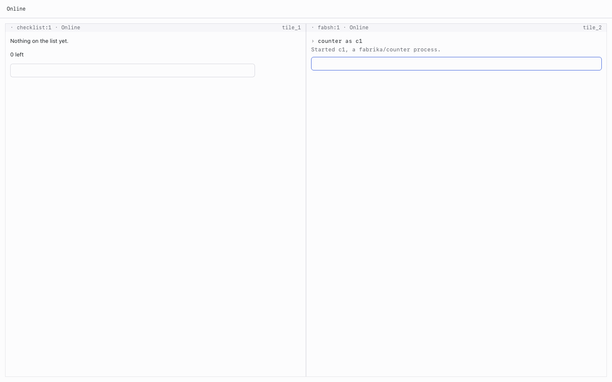

# fabsh guidelines

**Proposed 2026-11-14.** From [experiment 290](../../../experiments/290-fabsh-guidelines.md) and the
Design canvas "fabsh guidelines".

fabsh is the shell in `next/`, a regular program in a tile
([0275](../../../.decisions/0275-the-shell-is-a-regular-program.md)). A classical terminal is where
it starts: a prompt, a scrollback, one line, echo at once. It is more than a terminal in five ways,
each a principle below: its answers are typed (F5), a started program gets a tile and a pipe is
saved mail (F6), agents have names you talk to (F7), every word has a role (F3), and its grammar is
the picker's too (F8). The scope is fabsh's own view; the chassis around its tile is unchanged.

```text
fabsh$ help                                                 ✓ done
help [word]            the words fabsh knows, or what one of them does
fabsh$ countr                                               ✕ refused
`countr` is not a built-in or a program.
fabsh$ counter as c1                                        → started in tile_3
Started c1, a fabrika/counter process.
fabsh$ @scout what changed in next/ yesterday?              ● running · scout
fabsh$ counter as c_
```

The do shots are owed: they come from the build of the design the owner picks. Each don't shot is
PR 1232's real build ([PR 1232](https://github.com/kamp-us/tea-fabrika/pull/1232)).

## F1: a prompt, a scrollback, the line where you type

| Do | Don't |
|---|---|
| Owed by the build. |  |

- **Kind:** taste.
- **Means:** every line in the scrollback starts with `fabsh$`, and so does the line you type. The
  scrollback fills the tile and keeps the newest in view. The line is a real text field drawn with
  no box of its own: the tile's edge is the box.
- **Why:** POSIX: "input characters shall be echoed back to the terminal", and input "is processed
  in units of lines" ([General Terminal Interface](https://pubs.opengroup.org/onlinepubs/9799919799/basedefs/V1_chap11.html)).
  ARIA: a `log` is "a live region where new information is added in a meaningful order"
  ([MDN](https://developer.mozilla.org/en-US/docs/Web/Accessibility/ARIA/Reference/Roles/log_role)).
- **Example:** the don't shot above.
- **Tokens:** `--text-faint` for the prompt, `--text-primary` for the line, `--tile-edge-on` for focus.
- **Checked by:** the owner, at all five layouts, beside Linear Agent's chat box.
- **Held by:** the shot. The prompt word is decided in the summon guidelines' R5 (`fabsh$`).
- **Breaks today:** the line is Manti's boxed `Input` (`next/programs/fabsh/src/window.tsx:247`), has
  no prompt, and the scrollback stops at 24rem (`next/packages/tuval/src/window/style.css:180`), on
  PR 1232's branch.

## F2: mono for what you typed, sans for what fabsh says

| Do | Don't |
|---|---|
| Owed by the build. |  |

- **Kind:** lint.
- **Means:** your line, a program's name, a path and a usage are mono. fabsh's sentences, a table's
  headers and a state word are sans.
- **Why:** "Mono marks what a person types or reads as code; everything else is sans"
  ([0460](../../../.decisions/0460-mono-only-for-typed-words.md)).
- **Example:** the don't shot above.
- **Tokens:** `--mono` on typed words only, `--font` for the rest.
- **Checked by:** the owner, at one tile, beside Linear's search box.
- **Held by:** [0460](../../../.decisions/0460-mono-only-for-typed-words.md).
- **Breaks today:** the whole view is mono (`next/packages/tuval/src/window/style.css:176`), on PR
  1232's branch.

## F3: every word shows its role, by weight and a word, never by hue

| Do | Don't |
|---|---|
| Owed by the build. |  |

- **Kind:** law.
- **Means:** a verb and a new name are bold, a keyword is the low text step, and a refused word is
  `stuck`, underlined, and its reason said. Past lines keep their marks. A word still being typed is
  not refused while it can still become a word.
- **Why:** fish "interprets the command line as it is typed and uses syntax highlighting to provide
  feedback" ([fish](https://fishshell.com/docs/current/interactive.html)); color never works alone
  ([WCAG 1.4.1](https://www.w3.org/WAI/WCAG22/Understanding/use-of-color.html)).
- **Example:** the don't shot above.
- **Tokens:** `--role-verb`, `--role-keyword`, `--role-name`, `--role-unknown`.
- **Checked by:** the owner, at the 2x2 layout, beside Linear's search box with `@ma` typed.
- **Held by:** S1's law in `next/programs/fabsh/src/read.laws.test.ts`, on PR 1232's branch. It gets
  a decision file on approval.
- **Breaks today:** past lines are plain text (`next/programs/fabsh/src/window.tsx:229`); a verb and a
  name look the same; `cou` is refused before it can become `counter`, on PR 1232's branch.

## F4: one line, one answer, one state word

| Do | Don't |
|---|---|
| Owed by the build. |  |

- **Kind:** taste.
- **Means:** a line and its answer are one unit, and its state is a word with a glyph: done ✓,
  refused ✕, running ●, started → and the tile.
- **Why:** Warp: "A Block groups commands and outputs into one atomic unit"
  ([Blocks](https://docs.warp.dev/terminal/blocks)). A tile's state is a word
  ([0502](../../../.decisions/0502-a-tiles-state-is-a-word.md)).
- **Example:** the don't shot above.
- **Tokens:** `--text-faint` for done and started, `--stuck` for refused, `--running` for running.
- **Checked by:** the owner, at the 2x2 and small layouts, beside Linear Agent's chat box.
- **Held by:** the shot.
- **Breaks today:** no answer has a state word (`next/programs/fabsh/src/window.tsx:119`), on PR
  1232's branch.

## F5: answers are typed, and drawn by their type

- **Kind:** law.
- **Means:** rows are a table, a usage is a description list, a refusal is a sentence that names the
  word, and a start is a receipt. No answer is a string padded to look like columns.
- **Why:** "Nu models data using a set of simple, structured data types", and "The table is a core
  data structure in Nushell" ([Nushell](https://www.nushell.sh/book/types_of_data.html)).
- **Example:** `help` already answers with typed rows, `Said` in `next/programs/fabsh/src/program.ts`,
  drawn as a description list (`next/programs/fabsh/src/window.tsx:126`), on PR 1232's branch.
- **Held by:** a law to write: the view picks a part by the answer's tag and never parses a string.
  It gets a decision file on approval.
- **Breaks today:** `history` pads numbers into a string (`next/programs/fabsh/src/program.ts:95`);
  `programs` is a list of strings (`program.ts:99`), on PR 1232's branch.

## F6: a start opens a tile, a pipe is mail, and the shell keeps a receipt

| Do | Don't |
|---|---|
| Owed by the build. |  |

- **Kind:** law.
- **Means:** a line that starts a program opens its tile beside the shell. The shell never draws
  another program's view; it keeps one receipt that names the process and its tile. A pipe's
  receipt names the pipe's letter, as its tiles do.
- **Why:** a Bloomberg Terminal opens a typed function on a panel beside the command line
  ([NYPL's guide](https://libguides.nypl.org/BloombergTerminal/basics), secondary). A tile shows one
  process ([0276](../../../.decisions/0276-a-tile-shows-one-process.md)); a pipe is saved program
  mail ([0109](../../../.decisions/0109-a-pipe-is-saved-program-mail.md)).
- **Example:** the don't shot above.
- **Held by:** [0276](../../../.decisions/0276-a-tile-shows-one-process.md),
  [0109](../../../.decisions/0109-a-pipe-is-saved-program-mail.md).
- **Breaks today:** `counter as c1` starts c1 and no tile opens; the receipt does not say where it is
  (`next/programs/fabsh/src/window.tsx:161`), on PR 1232's branch.

## F7: `summon` starts, `@name` talks, and the prompt stays yours

- **Kind:** law.
- **Means:** an `@scout` line becomes a unit that says "running · scout" and gives the prompt back at
  once; the reply lands in that unit; `fg %scout` waits on it. A name nobody summoned is refused with
  one guess.
- **Why:** "An `@` line runs in the background, as if it ended in `&`. It never takes over the
  person's prompt" ([0157](../../../.decisions/0157-summon-starts-an-agent-and-at-talks-to-it.md)).
- **Example:** the summon guidelines' lines, `fabsh$ @scout why does post print #7 twice?`
  ([summon guidelines](../../direction/summon-guidelines.md)).
- **Held by:** [0157](../../../.decisions/0157-summon-starts-an-agent-and-at-talks-to-it.md).
- **Breaks today:** Nothing to break yet: `summon` and `@name` are not built in `next/`.

## F8: one grammar for the shell and the picker

- **Kind:** law.
- **Means:** every line fabsh accepts is a picker Run row, and every command has a shell word. The
  shell's Tab and the picker's rows read the same reader.
- **Why:** Linear's command menu "lets you execute any command with just a few keystrokes"
  ([Linear](https://linear.app/changelog/2019-12-18-new-command-menu)).
- **Example:** `read` in `next/programs/fabsh/src/read.ts` returns `expects`, the roles the line
  takes next, which Tab reads, on PR 1232's branch.
- **Held by:** [0278](../../../.decisions/0278-each-window-runs-its-own-prefix.md),
  [0514](../../../.decisions/0514-a-prefix-narrows-the-picker.md).
- **Breaks today:** Nothing to break yet: `next/` has no picker.
